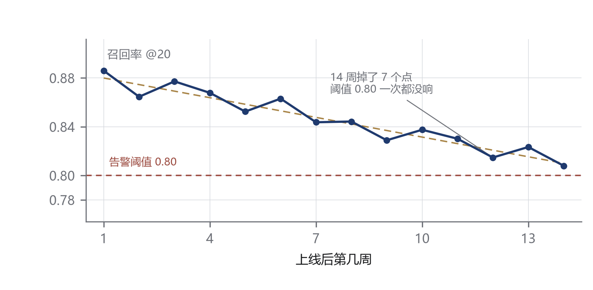

## 生产化：上线之后会怎么坏

一个系统在内部验证了两周，测试集 87 分，用户反馈不错。上线三个月后，三件事同时发生：客服开始抱怨"它最近答得不准了"，前端监控显示 P95 延迟从 1.8 秒涨到 3.4 秒，月度账单比预估高了 2.6 倍。

三件事都不是"模型退化"。模型没变，提示没变，代码没怎么变。变的是数据和流量。

这一章讲这套东西上线之后会怎么坏、怎么发现、怎么回滚。它不讲架构，讲的是每天都在发生的小规模腐蚀。

### 第一类：答得越来越差

原因通常有三个，而且往往同时发生。

**知识库在漂移。** 文档每周更新，索引没跟着重建；或者重建了，但切块策略没随文档结构调整。半年前切得好好的政策文档，改版后标题层级从三级变成两级，原来的切块规则切出的块全乱了。

**用户问的东西变了。** 上线时覆盖的是高频问题，三个月后用户开始问长尾，而长尾恰恰是知识库覆盖最差的部分。这个变化是渐进的，每天的分布差异都很小，但三个月累计下来差别很大。

**模型或提示被悄悄改了。** 有人为了修一个具体问题改了系统提示，另一个场景反而变差。这类改动往往没有经过评测，因为在很多人心里"改一句话"不算改动。

三种原因有一个共同点：**都是缓慢的，单日看不出来。**

对策是定期回归，而不是等投诉。具体做法在后面的监控一节。

### 第二类：越来越慢

慢的来源有四处，都可以定位到具体环节。

**索引变大。** 文档从 1 万涨到 10 万，向量检索的候选变多，重排的负担变重。如果当初按 1 万文档的规模选了 `ef_search=64`，到 10 万时召回可能不够，有人就会把它调到 256，延迟翻两倍。

**上下文变长。** 有人把材料上限从 5 段改成 8 段"为了提高准确率"。准确率可能真涨了 2 个点，但输入 token 涨 60%，延迟和成本一起涨。

**Agent 步数变多。** 工具从 6 个涨到 20 个之后，模型更容易绕路，平均步数从 7 涨到 11。步数每多一步，就多一次往返和一次生成。

**外部依赖变慢。** 工具调的下游接口变慢，Agent 的每一步都在等它。这类问题在系统自身指标里看不出来，要看工具的 P95。

要盯的四个数：端到端 P50 与 P95、检索耗时、重排耗时、平均步数。任何一个单独涨上去，都能定位到对应环节。

### 第三类：越来越贵

一次问答的成本由四部分组成，量级差别很大。

| 环节 | 单次成本（经验值） | 说明 |
|---|---|---|
| 查询改写 | 0.001 元 | 一次小模型调用 |
| 嵌入 + 向量检索 | 0.0002 元 | 查询嵌入很便宜，检索是自建算力 |
| 重排 | 0.002 元 | 30 到 50 个候选，按算力折算 |
| 生成 | 0.007–0.03 元 | 输入 2500 token + 输出 500 token |
| 工具调用 | 0.001–0.02 元 | 取决于工具是否也调模型 |

生成占了七成以上。所以成本控制的主战场在生成：输入 token、输出 token、调用次数。

三个具体手段：

**给上下文设硬上限。** 2500 token 就是 2500，超了先删历史再删弱相关材料。

**给步数设硬上限。** 12 步，超了就总结退出。

**删掉提示里用不上的东西。** 很多系统的提示里躺着一半没用的内容：三段历史、两段"以防万一"的材料、一段没人读的输出格式说明。清一遍通常能省 20% 到 30%。

### 三类退化怎么分开查

三类问题（变差、变慢、变贵）常同时出现，查的时候要有顺序，否则会陷在“先改哪个”的争论里。

| 现象 | 先查 | 看哪个数 | 常见原因 |
|---|---|---|---|
| 答不准 | 索引新鲜度 | 索引构建时间 | 文档改了没重建 |
| 答不准 | 召回分布 | 召回@20 周环比 | 长尾问题变多 |
| 变慢 | 分段耗时 | 检索/重排/生成 | 候选数或段数被调大 |
| 变慢 | 平均步数 | 步数 P50 | 工具变多、开始绕路 |
| 变贵 | 输入 token | 单次输入 P95 | 历史或资料没设上限 |
| 变贵 | 调用次数 | 每任务调用数 | Agent 重试与并行 |

三条经验。第一，先查索引新鲜度，因为它最便宜也最常见——一条 SQL 就能看出上次构建是几天前。第二，变慢和变贵要分开看输入 token 和调用次数，前者是“一次读太多”，后者是“读了太多次”，解法完全不同。第三，如果三个现象同时出现且都在同一周开始，先怀疑一次上线或一次文档批量导入，而不是分别去调三个参数。


### 算一遍：单位成本与盈亏

假设一天 5000 次问答，每次输入 3000 token、输出 500 token，模型定价输入 2 元/百万、输出 8 元/百万。

输入：3000 × 2/1e6 = 0.006 元
输出：500 × 8/1e6 = 0.004 元
检索链路（改写 + 嵌入 + 重排）：约 0.003 元
单次合计：0.013 元

一天：5000 × 0.013 = 65 元。一个月约 1950 元。

如果上下文从 3000 涨到 6000（材料 5 段改 8 段、历史不设上限）：

输入 0.012 + 输出 0.004 + 检索 0.005 = 0.021 元，一天 105 元，一个月 3150 元。涨 61%，而准确率可能只涨 2 个点。

如果加了 Agent 循环，平均 7 步，每步输入 3000 累积到 15000：单次输入成本 0.03 元，加输出 0.028 元（7 × 500 token），合计 0.06 元，是纯问答的 4.6 倍。

这三个数放在一起能得出一个判断：**每加一层能力，先算一遍单位成本，再决定值不值。** 很多"提升体验"的功能，代价是把成本抬高一倍，而体验提升只有百分之几。

### 再算一遍：每次对话的毛利

单位成本只有在有定价时才有意义。假设这个助手按 0.05 元一次对外收费（内部结算也一样，按席位或按次分摊）。

单次成本 0.013 元时，毛利 0.037 元，毛利率 74%。看着健康。

但真实流量的分布不是均匀的。假设 70% 是简单问题（成本 0.008 元），25% 是需要多轮检索的中等问题（0.03 元），5% 是 Agent 任务（0.06 元到 0.5 元）。加权平均成本 = 0.7×0.008 + 0.25×0.03 + 0.05×0.15 = 0.0056 + 0.0075 + 0.0075 = 0.0206 元。毛利率降到 59%。

更麻烦的是那 5% 的长尾贡献了不确定的方差。如果某天一个客户用批量脚本跑了 2000 次 Agent 任务，每次 0.4 元，一天就 800 元，把一个月省下的毛利吃掉。

所以生产环境要做两件事。**按用户设配额**（每天 N 次或每月 M 元），超了降级到“只做单轮问答”；**按任务类型定价**（Agent 任务单独计费或单独限流）。这两件事与模型能力无关，但决定了这个系统能不能长期活下去。

一个反直觉的点：把那 5% 的任务单次成本上限定在 0.1 元，加权平均只从 0.0206 降到 0.0181，看着不多，但成本的**方差**大幅收窄——财务上，可预测比便宜更重要。

这两笔账（单次成本、毛利）加起来，才够回答“要不要加一层能力”。只看单次成本，会漏掉长尾对总量的影响；只看平均毛利，会漏掉少数请求把利润吃光的情况。

### 监控要看趋势，不只看阈值



这张图是一次真实事故的形状：召回率每周掉不到 1 个点，14 周掉了 7 个点，而告警阈值设在 0.80——从头到尾没响过一次。等到用户投诉时，系统已经比上线时差了 7 个点。

阈值告警的盲区就在这里：它只能抓"突变"，抓不到"缓慢下滑"。而缓慢下滑恰恰是生产系统最常见的退化形态。

补两个东西：

**趋势告警。** 对关键指标做周环比，连续两周下降超过 2 个点就报。这个规则很粗，但能抓住大部分漂移。

**主观看板。** 每周固定抽 20 条真实请求，人工看"答得对不对"。这个动作很土，但它是唯一能发现"指标没变但答案变差"的方法——比如引用了旧政策、语气变差、开始长篇大论。

### 最小可用的监控集

不需要一上来就上全套，但这几样必须有。

| 指标（采样） | 告警规则 | 看什么 |
|:--------|:--------|:--------|
| 端到端成功率（全量） | 日环比跌 5 点 | 点踩或转人工算失败 |
| 端到端 P95 延迟（全量） | 1 小时超 4 秒 | 分环节才能定位 |
| 召回率@20（每日评测） | 周环比跌 2 点 | 需固定评测集 |
| 零结果率（全量） | 日环比涨 50% | 知识库缺口 |
| 拒答率（全量） | 周环比涨 3 点 | 检索变差或提示被改 |
| 平均步数（全量） | 周环比涨 20% | 绕路信号 |
| 单次成本 P95（全量） | 日环比涨 30% | 防跑飞 |
| 工具失败率（全量） | 任一工具超 5% | 按工具分别看 |

这八项里，只有"端到端成功率"和"单次成本"适合做成即时通知，其余更适合放进日报或看板，每天扫一眼。告警一旦泛滥，人就会开始忽略它，那比没有告警更危险。

八项里前三项决定"用户有没有感觉变差"，后五项决定"你能不能提前知道"。

采样方式上有一条经验：**延迟和成本必须全量采，质量和效果可以抽样。** 前两者是计费和体验，抽样会漏掉长尾（而长尾正是问题所在）；后两者抽样就够，因为它们的判断需要人工或评测集，全量既贵也没必要。

具体的采样率可以这样定：延迟与成本 100%，错误与超时 100%，零结果与拒答 100%（这两类本身量小，全量也不贵），正常回答的质量抽检 10%。最后一项用固定比例而不是随机时间窗，否则遇到流量高峰时抽样全落在同一类用户身上。

### 灰度与回滚

任何改动都应该能灰度，包括"只改了一句提示"。

**灰度流程。** 先给 5% 流量，观察 24 小时，对比三个指标：任务成功率、P95 延迟、单位成本。三个都在预期范围内，放到 50%，再观察一天，然后全量。

只看成功率会忽略成本和延迟，只看成本会忽略体验。三个一起看，才不会"修好一个问题，引入两个新问题"。

**回滚要能独立。** 提示、索引、模型版本、工具版本，这四样要能分别回滚。做不到独立回滚时，至少保证整体版本可回退（比如整包发布、整包回滚）。

一个常见的坑：索引重建之后发现效果变差，但旧索引已经被覆盖了。所以重建要用蓝绿：新索引建好，验证通过，切别名，旧索引保留至少一周。

**回滚要演练。** 没演练过的回滚流程，真出事时大概率不work。季度演练一次，实际切一次再切回来，比写十页文档有用。

### 灰度要看多少样本才够

5% 流量跑一天，听起来足够，实际可能什么都测不出来。

算一下。假设日活 5000 次请求，5% 是 250 次。如果基线成功率是 0.86，250 个样本的标准误是 √(0.86×0.14÷250) = 0.022，95% 区间 ±4.3 个点。也就是说，灰度组比对照组差 4 个点以内，你根本分不出来。

250 次要看出 3 个点的差异，样本得接近 1200（按两组比较的常规估算，每组一千上下）。折算成流量：日活 5000 时，20% 到 25% 跑一天，或者 5% 跑四五天。

三个实用结论。

**改动越小，越不该只看成功率。** 改一句提示，成功率的变化大概率被噪音淹没，这时更该看的是过程指标：引用覆盖率、平均回答长度、拒答率。这些指标的方差小得多。

**延迟和成本可以用小样本。** 它们不需要“判对错”，单次测量就有意义，几百个样本足够看出 P95 的移动。

**先定判定标准再开灰度。** “成功率不低于对照组、P95 不超过 3.2 秒、单次成本不超过 0.015 元”，三条写下来，跑完直接对照。事后补标准，人总会挑一个对自己有利的解释。

### 一个事故复盘

某客服助手上线两个月，投诉集中在"答非所问"。

查轨迹发现：检索召回的段落和问题确实相关，但都是旧版政策。新版政策上线后，索引没有重建（文档进了共享盘，但没人触发索引任务）。

再看监控，召回分数分布在这两个月里缓慢下降——因为用户的问题逐渐转向新业务，而知识库没跟上。这个信号在第二周就出现了，只是没人设趋势告警。

修复只用了半天（重建索引），排查用了两天。真正的问题不在技术，在流程：文档更新和索引重建之间没有联动。

改进三条：文档入库走统一入口，入库即触发增量索引；索引目录记录"最后构建时间"，超过 7 天未更新就告警；把"召回分数周环比"加进看板。

这个案例的教训不是"要重建索引"，而是：**能自动化的联动不要靠人记。** 靠人记的流程，在第三个新人入职后一定会断。

### 权限与审计

生产系统里，权限问题往往不是技术问题，是流程问题。

三条底线：

- **工具侧校验权限**，不依赖模型判断。模型可以被诱导，代码不会。
- **敏感操作留审计日志**，记清谁、什么时候、做了什么、结果如何。审计日志要独立存储，不能被业务代码删改。
- **数据访问可追溯**，某条回答引用了哪些文档，要能查出来。这既是合规要求，也是事故复盘时唯一的依据。

三条在合规检查里几乎必查。第 2 条和第 3 条还经常被当成"以后再说"，然后在第一次数据问题时被迫补，代价是几周的补日志和回溯。

### 内容的日常维护

系统上线后，最大的工作量不在代码，在内容。

**入库走统一入口。** 文档不能"谁想上传就上传"。要有一个人口：上传时填元数据（标题、生效日期、权限、类型），系统自动切块、嵌入、建索引。绕过入口上传的文档，永远进不了索引，而它的作者会以为系统"应该知道"。

**过期要下架。** 政策、价格、组织架构这类文档要带失效日期。到期自动从索引里移除，或者至少打上 `expired` 标签在检索前过滤。没有这一步，旧政策会一直和新政策竞争，而模型会随机挑一个。

**重复要合并。** 同一份文件在三个目录下各存一份，索引里就有三份内容一样的块，检索时占掉三个名额。定期做一次近似去重（按内容哈希或相似度），能明显改善结果。

**变更要重跑评测。** 文档批量更新后，跑一次固定评测集，看召回率有没有掉。这一步十五分钟，能提前发现"新版本文档切块变差"这类问题。

这四件事听着像行政工作，但它们对效果的影响比模型选型大。做了这四件事的团队，用中等模型就能有稳定输出；不做的团队，换模型只是在换一种随机。

这四件事落到工具上，就是三张表。

| 表 | 一行是 | 谁维护 | 更新时机 |
|---|---|---|---|
| 文档台账 | 一份文档 | 业务侧 | 入库与下架 |
| 零结果清单 | 一条查不到的问题 | 工程师 | 每周 |
| 重复清单 | 一组同内容文档 | 业务侧 | 每月 |

台账回答“谁负责这份、什么时候过期”，没有它，“过期要下架”这条永远做不到——没人知道哪份过期了。零结果清单把“用户问了但库里没有”变成待办，它是知识库缺口最直接的证据。重复清单防的是同一份内容占掉多个检索名额，这件事在检索结果里看不出来，只能靠定期比对。

三张表都不需要新系统，一个表格文件就够。它们的价值在于把“内容维护”从口头约定变成了有名字、有日期、有负责人的东西。

### 上线第一周做什么

第一周的目标不是"验证系统对不对"，是"收集真实的失败形状"。四件事按天排。

**第 1 天：看零结果与拒答。** 把当天所有"没召回""拒答"的查询导出来看一遍，按主题归类。这批直接告诉你知识库缺什么。

**第 2 到 3 天：看差评与转人工。** 逐条看用户点踩或转人工之前的对话，判断是检索错、生成错，还是超范围。抽 30 条做归因，填进失败归因表。

**第 4 天：测延迟与成本。** 用真实流量的数据算 P50、P95，看延迟在各环节怎么分布，成本在哪一项最高。这一步常常能发现"提示里有一段没人用的内容占了 40% token"。

**第 5 天：补评测集。** 把前四天发现的典型失败，挑 20 条写进评测集（带标注）。这批来自真实流量的样本，比上线前凭空造的问题有价值得多。

**第 6 到 7 天：改一处，重跑。** 只改一处最影响结果的地方（通常是切块或组装），重跑评测，确认变好再上。一周一个循环，四周后系统会明显不一样。

### 算一遍：要几台机器

容量规划最容易犯的错是按“日调用量 ÷ 86400”算 QPS，得出“一天 5000 次，QPS 0.06，一台机器绰绰有余”的结论。真实流量的形状完全不是均匀的。

按使用场景估。日活 5000 人，每人 3 次，集中在 8 小时工作时间内：15000 ÷ (8×3600) ≈ 0.52 QPS 平均。峰值系数取 3（午休和下班前），峰值 1.6 QPS。

再看单次请求的资源。生成阶段一次占用一个并发 2 秒，所以 1.6 QPS 的峰值需要 1.6 × 2 ≈ 3.2 个并发生成；按 30% 余量取 5 个并发。检索链路一次 0.45 秒，需要 1.6 × 0.45 ≈ 0.7 个并发，单核都够。

结论：生成侧是瓶颈，检索侧不是。5 个并发的生成能力对应 3 台 2 并发的小机器，或者 1 台能跑 8 并发的机器（看模型托管方式）。重排单独一台 CPU 机器，最多 0.7 并发，纯属浪费——这时把重排和检索放同一台，反而是合理的。

再算配额。一天 15000 次、单次 0.014 元，日成本 210 元，月 6300 元。给部门配额时，按“人均 3 次 × 人数 × 1.5 倍余量”给，而不是按总预算平均分——平均分会让小团队用不完、大团队不够用。

容量规划的输出应该是一张表：峰值 QPS、各环节并发、机器数、月度 token 配额。这张表每季度按真实数据更新一次，比拍脑袋扩容省得多。

这套流程的重点是"每天看真实数据"。上了线不看日志，等于把系统交给运气。

### 谁来负责

系统上线后需要一个明确的负责人，否则前面所有机制都会慢慢停摆。三块职责，至少要有名字对应。

**内容**：谁负责文档入库、过期下架、重复合并。通常是业务侧的一个角色，不是工程师。

**指标**：谁每周看评测、看趋势、写一份五行报告。通常是做这个系统的工程师。

**值班**：出问题谁先看。至少要有一个"看到告警知道去哪看轨迹"的人。

三块不需要三个人，但必须有人认领。最常见的失败形态是"大家都以为是别人在管"——三个月后没人跑评测，没人看趋势，直到用户投诉。

### 谁能改什么

上线之后，改动会来自四面八方：运营想调话术，工程师想换模型，业务想加文档。没有一张权限表，两周后没人知道线上跑的是什么。

| 改动 | 谁能改 | 前置条件 |
|---|---|---|
| 文档入库 | 业务侧 | 填元数据 |
| 提示模板 | 工程师 | 跑回归 |
| 切块与索引 | 工程师 | 跑评测 + 灰度 |
| 工具描述 | 工程师 | 工具验收 |
| 模型版本 | 技术负责人 | 压测 + 灰度 |

三条规矩比表格本身重要。

**提示模板不能由后台随手改。** 它看起来是文本，实际是行为定义。所有改动走代码评审，哪怕只改一个词——因为“只改一个词”是最常见的退化来源。

**索引重建要留记录。** 谁在什么时候、用哪个模型、哪版切块重建的，写进索引目录。做不到这一点，事故复盘时就只能猜。

**模型版本变更要单独灰度。** 模型换代的影响面比提示大，而且很难回滚到“半新半旧”。灰度期间固定评测集必须跑，且要看配对比较（多少条变好、多少条变差），不能只看总分。

这套规矩听起来重，实际执行成本很低——一周可能只有两三次改动。它的价值在于把“谁动了什么”变成可查的事实。

预算审批是另一件常被忽略的日常。业务方提“能不能把资料从 5 段加到 8 段”，技术上一天就能改，但成本会涨 30% 到 40%。这时需要的不是技术判断，是一份一页纸的账：现在单次 0.013 元、月 1950 元；改后 0.018 元、月 2700 元；多出的 750 元换来前 5 准确率 2 个点，值不值由业务定。

把账摊开有两个好处。决策变成业务方的选择，工程师不做价值判断；以及当预算被砍时，你知道该退哪一档（先退段数，再退重排，最后才退检索）。

一个提醒：预算审批的周期通常是季度，而流量的增长是连续的。按月看“已用 / 预算”的比例，到 70% 时就要提前沟通，不要等到月中超支再申请。

容量告警的处理也要有顺序，否则容易在错误的方向上扩容。顺序是：先看单次成本有没有变（如果涨了，扩机器没用，得先查提示和上下文），再看并发是不是被某个慢工具拖住（这时加机器只是加等待），最后才看真实 QPS 是否超过设计值。

一个常见的误判：P95 从 2.9 秒涨到 4.2 秒，第一反应是“加机器”。但如果分环节看，生成段的耗时没变、工具调用段从 0.3 秒涨到 1.6 秒，那问题在下游接口，扩容只会让更多请求堵在同一个地方。

### 季度复盘只问四个问题

季度复盘只问四个问题，比看一堆图有用。

一，召回有没有掉？（对比三个月前同一份评测集）
二，用户问的东西变了吗？（主题分布的最大差值）
三，钱花在哪一层？（生成、检索、工具）
四，上月定的动作完成了吗？

四个答案写在一页纸上，就是下一季度的输入。不做这件事的团队，一年后会发现自己一直在处理同一个问题的不同表现。

还有一条组织上的建议：**把这个系统的指标放进团队已有的看板，别单开一个。** 单开的看板没人看，混在日常看板里的指标才会被顺手扫到。

### 一份五行的周报

周报不需要长，五行足够，但每一行都要有数和动作。

```text
1 质量：召回@20 0.89（上周 0.91），端到端 0.74
2 延迟：P95 2.9s（上周 2.7s），检索段 0.42s
3 成本：单次 0.014 元，月累计 1980 元 / 预算 2500
4 主要问题：3 条零结果集中在“以旧换新”
5 本周动作：补文档 2 篇，切块规则加一条表格处理
```

五行的作用各不相同。第一行看趋势，第二行看体验，第三行看钱，第四行把问题落到具体主题，第五行承诺一个可交付的动作。

两个写法上的要求。**数字必须带对比。** “召回 0.89”没有信息，“0.89，上周 0.91”才有。**问题必须带主题。** “3 条零结果”是现象，“集中在以旧换新”才是可执行的线索。

坚持写十二周，会得到一条比任何单次评测都有用的曲线。很多退化在这条曲线上第一次显现时，还没有人投诉。

### 告警阈值怎么定

阈值不是拍出来的，是从历史数据里读出来的。

做法：把过去四周的指标按天排开，取 P50 作为"正常水平"，取 P95 作为"偶发波动上限"。告警线设在 P95 稍上方——这样正常波动不会误报，真异常也不会漏。

举例：端到端成功率的四周数据是 P50 0.86、P95 0.81（即最差的 5% 的天数低于 0.81）。告警线设 0.80，连续两天低于它才报。为什么两天？一天的波动可能是流量结构变化（比如某个大客户做了一次批量导入），连续两天才有统计意义。

另一个好用的做法是双阈值：慢阈值（周环比 2 个点，进日报）抓漂移，快阈值（日环比 5 个点，即时通知）抓突变。一条线兼顾不了两种退化，两条线各管一段。

另一个原则：**告警要少而准。** 一天报 50 条告警的看板，等于没有告警。八项指标里，真正需要即时通知的通常只有两个：成功率跌破线和成本异常。其余用日报或周报的形式呈现，让人扫一眼即可。


### 事故分级与响应

不是所有异常都值得半夜叫醒人。分三级，每级对应不同的动作，能省掉大量无效告警。

| 级别 | 判定 | 响应时限 | 动作 |
|---|---|---|---|
| P1 | 全线不可用或出现越权 | 15 分钟 | 回滚，全员 |
| P2 | 明显错误率上升（>10 点） | 2 小时 | 定位并回滚单项 |
| P3 | 指标缓慢漂移（周环比） | 本周内 | 排进迭代 |

分级的难点在 P1 与 P2 的边界。“答得不对”和“不能用”之间差别很大：用户还能拿到答案、只是不准，属 P2；系统直接报错或返回空，属 P1。

“出现越权”一律 P1，不看影响面。原因是越权的影响不可逆——数据一旦被看到就收不回来，而回滚只是止损。这条规则要写死，不能按“这次只泄露了一条”来降级。

P3 最容易被忽略，因为它不疼。但生产系统的主要退化都是 P3 累积出来的：召回率每周掉 0.5 个点，十四周就是 7 个点。P3 的处理方式不是“加班修”，而是“排进每周固定的维护时段”，让它有位置。

一个组织上的建议：把 P1 的判定写成一句话贴在告警群里——“用户拿不到答案，或者拿到了不该看到的”。含糊的判定标准会让每次讨论都变成吵架。

### 上线检查清单

分四组，逐条过。过不了就别上线，或者明确接受这个风险。

**检索与内容**

1. 有固定评测集，且至少有 100 条标注过的查询。
2. 召回@20 与端到端正确率有基线记录。
3. 索引记录了三元组：切块版本、嵌入模型版本、构建时间。
4. 文档更新能触发索引重建，有超期未更新的告警。

**回答质量**

5. 提示里明确了"只用资料回答""冲突取新""不足时拒答"。
6. 引用能指到原文位置，回答里的编号经过校验。
7. 抽样 20 条真实请求，人工确认没有系统性错误。

**稳定性与成本**

8. 端到端 P95 延迟有上限，且超时有降级方案。
9. Agent 有最大步数、最大 token、最大步时三个硬限。
10. 单次成本 P95 与月度预算匹配，有超支告警。
11. 幂等表与唯一约束到位，重试不会重复扣款。
12. 回滚流程演练过一次。

**权限与合规**

13. 工具侧校验权限，模型无法指定他人身份。
14. 越权尝试有日志。
15. 数据可删除（用户要求时能真删），删除有记录。

十五条里，前 4 条决定"它准不准"，5 到 7 决定"它靠不靠谱"，8 到 12 决定"它会不会失控"，13 到 15 决定"它能不能过审"。四组都过，才算能上生产。

### 收束

把十章连起来，这类系统的工程要点其实只有几条：切块决定上限，评测决定方向；检索要混合，重排要克制；上下文是稀缺资源，每一段都要有理由；工具设计比模型选择更影响成功率；Agent 要有明确的停止条件和失败路径；状态放外部，别指望模型记住；上线只是开始，回归和监控才是长期工作。

这些都不难，难的是每一件都做到。多数系统的差距不在用了什么模型，而在这些基础工作做了几成——做了七成的系统，用中等模型也能给出稳定的答案；做了三成的系统，换上最强的模型，用户还是在投诉。
