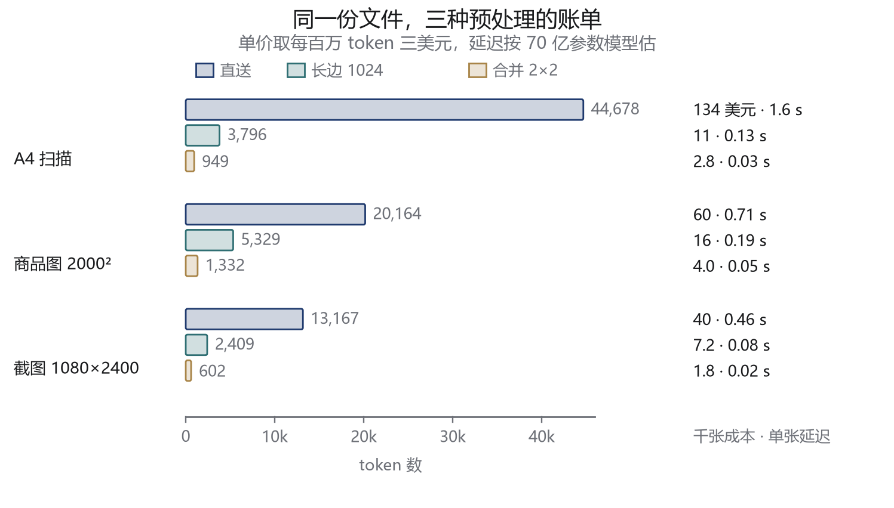

## 图像怎么变成 token

一个做报销系统的团队曾经算错了一笔账。他们要在每月四十万张发票里自动抽取金额和税号，选了一家口碑不错的视觉模型，按"输入每百万 token 十几美元"的价格估了预算，觉得一个月几百美元足够。上线第三天账单就超了预估的三十倍。

问题不在单价，在数量。他们把每张发票按 300 dpi 扫描进来，然后原样送进模型，一张 A4 就是四万多个视觉 token。四十万张乘四万四千，大约一百八十亿 token。任何单价乘上这个数量都是灾难。

这件事的根源在于一个容易被忽略的换算：图像进模型之前必须先变成 token，而"一张图值多少 token"完全由你自己的预处理参数决定，跟模型厂商的宣传页无关。这一章就把这笔账从头算清楚。

### 切块：把连续像素切成离散单元

语言模型处理的是离散符号。图像的原始形式是一个像素网格，每个像素是三个 0 到 255 的整数，既连续又冗余，没法直接当成词。

最常见的转换方式叫切块（patchify）。取一个 $P\times P$ 的窗口，在图上按步长 $P$ 滑动，把每个窗口里的 $P^2\times 3$ 个数拉直成一个向量，再乘一个矩阵映射到 $d$ 维：

$$z_i = W x_i + b,\qquad x_i\in\mathbb{R}^{P^2\cdot 3},\quad W\in\mathbb{R}^{d\times P^2\cdot 3}$$

$x_i$ 是第 $i$ 块里的原始像素，$z_i$ 是这块变成的 $d$ 维向量。$d$ 通常取 1024 或 1280，和语言模型的隐藏维度对齐。

这个式子在说一件很朴素的事：每一小块像素被压成一个"词向量"。$W$ 是学出来的，它决定"什么样的像素花纹应该对应什么样的向量"，比如竖边缘、横边缘、肤色区域各自落在向量空间的哪个方向。

块的数量由图像尺寸和块大小共同决定：

$$N=\left\lceil \frac{H}{P}\right\rceil \times \left\lceil \frac{W}{P}\right\rceil$$

$H$、$W$ 是高和宽，向上取整是因为边缘的残块也要算一块。这个式子是这一章所有账目的起点：**token 数与边长成平方关系**。边长翻一倍，token 数变四倍；分辨率翻四倍（比如从 336 到 672），token 数变十六倍。

按 14 像素切块，常见尺寸的结果是这样：

| 输入尺寸 | 块数（14 px） | 块数（16 px） |
|---|---|---|
| 224×224 | 256 | 196 |
| 336×336 | 576 | 441 |
| 448×448 | 1024 | 784 |
| 896×896 | 4096 | 3136 |
| 1024×1024 | 5329 | 4096 |
| A4 300 dpi（2480×3508） | 44678 | 34100 |

表里 1024 那一行不是整数平方，因为 1024 除不尽 14，工程上会裁掉两三个像素或者补边，按 $73\times73$ 算。

图里最右边那根柱子值得盯着看一会儿。一张 A4 纸在 300 dpi 下是 2480×3508 像素，切出四万四千多块，是 336 输入图的七十八倍。同一份文档，你选择不同的扫描分辨率和切块参数，成本能差两个数量级。

### 一张图相当于多少字

要让这个数字有手感，得换算成文字。

中文文本大致一个 token 对应零点六到零点七个汉字（不同分词器有差异，量级如此）。反过来说，一千个 token 大约等于七百个汉字，差不多是一篇短文。

于是：

- 336×336 的图，576 token，约等于四百字；
- 448×448 的图，1024 token，约等于七百字；
- 896×896 的图，4096 token，约等于两千八百字；
- A4 扫描件，44678 token，约等于三万字，一本小册子。

这个换算解释了很多产品现象。为什么早期的视觉模型默认把图片缩到 224 或 336：那个尺寸下，一次对话里塞四五张图还不算贵。为什么"看图说话"这类功能敢免费开放：一次几百 token，边际成本可以忽略。为什么"上传 PDF 问我问题"要单独定价：一页就是三万字，用户上传一份二十页的合同，等于让你读完一本书再回答。

### 算一遍：一页 A4 扫描件到底多少钱

现在把一页发票完整算一遍，假设条件是：A4 纸 300 dpi 扫描，24 位彩色，按 14 像素切块，模型输入单价按三档取（每百万 token）：便宜的 0.15 美元、中档的 3 美元、贵的 15 美元。

**第一笔，token 数。** 扫描得到 2480×3508 像素，切成 $178\times251$ 块：

$$178\times251=44678\ \text{token}$$

**第二笔，输入费用。** 按三档单价：

$$44678\times\frac{15}{10^6}=\$0.67\ \ (\text{约 }4.8\text{ 元})$$
$$44678\times\frac{3}{10^6}=\$0.13\ \ (\text{约 }0.95\text{ 元})$$
$$44678\times\frac{0.15}{10^6}=\$0.0067\ \ (\text{约 }5\text{ 分})$$

一个月四十万张，用贵的那档是 26.8 万美元，中档 5.4 万美元，便宜档 2680 美元。同一个任务，选型不同，账单差一百倍。

**第三笔，算力。** 钱是厂商收的，算力是实际消耗。预填充阶段每个 token 需要约 $2N$ 次浮点运算（$N$ 是模型参数量），一个 70 亿参数的模型处理四万五千 token：

$$2\times7\times10^{9}\times44678\approx6.3\times10^{14}\ \text{FLOP}$$

一张 H100 跑 16 位精度，理论峰值接近 $10^{15}$ FLOP/s，实际能用到四成，即 $4\times10^{14}$。于是单张发票的预填充时间约 1.6 秒。听上去还能接受，但你只有一张卡，四十万张就是 178 小时的纯计算，还不算排队和失败重试。

**第四笔，显存。** 四万五千 token 的 KV 缓存不是小数目。取一个 32 层、8 个 KV 头、每头 128 维的模型，每个 token 的缓存是：

$$2\times32\times8\times128\times2\ \text{字节}=131\ \text{KB}$$

四万五千 token 就是 5.9 GB。一张 80 GB 的卡，装完权重和激活，能同时处理的这类请求不到八个。并发能力被 token 数直接掐住了喉咙。

**第五笔，反推可行的做法。** 如果预算要求每页不超过五分钱，在贵档模型上只能给 3300 token，也就是长边约 800 像素。800 像素的长边上，一个五号汉字只有十来个像素宽，笔画开始粘连，OCR 很容易错。于是只剩三条路：换便宜档模型（同样的钱能买 30 倍 token）、先做版面分析只把关键区域高分辨率送进去、或者干脆不用通用视觉模型而接专门的 OCR。

这三条路对应三种完全不同的工程投入，而账算清楚之前，你不知道该选哪条。

### 三类件各算一遍：扫描件、商品图、截图

前面的账只算了 A4 扫描件。真实业务里最常送进来的是三类东西，它们的像素结构和成本结构完全不同。

先把口径固定下来：14 像素切块，块数取 $\lfloor H/14\rfloor\times\lfloor W/14\rfloor$，边缘不足一块的部分丢掉（对成本的影响不到百分之一）；单价每百万 token 三美元；延迟按 70 亿参数模型、有效算力 $4\times10^{14}$ FLOP/s、每 token $2N$ 次浮点运算估。

| 文件 | 直送 | 缩到长边 1024 | 再合并 2×2 |
|---|---|---|---|
| A4 扫描 300 dpi | 44,678 | 3,796 | 949 |
| 商品图 2000² | 20,164 | 5,329 | 1,332 |
| 截图 1080×2400 | 13,167 | 2,409 | 602 |

三行的形状不一样，取舍也不一样。

A4 那一行最陡，直送是缩图后的十二倍。缩到长边 1024 时，一页纸的宽只剩 724 像素，五号汉字落到十二三个像素高——正好在“能认但容易混”的区间。所以文档类产品宁可再切块，也不肯缩图。

商品图那一行温和一些。2000 像素的方图缩到 1024，边长减半、token 减到四分之一，而商品主体（一只包、一双鞋）在这个尺度上仍然完整。真正丢的是标签：原图上三十像素高的款号，缩完只剩十五像素，型号里的 8 和 3 开始分不清。

截图那一行看着最便宜，其实最容易出事。1080×2400 是瘦长比例，缩到长边 1024 之后宽度只剩 462 像素，顶部的状态栏和底部的导航栏被压成几行模糊的色带，模型读不出电量和时间。所以截图的正做法是按宽切块，每块 720×800 单独编码，token 落在两千五到三千之间，细节反而全保住了。

把 token 折算成钱，三类的差距更直观。按每千张算：A4 直送 134 美元，商品图 60 美元，截图 40 美元。一个月四十万张发票，等于每天一万三千多张，光输入就是一千八百美元一天。同样的量如果换成截图，一百八十美元一天。两个量级之间没有中间地带，只有预处理方案的选择。

### 字有多少像素高，才读得出来

上面反复出现“字高十二像素”这个说法，它不是感觉，是可以算的。

五号字是 10.5 磅，也就是 $10.5/72$ 英寸，即 3.7 毫米。扫描分辨率决定这 3.7 毫米变成多少像素：

$$\text{字高（像素）}=3.7\ \text{mm}\times\frac{\text{dpi}}{25.4}$$

300 dpi 时是 43.7 像素，150 dpi 时是 21.8 像素。再乘上缩放比例，就是模型实际看到的字高。长边 3508 缩到 1024，比例 0.292，43.7 乘 0.292 得 12.8 像素。

| 长边 | 字高 | 现象 |
|---|---|---|
| 3508（原图） | 44 px | 笔画、字号、下划线都清楚 |
| 1600 | 20 px | 稳定可读，接近印刷体识别的最佳区间 |
| 1024 | 13 px | 能认，相近字开始混（未与末、己与已） |
| 800 | 10 px | 半数汉字要靠上下文猜 |
| 512 | 6 px | 只剩版面结构，等于没读 |

粗糙的边界是：八像素以下不可认，十二像素是临界，二十像素以上稳定。这张表可以反着用：先问“这一页上最小的字是几号”，再问“它需要多少像素”，最后算出能缩到多小。

它还会给出一个反直觉的结论：**扫描 dpi 比模型选择更影响成本**。同一页纸，150 dpi 只有 1240×1754 像素，切出 11,169 个 token，是 300 dpi 的四分之一；而 150 dpi 下五号字仍有 21.8 像素高，落在“稳定可读”区间里。很多团队默认扫 300 dpi，白花了四分之三的钱，换来的是模型根本用不上的精度。

当然边界在很小的字上。发票的备注、合同里的脚注常用小五号甚至六号，150 dpi 下只剩十几像素，这时候就得保住 300 dpi，或者干脆只对含小字的区域高分辨率重扫。判断标准还是那张表：把这一页上最小字号的字高算出来，落在二十像素以下就别降 dpi。

### 分辨率的三档取舍

同样是"看图"，不同任务对有效分辨率的要求差很远。

**缩到固定尺寸。** 一律缩到 336 或 448，宽高比用填充或裁剪对齐。成本恒定（576 或 1024 token），实现最简单，适合"整张图大致是什么"这类判断：是不是宠物照片、是什么风格的插画、画面里有几个人。

代价是细节直接消失。一张 4000 像素宽的商品图缩到 336，标签上的型号文字被压缩成一片模糊的色块，模型只能靠猜。

**动态切块。** 保持原图宽高比，把图切成若干固定大小的块（比如 $1\times1$、$2\times3$、$3\times2$ 的组合），每块单独编码，最后拼成一串。这样细节保住了，token 数随原图大小浮动，一张大图可能两三千 token，一张截图可能只有几百。

工程上必须设上限，否则用户传一张 8000 像素的全景图，你的服务就被一个请求打满。常见做法是限制单图最多 $N$ 块，超出的部分降采样，或者拆成多轮对话分别看。

**切片加缩略图。** 在动态切块的基础上补一张全局缩略图，让模型既知道局部细节，又知道"这些局部拼起来是什么"。缩略图占的 token 很少（一张 336 就是 576），但对"这张图整体是两栏排版还是三栏"这类判断至关重要。

第三种是当前文档类产品的主流做法。它的成本结构很典型：一张 A4 切成 $2\times2$ 四块，每块 1240×1754 像素，各 11214 token，加一张缩略图 576 token，合计 45432 token。看起来和原图直送（44678）差不多，但单块的像素密度没有变，模型在每一块里看到的细节和原图一样清楚，而它还额外获得了"这是四块拼起来的一页"这个结构信息。

### 块变成向量之后，怎么进语言模型

视觉 token 的维度是视觉编码器给的，语言模型要的维度是它自己的。中间要接一层，接法有两种。

**投影后拼接。** 用一个线性层或两层 MLP 把每个视觉 token 映射到语言模型的隐藏维度，然后直接拼在文本 token 前面：

$$h=\bigl[\,f(z_1),\dots,f(z_N),\,e(w_1),\dots,e(w_M)\,\bigr]$$

$f$ 是投影层，$e(w)$ 是文本词向量。拼完之后就是一条普通序列，语言模型照常做因果注意力，视觉 token 能看见彼此，文本 token 能看见所有视觉 token。

这个做法简单、稳定、生态好。缺点是视觉 token 会挤占上下文：一张图四千 token，等于对话还没开始就花掉了四千。

**交叉注意力。** 视觉 token 不进主序列，而是作为一组额外的键值，让语言模型的某些层主动去"查"。序列长度只算文本，视觉部分的开销挪到了注意力的另一侧。

好处是省位置、省 KV 缓存；坏处是实现复杂，训练时容易出现"某个模态压过另一个"的失衡，而且推理框架要为两套注意力各写一份内核。所以在消费级产品里，投影拼接仍是主流，交叉注意力更多出现在视频、长文档这类视觉输入特别长的场景。

### 视觉编码器自己也要算钱

切块之后那串向量不是原始像素，而是经过一个视觉编码器（通常是 ViT）处理过的特征。这一步的算力常被忽略，但它和 token 数成正比。

一个 3 亿参数的 ViT，处理四万五千个块：

$$2\times3\times10^{8}\times44678\approx2.7\times10^{13}\ \text{FLOP}$$

按同样的有效算力估算，约 0.07 秒。看起来不多，但要注意它是在语言模型之前串行跑的，而且视觉编码器通常是稠密模型，没法像 MoE 那样只激活一部分参数。一张大图的总延迟里，视觉部分占的比例会随着分辨率上升而变大——因为它是平方增长，语言模型那部分只是线性增长。

### 预填充和解码是两笔不同的账

把一张大图送进模型，花的钱大部分不在“看图”，而在“把图读进显存”。这两件事的硬件瓶颈不一样，因此批处理对它们的效果也不一样。

预填充阶段要把所有输入 token 一次算完，是计算密集型。70 亿参数的模型处理四万五千 token，大约 $6.3\times10^{14}$ FLOP，单卡有效算力四成峰值时，一点六秒。这个时间随 token 数线性增长，与并发无关：并发八路，要么排队，要么每路都变慢，总吐吞不变。

解码阶段不同：每生成一个 token，都要把全部权重从显存读一遍。7 十亿参数、16 位精度，权重是 14 GB，按 3 TB/s 的显存带宽算：

$$14\ \text{GB}\div3\ \text{TB/s}\approx4.7\ \text{ms}$$

单路每秒两百个 token，而且这个数字跟 token 数无关。批处理在这里才真正有效：同一份权重读一次，可以同时算八路、十六路的下一步，总吐吞直接乘上去。

| 阶段 | 瓶颈 | 批处理的效果 | 单卡量级 |
|---|---|---|---|
| 预填充 | 算力 | 几乎不提吞吐，只拉高延迟 | 四点五万 token 一点六秒 |
| 解码 | 显存带宽 | 吞吐近线性增长 | 单路两百 token 每秒 |

这个区别解释了一个现象：文档类产品（输入巨大、输出很短）的成本几乎全在预填充，所以它们拼命压 token；聊天类产品（输入短、输出长）的成本全在解码，所以它们拼命优化批处理和缓存。两类产品看着都是“调模型”，优化的对象完全不同。

还有一个推论：视觉输入的报价里，“输入 token”和“输出 token”的价差往往很大（常见是四到五倍），而视觉任务恰好是输入多、输出少。所以做多模态产品时，输出长度反而是次要的，把输入压下去才是主战场。反过来，如果任务需要模型写一大段图评，那成本结构立刻翻过来，得按纯文本长文的方式重新算。

### 一个失败案例：缩图与截断

有个团队做过一个"合同条款问答"的内部工具，效果时好时坏。上线两周后他们才定位到两个原因，都不是模型能力问题。

第一个是缩图。他们的预处理是"长边缩到 1024"，对一张 A4 扫描件来说，1024 的长边意味着每个汉字只有五六个像素高。模型看到的是一片模糊的墨点，于是它根据标题和上下文"合理推测"了条款内容。回答读起来非常顺，格式也对，金额和日期全是编的。这种错误最危险，因为输出没有任何异常信号。

第二个是截断。有的合同二十多页，每页 1024 token 的预算下，上下文很快超限。他们的代码在超限时直接截断后面的内容，而模型并不知道自己被截断了，问它"违约责任在第几条"，它会拿着前十页的内容自信地回答。用户以为模型读完了全部，实际上它只看到一半。

两个问题的修法都很朴素：一是把"每页多少 token"和"这一页上有多少字"做成一个可计算的检查，字数除以 token 数小于某个阈值就报警，提示分辨率不足；二是上下文超限时明确告诉模型"以下只包含文档的前 N 页"，并在界面上标出来。

### 能用文字就别用图

上面那笔账还有一个很自然的推论：同一份信息的两种形式，成本可能差二十倍。

一页 A4 正文大约排 1500 个汉字，转成文本 token 大约 2200 个。同样的内容如果以图像形式送进去，要 44678 个 token。比例是 1 比 20。

这不是模型的缺陷，是信息密度问题。文本已经被人压缩过一遍了：字就是字，不需要描述笔画、墨色、行距、纸张纹理。图像里背着大量与语义无关的像素，模型得先花算力把它们识别掉。

所以工程上的第一条原则是：**能抽出文本的，就不要送图**。PDF 里有文字层就直接提文字层；网页截图换成抓 DOM；聊天记录截图换成导出的聊天记录。这一条能省下的钱，比任何模型选型优化都多。

真需要送图的情况其实只剩三类：图里的信息从来没被文字化过（照片、手写、设计稿）；版面本身携带含义（表格合并单元格、发票验真、图表趋势）；以及文字层不可靠（扫描件、拍照、字体嵌入异常）。判断标准很具体：你能否可靠地拿到这段文字。拿不到，再送图；拿得到，先抽文字。

### 为什么厂商报的 token 数和你算的不一样

看过产品文档的人会发现一个矛盾：自己按 14 像素切块算出一张图四千 token，而文档里写着“单图最多 1,105 token”。两者都没错，只是**它们算的不是同一件事**。

厂商那个数说的是“计费口径”，通常经过了三道压缩：切块之后再合并（每四个块并成一个）、把合并后的序列池化到固定长度、设一个硬上限，超出的部分降采样。三道做完，四千 token 变成一千上下，你在调用日志里看到的也是这个数。

麻烦在于这个口径不透明。同一张图，两个厂商报的 token 可能差三倍，因为一个做了两级合并、一个只做一级。做容量规划时如果直接拿文档里的数字乘请求量，误差会累积到“上线才发现预算差一半”。

所以工程上的做法是：**用自己的预处理算账，用厂商的口径核对**。具体两步。第一步，按自己的切块和合并策略算出上限；第二步，拿十张有代表性的图实际调一次接口，读返回里的用量，看两者差多少。差值稳定（比如都在 0.26 倍左右），说明厂商做的是固定压缩，按比例折算即可；差值不稳定，说明它按内容自适应（简单图压得多、复杂图压得少），那就只能按实测的分布做预算，不能按平均值。

还有一点容易被忽略：硬上限是**静默**的。超过上限的图不会报错，只会被降采样，而你从返回里看不出来。一张 4000 像素宽的商品图如果被压到 1024，标签上的型号就没了，模型答错时你会以为是能力问题。可靠的检查是给预处理加一道断言：缩放比例低于某个阈值（比如 0.4）时打日志，让它出现在监控里。

### 长宽比不合，切法得自己定

动态切块的实现里最容易被跳过的部分，是“到底切几块”。这不是拍脑袋，可以算。

做法是枚举。先定一个块数预算 $N_{\max}$（比如 12 块，按每块 729 token 算，上限约 8,700 token），再枚举所有满足 $r\times c\le N_{\max}$ 的切法，对每种算它的长宽比与图片长宽比的偏差：

$$\text{偏差}=\left|\log\frac{r/c}{H/W}\right|$$

取偏差最小的一种。用对数是因为比例是乘性关系：2:1 和 1:2 的偏差应该一样大，而差值做不到这一点。

举个具体的例子。手机截图 1080×2400，比例 0.45，预算 12 块。候选里 1×2 的比例是 0.5（偏差 0.11）、1×3 是 0.33（偏差 0.31）、2×3 是 0.67（偏差 0.40）。选 1×2，也就是上下切一刀。切完每块 1080×1200，各 77×85 块，合计 13,090 token——和直送几乎一样，但每一块的像素密度没变，模型在块内看到的细节是原图级别。如果换 2×3，每块 540×800，单块 38×57，六块合计 13,000，token 差不多，但块变窄之后版面的左右关系被切断了，读表格时容易串列。

| 切法 | 单块像素 | 单块 token | 适合 |
|---|---|---|---|
| 1×1 直送 | 1080×2400 | 13,167 | 预算充足、只想一次看完 |
| 1×2 | 1080×1200 | 6,545 | 竖版长图、聊天记录 |
| 2×3 | 540×800 | 2,166 | 宽高比接近 0.45 的截图 |
| 3×4 | 360×600 | 1,100 | 内容稀疏、只要版面 |

关键在于：**切块不省 token，只换细节**。同样一张图，切成四块的总 token 和直送差不多（甚至因为补边略多），省下来的是“每块可以缩得更小”。真正省 token 的是缩图和合并，切块解决的是“缩了之后字看不清”这个矛盾。两者得配合用：先按字高表定一个“不能低于”的分辨率，再用合并把 token 压回预算内。

### 切块大小：14 还是 16，还是先合并

切块大小是一个纯权衡，没有正确答案。

块越小，每个 token 覆盖的像素越少，模型能分辨的细节越细，代价是 token 数按平方增长。14 像素的块在 336 输入上是 576 个 token，16 像素的块只要 441 个，少了四分之一。但这四分之一不是白省的：16 像素的块把更多的像素压进同一个向量，相邻两笔细笔画容易被平均成一团。

工程上还有第三条路，先在视觉侧做一次合并再送进语言模型。做法是把相邻的 $2\times2$ 个块的特征拼起来，过一个线性层压成一个 token：

$$z'_{k}=W_{\text{merge}}\,\bigl[z_{4k},z_{4k+1},z_{4k+2},z_{4k+3}\bigr]$$

四个向量变一个，token 数直接除以四。四万五千 token 的 A4 页，合并一次剩一万一千，合并两次剩两千八。

代价是位置精度。合并之后的 token 对应原图上 $28\times28$ 像素的区域，让模型指出"第三行第二个数字"就变得困难，因为它手里最细的格子就有半个字大。

所以合并的位置很关键。常见做法是只对深层特征做合并，浅层保留细格子；或者按任务分支，需要读字的请求走高分辨率不合并的通路，只需要看整体风格的请求走合并通路。一个产品里同时存在两条通路，成本就变成了"按需付费"，而不是"全部按最贵的那条算"。

### 多轮对话里，图会被重复计费

单次请求的账好算，多轮对话的账容易被忽略。

对话历史每轮都要重发一次。用户第一轮传了一张 1024 token 的图，后面又问了三轮，如果每一轮都把整段历史重新送进去，那张图就被算了四次。四轮之后，账单是 4096 个视觉 token，而用户只上传了一张图。

有的接口做了缓存：同样的前缀第二次出现时按折扣价计费，常见折扣是一折。于是同一张图重复十轮，实际付费相当于一次多一点。这个机制值得在架构上利用：把图片放在对话最前面、不要改动它之前的内容、不要把时间戳之类的变量塞进系统提示，前缀才能稳定命中缓存。

反过来，如果产品逻辑是"每轮重新上传一张截图"，那缓存完全帮不上，成本就是线性的。做屏幕助手的团队最容易掉进这个坑：用户每问一句就截一张屏，十轮对话就是十张图，token 消耗比用户感知的高一个数量级。

一个折中的工程做法是给历史图片降采样：最近两轮保留原图，更早的替换成缩略图或者一段文字摘要。这样既保住了"刚刚看到的"细节，又把老图的成本压到十分之一。

### 宽高比一改，位置编码就错位

还有一个不显眼但很致命的细节：位置编码。

视觉编码器也是有位置编码的，它告诉模型"这个块在左上角"还是"在正中间"。这套编码在训练时按某种网格形状学出来，比如 $24 imes24$。推理时如果来一张 $24 imes48$ 的图（宽高比 1:2 的长图），网格形状变了，位置编码直接对不上。

三种处理方式，各有代价。

插值：把 $24 imes24$ 的位置编码双线性拉伸到 $24 imes48$。实现简单，但拉伸之后相邻位置的编码差异变小，模型对"精确位置"的敏感度下降，读表格时容易串行。

切块：把长图切成两个 $24 imes24$ 的方图分别编码。位置精度保住了，但模型不知道左右两半是连着的，可能把跨块的表格读成两张表。

重训：在预训练阶段就用混合宽高比的数据，让位置编码见过各种形状。效果最好，代价是要重新训一遍视觉编码器。

最常见的失败现象是截图。手机截图是 $1080 imes2400$ 这种瘦长比例，如果预处理粗暴地缩放到正方形，界面元素会被横向拉扁，模型读出来的按钮文字全是变形的；如果只做中心裁剪，顶部的状态栏和底部的导航栏直接消失，用户问"电量多少"，模型看不见。

### 上下文不是唯一的上限

最后一个容易被忽略的约束：即使模型的上下文窗口装得下，服务端也未必扛得住。

上下文窗口是模型结构决定的，比如 128K token。四万五千 token 的 A4 页，理论上一次能塞将近三页。但服务端的显存是按并发算的：每个请求的 KV 缓存 5.9 GB，一张 80 GB 的卡最多同时跑八个。如果每个请求都要求八页文档，单请求就是 47 GB，一张卡跑一个。

于是产品上出现一条隐含的规则：**上下文窗口决定"能不能"，显存决定"多少钱"**。同样是一百万 token 的日处理量，拆成两千个小请求和拆成二十个大请求，服务端的成本和排队延迟完全不同。

这也是为什么长文档产品普遍采用"先检索再问答"的架构：不是模型读不完，是读完太贵。把一份两百页的文档先切碎、建索引，每次只把最相关的三页送进模型，token 消耗能降两个数量级，而答案质量往往更好——因为干扰信息少了。

### 一条可以照着走的预处理链

把本章的结论串成一条链，顺序不能颠倒：

1. 先算字高。拿到样本图，量出最小字号的像素高，低于十二像素就不进入下一步。
2. 再定分辨率。按“字高不低于十二”反算缩放比，得到每张图允许的最大缩小倍数。
3. 再选切法。在块数预算内枚举切法，取长宽比偏差最小的那个。
4. 最后才合并。如果 token 还超预算，从深层特征开始做 2×2 合并，不要先在输入端缩图。
5. 加一道断言。缩放比例、单图 token 数、总输入长度三个数都写进日志，超阈报警。

这条链的关键在第三步和第四步的先后。先缩图再合并，看起来省了事，实际上把字缩没了；先切块保护细节，再用合并压 token，细节在潜空间里至少还活着。两者差的不只是成本，是“能不能读对”。

最后还有一个容易被忘的输入：页面数。一份二十页的合同，哪怕每页只花一毛钱，一个请求也是两美元；而用户往往只需要其中两页。先检索再读，在这类场景里省下的钱比任何预处理都多。

### 一个请求的完整时间线

前面分段算了成本，把一段拼起来看，才知道该先优化哪一步。

假设一个“拍发票问金额”的请求：手机上拍一张 5 MB 的图，4G 上传，识别一页，答一句话。

| 阶段 | 耗时 | 占比 |
|---|---|---|
| 上传 | 200 ms | 7% |
| 解码与预处理 | 110 ms | 4% |
| 视觉编码 | 500 ms | 17% |
| 语言模型预填充 | 1,600 ms | 55% |
| 首字到末字 | 250 ms | 9% |
| 网络回传与渲染 | 240 ms | 8% |

预填充占了一半以上，这符合直觉：四万多个 token 是一次算完的。接下来是视觉编码，占了六分之一，而且它随分辨率平方增长——如果用户拍的是 4000 万像素的原图，这 500 毫秒可能变成三秒。

所以优化顺序很清楚：先降 token（预处理），再降视觉编码（缩图或窗口注意力），最后才是换更大的模型或加卡。很多团队反着来，先买卡，发现单个请求还是慢——因为卡再多也不能把一次串行计算变快。

表里还有一行容易被忽略：上传与回传合计占了 15%。这意味着在弱网下，一个本来两秒的请求可能变成五秒，而用户会把这种慢归因于“模型不行”。工程上的对策是客户端先缩图再上传（手机上一张 1024 长边的 JPEG 只要两三百 KB），这一条能把上传从 200 毫秒降到 50 毫秒，而且对读数精度几乎没有影响——只要先按字高表确认缩完仍可读。

### 二十页文档：一个请求还是二十个

把整份合同一次性送进去，还是拆成二十个请求，成本与能力都不一样，而且答案会不同。

**整送。** 二十页乘四万五千 token，是九十万 token。上下文装得下（很多模型支持一百万），但显存装不下：每万 token 的缓存约 1.3 GB，九十万就是一百多 GB。所以实际部署里，“整送”往往是在服务端分块预填充后拼起来的，单请求就要占一张卡。

**拆送。** 二十个请求，每个 5.9 GB，可以并发八个。延迟从“等一次很长的预填充”变成“等两次短预填充”，总吐吞差不多。但拆送有一个新问题：跨页信息断了。第二页的续表没有表头，第十五页的“上述金额”指的是第三页。

| 方式 | 单请求显存 | 并发 | 跨页信息 |
|---|---|---|---|
| 整送 | 一百多 GB | 1 | 完整 |
| 拆成 20 页 | 5.9 GB | 8 | 丢 |
| 四页一批 | 24 GB | 3 | 部分 |

第三种是工程上最常见的折中：按四页一批，每批带上前一批的段落小结作为上下文。三十页的合同分八批，显存可控，跨页信息靠小结传递。代价是多了一轮“写小结”的调用（很短，几百 token），以及小结可能丢掉关键细节。

选择标准不是“哪个准”，而是“错了赔多少”。审计类场景宁愿整送（慢、贵、但完整）；问答类场景拆送就够；合同比对这种需要跨页推理的，用四页一批加人工复核最划算。

### 格式与色彩：三个被忽略的变量

讲到预处理，大家只关心分辨率，而下面三件事同样影响结果，而且几乎不花成本。

**色彩空间。** 扫描件常存成 CMYK，直接送进模型会变成四个通道，而视觉编码器只接三个。如果预处理里没做转换，有的库会把 CMYK 当 RGB 读，颜色整体发青。这类 bug 很难从准确率上看出来，只会让模型“偶尔看不清”。

**灰度。** 灰度图只用一个通道，按理说能省三分之二的输入维度，但视觉编码器通常固定三通道输入，所以它会被复制三份——token 数不变，算力也不变。真正的收益在传输：一张灰度 JPEG 比彩色小一半以上。

**透明通道。** 带 alpha 的 PNG 转 JPEG 时，透明区域会被填成黑色或白色，而两种填法对模型的影响不一样：填黑会让深色文字消失，填白会让浅色文字消失。工程上应该根据背景亮度选填色，而不是统一填白。

| 变量 | 对 token | 对准确率 |
|---|---|---|
| CMYK 未转换 | 无影响 | 颜色类错误上升 |
| 灰度 | 无影响 | 对字迹影响很小 |
| alpha 填错 | 无影响 | 浅色内容消失 |

三行都是“不影响成本、只影响质量”的项，所以容易被归到“不重要”。但它们的修法都是一行代码，投入产出比比换模型高得多。

### 一个最小可用的预处理模块

把本章的东西落实成代码，其实只需要五个函数，参数不超过十个。列出参数与默认值，方便直接对照。

| 步骤 | 关键参数 | 默认值 |
|---|---|---|
| 读入与色彩 | 目标空间、填色 | RGB、按背景亮度 |
| 尺寸控制 | 长边、最小字高 | 1024、12 px |
| 切块 | 块大小、最大块数 | 14 px、12 |
| 合并 | 合并倍率、起始层 | 2×2、深层 |
| 断言 | token 上限、缩放比 | 按上下文、0.4 |

五个步骤里有三个参数值得强调。一是“长边 1024”不是硬规则，它只是“字高 12 像素”在一个常见页面尺寸上的投影；换个页面尺寸就该重算。二是“最大块数 12”是预算约束，不是模型约束；同样的模型可以吃更多块，只是钱不同。三是“缩放比 0.4”是一个报警阀值，目的是把静默降采样变可视。

这套默认值背后的思路是：**先保可读，再压预算**。先算字高，保证不丢信息；再用切块与合并把 token 降到付得起的量。反过来（先定 token 再缩图）一定会丢字，而且丢得不声不响。

最后一个建议：把这五个参数写进请求日志，与模型版本一起存。排障时，这五个数比 prompt 更能解释“为什么这次答错了”。

### 这一章的主线

图像变 token 这件事，表面上是格式转换，实质上是把"看得清"翻译成"付得起"。切块大小、输入分辨率、动态切块策略、投影还是交叉注意力，这些选择最后都归结到同一个数字：这张图占了多少 token。而 token 数一旦确定，成本、延迟、并发、上下文余量就全都确定了。

后面几章讲的所有东西——视觉编码器怎么学、多模态怎么训、视频为什么更贵——都建立在这个换算之上。看任何多模态产品的定价，先问它一张图算多少 token，多半就能判断出它的技术路线和毛利结构。

这也意味着，“多模态能力”在工程上不是一个是或不是的问题，而是一个预算分配问题。同样一块钱，你可以买一张很清楚的局部图，也可以买十张模糊的全景图。选哪个，取决于你要从图里得到什么，而不取决于哪个模型参数更大。
