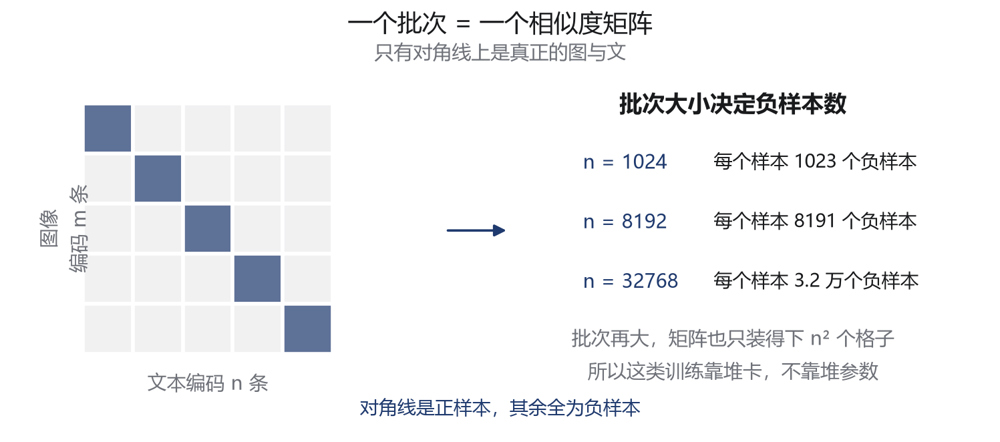

## 视觉编码器与图文对齐

上一章把图切成了块。但块本身没有意义，一块 14×14 的像素可能是猫耳朵的一角，也可能是电视雪花。把块变成"有意义的东西"，再让它和文字对上，是这一章要讲的两件事。

先说一个真实的产品投诉。某电商的"拍照找同款"上线后，用户在评论区反复提到同一句话：搜出来的东西样子对，颜色不对。搜一只棕色皮包，出来一堆黑包和深红包；搜一件雾霾蓝的毛衣，出来的全是灰的。技术团队查了半个月，模型没坏，数据也没错，问题出在训练目标上——他们的图文对主要来自商品页，而商品页的标题里"棕色"这个词出现的频率远低于"真皮""单肩""女包"。对比学习只要求"这张图和这句话比别的图文对更配"，颜色这种出现频率低的属性，自然被压到了向量空间里不重要的方向。

要理解这个现象，得先知道视觉编码器在学什么，以及图文对齐的目标函数长什么样。

### 先把块过一遍注意力

视觉编码器的主流结构是 ViT，做法和语言模型几乎一样：把块当成 token，加上位置编码，过若干层自注意力，输出每个块的特征向量。

一层注意力的核心公式：

$$\mathrm{Attn}(Q,K,V)=\mathrm{softmax}\!\left(\frac{QK^{\top}}{\sqrt{d_k}}\right)V$$

$Q$、$K$、$V$ 都是输入特征乘上三个不同的矩阵得到的。$QK^{\top}$ 算的是"每个块和其他块有多相关"，softmax 把相关性变成权重，再拿权重去加权平均 $V$。这个式子在说：每个块都要看一眼全图，按相关程度把别人的信息混进来。

一个块在浅层看到的是邻近的纹理，到了中深层，它的向量里混进了整幅图的信息，于是"这是一只眼睛"逐渐变成"这是猫脸上的一只眼睛"。ViT-L 有 24 层、宽度 1024、约 3 亿参数，ViT-H 有 32 层、宽度 1280、约 6 亿参数。相对语言模型这很小，所以视觉编码器通常一次训练好，后面反复复用。

代价是注意力对块数是平方复杂度。576 个块时，注意力矩阵是 576×576，三十多万个格子，可以忽略；到 4096 个块，矩阵变成 1670 万格，显存和算力都开始咬人；到四万个块（A4 扫描件），矩阵是十六亿格，单层就要几个 GB。这是高分辨率视觉输入在工程上昂贵的第一层原因，和上一章算的 token 费用是两笔账。

### 位置编码与"换个分辨率就不认识"

自注意力本身不知道顺序，位置信息全靠位置编码注入。视觉的位置编码通常是二维的：给每个块一个行号和列号，各自编码后相加，或者把行、列两个方向的编码拼接。

训练时的网格形状是固定的，比如 336 输入对应 $24\times24$。推理时来一张 $36\times36$ 的图，编码表里没有第 25 到 36 行，怎么办？

工程上有三种处理。双线性插值，把 $24\times24$ 的编码表拉伸到 $36\times36$，简单但会让相邻位置的编码差异变小；分块，把大图切成四块 $24\times24$ 分别处理，精度保住了但丢了全局结构；混合训练，在预训练时就随机采样各种网格形状，让编码表见过 $24\times24$、$36\times36$、$24\times48$ 等等。

第三种效果最好，也是现在主流视觉编码器的训练方式。它带来一个副产品：位置编码可以外推到训练时没见过的形状，只是因为见过的形状够多。

### 对比学习：一个批次就是一个矩阵

对齐图文最有效的方法是对比学习。思路极其简单：拿一批图文对，图片走图像编码器得到 $u_i$，文字走文本编码器得到 $v_i$，都做归一化，然后要求"配对的 $u_i$ 和 $v_i$ 相似度最高"。

一个批次有 $n$ 对，就构成一个 $n\times n$ 的相似度矩阵 $S_{ij}=u_i^{\top}v_j$，对角线是正样本，其余 $n^2-n$ 个格子全是负样本：

$$S=\begin{bmatrix} u_1^{\top}v_1 & u_1^{\top}v_2 & \cdots \\ u_2^{\top}v_1 & u_2^{\top}v_2 & \cdots \\ \vdots & & \ddots \end{bmatrix}$$

训练目标是让对角线上的值大、其他格子小。写成损失函数（图像到文本方向）：

$$\mathcal{L}_{i\to t}=-\frac{1}{n}\sum_{i=1}^{n}\log\frac{\exp\bigl(u_i^{\top}v_i/\tau\bigr)}{\sum_{j=1}^{n}\exp\bigl(u_i^{\top}v_j/\tau\bigr)}$$

这个式子在说什么：对每张图，把它和全部 $n$ 条文本的相似度做一次 softmax，希望自己的那条文本概率最大。取对数、取负，就是交叉熵。$\tau$ 是温度，通常设成 0.07 左右，作用是把相似度差距放大——除以一个小于 1 的数，原本 0.3 和 0.25 的差距会变成 4.3 和 3.6，softmax 之后概率差距就明显了。

实际训练时还会算另一个方向（文本到图像），两个损失取平均。这叫对称损失，作用是让两个编码器的更新幅度均衡，不至于一方压着另一方。

### 温度与批次：两个超参数的实质

$\tau$ 小，模型的判别要求变得苛刻，负样本必须被压得很低才算过关，训练更不稳定但特征更"硬"；$\tau$ 大，要求宽松，特征更平滑。它通常设成可学习参数，让模型自己调。

批次大小 $n$ 的影响更结构性。看损失函数的分母：softmax 里有多少项，就有多少负样本参与比较。$n$ 越大，分母里塞进的"干扰项"越多，模型被迫学更细的区分。

这个关系不是线性的。理论上，对比学习损失与互信息之间存在下界关系，$n$ 增大时下界变紧，收益大致随 $\log n$ 增长。工程上的经验是：从 1024 涨到 8192 收益明显，从 8192 涨到 32768 收益变小，再往上要靠技巧。这里只给量级，因为具体曲线取决于数据和模型规模，公开报告里的数字彼此差别很大。

### 算一遍：凑一个 32768 的批次要多少显存

为什么这类模型训练要用几百张卡？不是因为参数量大（ViT-L 加文本编码器也就四亿参数左右），是因为批次。

估算激活值。ViT-L 处理 256 个块，宽度 1024，24 层。每层的中间张量大致包括注意力的 $Q$、$K$、$V$、softmax 矩阵、输出投影、两层 MLP 的中间结果，保守算是输入大小的十几倍：

$$256\times1024\times24\times12\approx7.6\times10^{7}\ \text{个数}$$

按 16 位精度、每个数 2 字节算，单个样本的激活约 150 MB。这批激活要留着做反向传播。

一个批次 32768 个样本：

$$150\ \text{MB}\times32768\approx4.9\ \text{TB}$$

一张 80 GB 的卡扣掉权重和优化器状态，实际能放三十来 GB，于是：

$$4.9\ \text{TB}\div30\ \text{GB}\approx160\ \text{张卡}$$

这还只是把前向激活放下的数量，没算梯度通信、数据加载和文本侧的消耗。真实训练里，为了让这么大的批次同步更新，还要做梯度分片、激活重计算（用算力换显存，代价是前向多跑一遍），卡数通常要再翻一倍。

所以"对比学习靠堆卡"这句话有具体的算术支撑：卡数是被批次和激活逼出来的，不是被参数量逼出来的。这也是为什么后来大家要发明各种省显存的对比损失——不是为了模型更大，是为了批次能更便宜地变大。

### 两个改进：队列与成对损失

批内负样本有个固有的偏差：同一个批次里出现的样本，往往来自同一批数据源，主题相近。如果这一批全是宠物图，那"宠物 vs 汽车"这种区分就学不到。

第一个改进是队列。把过去若干个批次的图像特征存进一个队列（比如存 65536 条），每次算负样本时从队列里取。队列里的特征由动量编码器产生——一份不参与梯度更新、只缓慢跟随主编码器的副本，保证队列里的特征不会因为参数剧变而失效。这样负样本数可以远超批次大小。

第二个改进是换损失。把 softmax 换成逐对的 sigmoid：

$$\mathcal{L}=-\sum_{i,j}\log\sigma\bigl(z_{ij}\,(t\cdot u_i^{\top}v_j+b)\bigr),\qquad z_{ij}=\begin{cases}+1,&i=j\\-1,&i\neq j\end{cases}$$

$t$ 是温度（这里是乘不是除），$b$ 是偏置。这个式子在说：每一对图文独立判断"是不是一对"，正例往 1 推，负例往 0 推，不再要求整个批次做归一化竞争。

好处是不再需要全局 softmax，也就不需要在几百张卡之间同步整个相似度矩阵，批次可以拆开算再合并。代价是失去了 softmax 的"相对比较"性质，需要靠偏置项和更长的训练来补偿。

### 零样本分类：一个意外的副产品

图文对齐训练好之后，会出现一个很实用的能力：不训分类头也能分类。

做法是先把类别名编成句子，"一张猫的照片""一张狗的照片"，各自编码成文本向量；来一张图，编码后算它和每个文本向量的相似度，取最大。

$$\hat{c}=\arg\max_{c}\ \cos\bigl(f_{\text{img}}(x),\,f_{\text{txt}}(\text{"一张}c\text{的照片"})\bigr)$$

一句话解释：把"分类"变成"检索最像的描述"。因为文本编码器和图像编码器被训练到了同一个空间，比较相似度就是在比较语义。

这个能力对成本的意义很大。传统做法要为每个类别标注几千张图、训一个分类头；零样本只要写类别名。一千个类别、每个类别名十个 token，一共一万个 token，一次编码就能缓存复用，边际成本接近零。

它对措辞还很敏感。同一批图，用"一张猫的照片"和"猫"两种模板，准确率能差几个百分点。原因是训练时的图文对都是自然句子，短词和句子的向量分布不完全一致。所以工程上会准备一组模板（"一张{}的照片""一张{}的图片""{}的特写"），把相似度平均，代价是编码次数乘以模板数。

### 相似不等于理解

回到开头那个颜色搜不对的问题。对比学习的成功标准是"配对的排第一"，它没有要求模型理解颜色、数量、空间关系。

举一个具体的失败：一张"红色杯子放在木桌上"的图。如果训练数据里"红色杯子"这类描述很少，而"杯子"很多，那么模型学到的最优解是把"杯子"这个语义放到向量主要方向上，红色这个属性放在一个很弱的方向。检索时，红色杯子和白色杯子的向量距离可能只差一点，排在前面的既有红的也有白的。

有三种典型的失效：

**属性错。** 颜色、材质、数量这类低频属性被忽略。

**关系错。** "狗咬人"和"人咬狗"在词袋意义上很近，向量也近。

**文字读不出。** 图像里的文字是像素，对比学习不会专门教模型读它。

后来出现了两类改进，现在的视觉语言模型基本是两条腿走。

**更细的监督。** 用区域标注（框、掩码）做区域与短语的对齐，或者用更长的描述（一段而不是一句）逼模型关注细节。代价是标注成本，一条区域级标注的价格是普通图文对的几十倍。

**生成式目标。** 让模型直接输出描述文字，用语言模型的损失训练：

$$\mathcal{L}_{\text{cap}}=-\sum_{t}\log p_\theta\bigl(y_t\mid y_{<t},\,f_{\text{img}}(x)\bigr)$$

这个式子在说：给定图像特征，逐字生成描述，每个字都要预测对。它逼着模型学细节，因为描述里要提到颜色、位置、数量、动作。它比对损失的优点是信号密（每个字都给梯度），缺点是不能像对比学习那样利用海量噪声图文对——描述错了，模型就学错了。

工程上的组合是：对比学习打底，用几亿到十几亿对噪声数据把空间建起来；再用几百万条高质量描述做生成式微调，把细节补上。

### 两个锥体：模态间隙

对比学习有一个很奇怪的现象，第一次看到的人往往不信。把一批图相和它们对应的句子编码出来，全部归一化到单位球面上，你会发现图像向量挤在一个区域，文本向量挤在另一个区域，两个区域之间有一道缝。

这道缝叫模态间隙。匹配的图文对之间相似度可能只有 0.3，而两张毫不相干的猫图之间相似度能到 0.9。原因是两个编码器的参数、初始化、训练信号完全不同，它们只能保证"在这个球面上，我排第一"，不保证"我们俩靠得近"。

这个现象对工程有直接影响。如果你的应用需要拿图像向量去和文本向量比阈值（比如"相似度低于 0.25 就当没找到"），这个阈值在不同模型上完全不可移植，甚至在同一模型的不同版本上都会变。要做跨模态的绝对判断，得先拿一批标注数据校准，或者改用"取前 k 个"这种相对判断。

更麻烦的是，模态间隙的大小与模型质量无关。一个很强的模型也可能有很大的间隙，因为损失函数根本不惩罚这个。

### 文本侧的上限：77 个 token

图文对齐模型里，文本编码器往往被忽略，实际上它带着一个硬约束。

很多模型用的是 77 个 token 的上下文（这是早期 Transformer 实现留下来的习惯），超出部分被截断。一句话写太长，后半句直接不参与对齐，而模型并不会报错。

这在检索场景里会造成很难查的 bug：用户输入一段两百字的描述，前五十字是背景铺垫，真正关键的"蓝色磨砂玻璃瓶"在后面，被截掉了。搜出来的结果看起来像在乱猜，实际上是因为那句话根本没进去。

工程上的做法是把长描述拆成多段分别编码，取平均或者取最大相似度；或者在入口处就限制长度，提示用户写短。两种都行，但如果不知道这个 77 的存在，就想不到要处理。

### 算一遍：零样本分类的每日成本

假设一个内容平台要用零样本分类给图片打标：一千个候选类别，三个提示模板，每天十万张图。

**文本侧。** 一千类乘三个模板，每个类别名约十个 token，加上模板本身十几个 token：

$$1000\times3\times25=75000\ \text{token}$$

这七万五千 token 只算一次，缓存起来反复用。单张图只需要算图像侧。

**图像侧。** 按 336 输入算，每张图 576 token。十万张：

$$100000\times576=5.76\times10^{7}\ \text{token}$$

按中档价位每百万 token 三美元算，一天一块七。即使图像侧用的是视觉编码器的算力而不是语言模型，量级也差不多。

**对比。** 如果改成“训一个一千类的分类器”：需要每类至少几百张标注图，三十万张标注按每张两毛算是六万元，一次性投入，还不算重训。零样本在这里的优势不是精度，是冷启动成本。

什么情况下零样本不够用？类别非常细（不同型号的零件）、类别之间差别很小（相似的车型）、或者需要高准确率（医疗）。这三种情况下，标注钱迟早要花。

### 三层结构与冻结顺序

一个完整的视觉语言模型通常分三段：视觉编码器把图变成特征图；连接层（线性层、两层 MLP 或一组可学习的查询向量）把特征翻译成语言模型维度的 token；语言模型把视觉 token 和文本 token 一起吃进去，输出回答。

训练是有顺序的，顺序错了会出事。

第一步只训连接层，视觉编码器和语言模型都冻结。这一步的数据是图文对，目标是让连接层学会"翻译"——把视觉特征的分布搬到语言模型认识的分布上。数据量几亿对，但可训练参数只有几千万，所以很快。

第二步解冻语言模型（或它的部分层），用"图像 + 问题 + 答案"训练。这一步才是真正教模型用图回答问题的阶段。

第三步做偏好对齐，修行为。

如果跳过第一步，直接联合训练，会发生一件很典型的事：语言模型的参数被视觉对齐的梯度带着跑，几轮之后它学会了"看图说话"，但纯文本能力明显退化。原因是视觉特征的分布和词向量差得太远，连接层还没学会翻译，梯度就只能靠改动语言模型来降低损失。

### 真正的瓶颈是数据清洗

图文对比学习的论文里，模型结构往往只有两页，剩下十几页在讲数据。这是有原因的。

从网页抓来的图文对，大部分是脏的：图片是网站 logo，配文是版权声明；图片是新闻配图，alt 文本是"点击查看大图"；一个页面里十几张商品图共用同一段店铺介绍。直接拿这些对训练，模型学到的是"logo 和版权声明是一回事"。

所以真实流水线里，数据过滤占的工程量远超模型。常见手段包括：丢掉 alt 文本过短或含模板词的样本；丢掉尺寸过小或宽高比极端的图；用训练到一半的模型算相似度，丢掉得分异常低的样本；按图像哈希去重，避免同一张图在数据里出现上千次。

最后一条对效果影响很大。热门图片在互联网上被转载无数次，如果不去重，模型会把某几张图记得很牢，在评测里表现虚高，到了长尾场景就崩。

### 一个失败案例：域偏移

有一个做工业质检的团队，想用开源视觉语言模型判断零件表面有没有划痕。他们拿了两千张产线照片做微调，测试集准确率很高，上线后一周就崩了。

原因有三个，都和解码器无关。

第一，他们的测试集和训练集来自同一条产线、同一批光照条件，而实际上线后接了三条产线，光照和相机角度都不同。视觉编码器对光照变化不算鲁棒，特征分布整体偏移。

第二，开源模型的图文对主要来自互联网，里面几乎没有"金属拉丝表面"这种图像，视觉编码器在这个域上是"没训练过"的状态，微调两千张不足以改变它的浅层特征。

第三，他们的类别名是"有划痕"和"无划痕"，两个词在文本编码器里的向量非常接近（共享"划痕"这个主词），零样本判断基本靠猜。

修法是：换一个在自己域上预训练过的视觉编码器，或者至少用几万张无标注产线图做一次自监督继续预训练；把类别描述改写成完整句子并拉开措辞差异；以及最关键的，按产线分别建测试集，别再拿单条产线的数据自我评估。

### 算一遍：分辨率一上去，视觉编码器就不是免费的了

前面说视觉编码器小、可以反复复用。这话token 少的时候成立，token 一多就不成立。

把它拆成两项算。线性项是每个 token 过一次全部参数，24 层 ViT-L、三亿参数，每 token 约 $2N$：

$$2\times3\times10^{8}\times T$$

注意力项是每层重算一遍 $T\times T$ 矩阵，一次乘加算两次运算：

$$4\,T^{2}\,d\times 24\ \text{层}$$

把两个项摆到同一张表里（$d=1024$，单位 TFLOP）：

| token 数 | 线性项 | 注意力项 | 合计 |
|---|---|---|---|
| 576（336²） | 0.35 | 0.03 | 0.37 |
| 4096（896²） | 2.5 | 1.7 | 4.2 |
| 44,678（A4） | 27 | 196 | 223 |

看最后一列的比例变化：token 少时，注意力可以忽略；token 到四万，注意力占了总量的近九成。这就是高分辨率视觉输入真正贵的地方——不是参数多，是注意力要算一个两亿格的矩阵，而且算二十四遍。

把这个数换算成时间：223 TFLOP 按 $4\times10^{14}$ FLOP/s 有效算力算，约半秒。而同样四万五千 token 在 70 亿参数的语言模型里预填充要一点六秒。两者同一个量级——也就是说，**处理一页 A4 的时间，将近四分之一花在“把图变成特征”上，还没开始读字**。

这个结果还解释了一个工程现象：为什么支持高分辨率的视觉编码器要用窗口注意力。把全局注意力换成 8×8 的局部窗口，注意力项从 $T^2$ 降到 $T\times 64$，A4 页从 196 TFLOP 降到 2.8 TFLOP。代价是跨窗口的信息要靠少数几层全局层来汇总，细节关系变弱——但成本差七十倍，这笔账没人能绕开。

### 三种训练目标，三种能力边界

视觉编码器不是只有一种训法。同样是三亿参数，训练目标不同，它“看得见”的东西完全不同。

**对比目标。** 图文对拉近、错配拉远，学的是“整体语义”。它的强项是开放词汇检索与零样本分类，弱项是细节：颜色、数量、图里的字。前面说的颜色搜不对，根源就在这里。

**自监督目标。** 不需要文本，只要求“同一张图的不同视图，特征要一致”（裁剪、变色、模糊都算同一张）。学的是形状与纹理的稳定描述。强项是细粒度分类、目测缺陷、检索同款；弱项是与语言对不上——它的特征空间没有“词”的概念。

**生成目标。** 让模型看图写描述，损失是逐字交叉熵。学的是“该说什么”，逼它把颜色、位置、数量写进去。强项是细节描述与文字阅读，弱项是训练数据贵（要人写或强模型标）而且信号噪声大。

| 目标 | 监督信号 | 强项 | 弱项 |
|---|---|---|---|
| 对比 | 图文对是否配对 | 检索、零样本分类 | 颜色、数量、图内文字 |
| 自监督 | 同一图的两个视图 | 细粒度分类、缺陷检测 | 与语言对不上 |
| 生成 | 逐字描述 | 细节、读字 | 数据贵、噪声大 |

工程上的组合方式很固定：用对比目标把参数量做大（数据免费），用自监督把特征做稳（不需要标注），用生成目标把细节补上（数据贵，所以只做最后一段）。三层叠完的模型，在小图上也能读出字，而成本只比纯对比版本多一两成。

这也给选型提了个醒：拿一个纯对比训练的编码器去做发票字段抽取，然后抱怨“模型不行”，实际上是在让它做它从没学过的事。看看它的训练目标，就能预测它会在哪类输入上出错。

### 一个失败案例：假负样本

前面那些失效还能靠换目标修，有一个问题得靠改数据采样，它叫假负样本。

有个团队做“同款比价”，用户传一张鞋的图，系统返回同一型号的不同配色和不同店铺。上线后发现一个奇怪的现象：模型能把鞋和包分开，却对颜色毫无反应——搜红色返回蓝色，搜黑色返回白底。

查到最后是批次构成的问题。他们的采样是按商品 ID 随机的，一个批次三十二张图，里面往往包含同一型号的不同配色——这些图在相似度矩阵里被当成负样本，模型被反复告知“这两张不像”。但它俩除了颜色完全一样，模型能抓到的差异就只有那点颜色，于是颜色这个方向被反复压，最后压没了。

修法有两层。第一层是采样：按型号分组，同一型号的配色不要放进同一个批次，或者放进去但标成“中性对”，不参与损失。第二层是阈值：先算一遍批内相似度，把高于某个值（比如 0.95）的负样本对剔除。这两层都不需要重训模型结构，只改数据管道。

假负样本在所有对比学习项目里都会遇到，只是形式不同：同一条新闻的不同配图、同一个商品的白底图与模拍图、同一集剧的相邻帧。它们的共同点是“语义上确实很接近，但被当成反例”。损失函数不会告诉你这件事，只有把批次里的相似度分布画出来才能发现——正常的批次，非对角线的相似度分布应该是单峰偏低的；如果出现一个次峰，那个峰就是假负样本。

### 算一遍：一个百万级检索库的账

图文对齐最直接的落地是检索。把账算一遍，能看出瓶颈到底在编码还是在搜索。

**建库。** 取 ViT-L 编码，每张图 576 token，算力 0.35 TFLOP。一百万张：

$$10^{6}\times0.35\ \text{TFLOP}=3.5\times10^{5}\ \text{TFLOP}$$

按有效算力 $4\times10^{14}$ FLOP/s 算，约九百秒，单卡十五分钟。所以建库的成本主要是“把图从对象存储读下来”而不是算力。

**存向量。** 768 维、16 位精度，每条 1,536 字节：

$$10^{6}\times1536\ \text{B}\approx1.5\ \text{GB}$$

能全放内存，不需要向量数据库也能跑。一亿条就是 150 GB，这才需要分片。

**查询。** 暴力搜一遍的代价是：

$$768\times10^{6}\times2\approx1.5\times10^{9}\ \text{FLOP}$$

单核一秒能算十亿次浮点，就是一点五毫秒；GPU 上可忽略。所以百万级以下，“向量数据库”这个词是被过度使用的——一个 NumPy 矩阵乘就够。

**什么时候才需要索引。** 一亿条时，单次暴力搜是一百五十毫秒，而且每次都要把 150 GB 读进内存。倒排聚类（把向量聚成几千簇，只搜最近的十几簇）能把比较次数降到千分之一，代价是召回率——常见水准是九成到九成五，也就是每百次查询有五到十次找不到真正最近的那条。

这个取舍在产品上体现得很具体：搜相似商品，差几条无所谓，用索引；查重与盗图检索，漏一条就是事故，宁可慢也要全量。

最后一句容易被忽略：检索的精度上限是编码器给的，不是索引给的。索引只能让你更快地找到“编码器认为最像”的那一条，它没法把颜色找回来。所以调检索效果时，先看召回集里到底有没有正确答案（把真实最近邻算出来比一比），有但没排上前就是排序问题，根本没有就是编码器问题——两件事的修法完全不同。

### 冻结到什么程度

视觉语言模型的训练里有个常被低估的参数：到底解冻多少。

三层结构里，视觉编码器是最大的一块（三亿参数），也是最“通用”的一块。常见的做法是先全冻，只训连接层；然后解冻最后几层做域适应；很少全解冻。

三个选择的数据需求差很多。全冻时，可训练参数千万级，几百万样本就能收敛，因为任务只是“把已有特征翻译过去”。解冻最后四层，可训练参数到一亿量级，需要十倍以上的数据，否则会过拟合到少数样本上。全解冻要的数据更多，而且会把预训练学到的通用特征改掉——改完之后，它在其他任务上的表现就掉了。

| 策略 | 可训练参数 | 数据需求 | 风险 |
|---|---|---|---|
| 全冻 | 千万级 | 百万级 | 新域适不了 |
| 解冻后四层 | 一亿级 | 千万级 | 过拟合、通用性下降 |
| 全解冻 | 三亿级 | 亿级 | 灾难性遗忘 |

选择标准很直接：新域与预训练域的差距。手机拍的发票、截图、普通商品图，都在预训练分布里，全冻就够；工业相机拍的金属表面、医学影像、遥感图，差得远，至少得解冻后半部分。

有一个判断方法比看指标可靠：把冻结状态下的视觉特征抽出来，算一下新域数据与公开数据集的分布距离（最简单的做法是比两者的特征均值与方差，或者训一个小分类器看能不能区分）。能轻易区分，说明域偏得远，冻结的编码器会“看不见”你要的细节。

### 去重有三个粒度

对比学习的效果对去重极敏感，而去重不是一个开关，是三层。

**精确哈希。** 对文件字节算哈希，相同就丢。只解决“同一文件被重复上传”，成本几乎为零，能去掉的比例通常在一成以下。

**感知哈希。** 把图缩成 32×32 灰度、做傅立叶或离散余弦、取低频的 64 位做指纹，汉明距离小于某个阈值（常见取 6 到 10）就算重复。能抓住缩放、裁边、加水印、改亮度的重复，而这正是网页转载的主要形态。

**语义去重。** 用编码器算向量，余弦相似度超过阈值（比如 0.95）的归为一类，每类只留一条。能抓到“同一个商品的不同角度”这种像素不同但语义重复的样本。代价是它会把“差一点但是不同的东西”（同一型号的两个配色）也吞掉，所以阈值不能定太低。

三层都做，删掉的比例在两成左右很常见，而且删掉的部分对训练几乎没有贡献——它们在损失里贡献的是重复的梯度，只会让模型把那几张图记得更牢。判断自己该不该加一层，有个简单方法：从训练集里随机抽一千条，手工数一遍真正的重复率；超过百分之五，就值得做感知哈希；超过百分之十五，语义去重也得加上。

### 一个编码器的能力边界

对比学习训出来的编码器能做很多事，但它在几件事上会稳定地错。把这些边界记住，比看榜单有用。

| 能力 | 可靠性 | 原因 |
|---|---|---|
| 物体类别 | 高 | 训练数据里最多 |
| 颜色与材质 | 中 | 频率低，被压到次要方向 |
| 数量（1 到 3） | 中 | 少量样本能学到 |
| 数量（四个以上） | 低 | 图与文的配对很少计数 |
| 空间关系 | 中低 | 词袋式的描述分不出左右 |
| 图内文字 | 低 | 像素字对对比学习是噪声 |

这个表可以直接当需求评估表用。客户说“帮我数一下图里有几个人”，而图里有十几个人时，错的概率很高——不是因为模型不努力，而是这类样本在训练数据里几乎没有。行业里一个稳定的观察是：计数在三个以内尚可，超过五个就开始数不准。

空间关系那一行也值得展开。“猫在狗左边”与“狗在猫左边”在词袋意义上几乎一样，图文对里的描述很少精确到左右，所以模型学到的是“猫和狗同时出现”而不是位置。要它判断左右，得靠更细的监督（区域标注或生成式描述），或者干脆把图切开分开问。

### 一条对齐数据的流水线

从网上爬到可训练，图文对要过五六道筛，每一道都会丢掉一部分。把通过率写出来，才能预估“要爬多少才能得到一亿对”。

| 筛子 | 丢掉 | 累计保留 |
|---|---|---|
| 尺寸与格式 | 15% | 85% |
| alt 文本长度与停用词 | 20% | 68% |
| 图像哈希去重 | 18% | 56% |
| 与文本相似度过低 | 25% | 42% |
| 敏感内容与低质图 | 8% | 39% |

累计保留四成。也就是说，要得到一亿对干净数据，得爬两亿五千万对。这个比例决定了整个项目的工程量——大部分时间花在爬取与清洗上，而不是训练上。

表里最有效的一道是“与文本相似度过低”，它需要先用小模型算一遍，成本不低（两亿对乘一次编码），但能去掉“图是 logo、文本是版权声明”这类完全无关的配对。代价是它也会误删“描述很抽象但图很对”的样本，所以阀值不能定太高。

还有一个不在表里的筛子：语言。多语言数据里，非目标语言往往占很大比例，而抹掉它们的成本极低（一个检测器就能做）。这也解释了一个现象：很多开源模型在小语种上的表现参差不齐——不是模型结构问题，是那个语言的数据过完筛之后只剩几千分之一。

### 一次编码，四处复用

视觉编码器最大的经济价值不是“能看懂图”，而是“同一份特征能被很多任务共用”。

把一个产品里常见的四个功能拆开看：相似商品检索、内容分类、重复图去重、图文审核。四个功能的输入都是同一张图，需要的都是“这张图大致是什么”。于是完全可以只编码一次，得到一组向量，分别接四个小头。

| 用途 | 需要的向量 | 额外成本 |
|---|---|---|
| 检索 | 整图向量 | 建索引 |
| 分类 | 整图向量加一层头 | 几万个参数 |
| 去重 | 整图向量加阈值 | 无 |
| 审核 | 整图向量加多层头 | 百万元级参数 |

四行里只有最后一行的头需要单独训，前三行几乎零成本。这就是为什么“先建一个向量库”是一个很划算的工程决定：它把四个需求变成一个入口，后续每加一个功能只是多一个头。

复用的前提是编码器不换。换一次编码器，所有向量都失效，索引要重建、小头要重训。所以选型时要看的不是“当前榜单第一”，而是“这个编码器能不能用两年”。这个判断很难，但有一个信号有用：它的训练数据、分词器、输出维度是不是被很多下游采用——被采用得多的，换代的代价小，因为社区会跟着适配。

### 批次改了，学习率得跟着改

对比学习最容易被忽略的联动是：批次与学习率必须一起调。只改一个，效果会变差，而你会以为是模型问题。

原因是梯度的信噪比随批次变化。批次从一千拉到八千，每个参数的梯度是八倍样本的平均，噪声降低约 $\sqrt{8}\approx2.8$ 倍。于是同一个学习率下，更新方向更稳、步长相对变得更小——训练变慢，或者卡在平坦区域。

两种常见补偿。线性缩放：学习率乘批次倍数（八倍批次就乘八），适合大批次加大模型；平方根缩放：乘 $\sqrt{8}$，更保守，适合层归一化之后的小模型。两种都不是定律，而是经验起点。

| 批次 | 倍数 | 学习率（线性） | 实际常用 |
|---|---|---|---|
| 1,024 | 1 | 基准 | 基准 |
| 8,192 | 8 | 8 倍 | 3–5 倍 |
| 32,768 | 32 | 32 倍 | 8–12 倍 |

表里第三列与第四列的差，是因为大学习率在前几百步容易把模型推坑里。工程上的解法是热身：前一两千步从很小线性升到目标值，之后再按余弦衰减。

这一套在图文对比学习里尤其重要，因为它的批次本来就很大，而且往往跨机。学习率没跟上，损失曲线会很平滑但下降很慢，看上去像“数据不够”，实际上是步长太小。

### 这一章留下的东西

视觉编码器解决的是"图里有什么"，图文对齐解决的是"这个词指的是哪种视觉内容"。前者靠自监督和架构，后者靠对比学习的目标函数和批次规模。

这两件事都不保证细节准确。对比学习学的是整体语义的粗对齐，颜色、数量、文字这些细节要靠更强的监督信号去补，而补细节的成本远高于建对齐。还有一个容易被忽略的事实：对齐得好不等于用得好，中间那层连接层如果没训到位，再好的视觉特征也传不进语言模型。下一章讲的是怎么把这几块拼成一个能用的模型：三个阶段、几类数据，以及幻觉为什么几乎无法避免。
