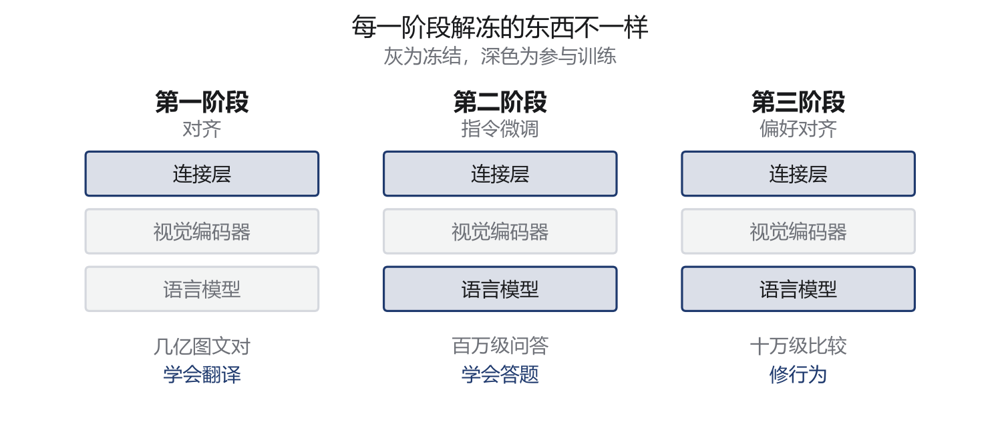

## 多模态模型怎么训

有个团队花了三个月训出一个视觉问答模型，在自建测试集上准确率九成。上线后第一周收到一堆投诉，全都指向同一类问题：问表格里的数字，答错；问小数点后两位，答错；问"第三行那个 8 是不是 3"，答"图里没有 3"。他们以为是训练不充分，又灌了三百万条问答数据，数字类的错误率从百分之三十降到百分之二十六，几乎没动。

后来有人提了个问题：你们的训练数据里，有多少条是关于表格和数字的？统计下来不到千分之三。三百万条数据里关于数字的不到一万条，而模型要学的是"看清一个小格子里的字形差别"，这需要专门的、密集的监督信号，靠增加通用问答的数量解决不了。

这件事说明了多模态训练的第一个特点：**它不是一次训练，是几轮目的完全不同的训练串起来**。每一轮解决一个特定的缺陷，用不同类型的数据，动不同的参数。搞混了顺序或配比，花再多算力也是白花。

### 三个阶段，三种缺陷

**第一阶段：对齐。** 冻结视觉编码器和语言模型，只训中间那个连接层。数据是图文对，几千万到几亿对。目标只有一个：把视觉特征的分布翻译成语言模型认识的分布。

这一阶段的可训练参数可能只有几千万，训练很快，效果却最直观：训完模型就能"看图说一句"。但它只会描述整体，细节基本靠猜，因为连接层能做的只是线性或浅层的映射，学不会"读字"这种需要深层计算的能力。

**第二阶段：指令微调。** 解冻语言模型（全部或后几层），用"图像 + 问题 + 答案"的三元组训练，数据量从几十万到几百万条。这一阶段教的是用法：按什么格式回答、什么时候该说"看不清"、什么时候该承认图里没有。

这一阶段的数据质量比数量重要得多。一条精心构造的多轮图像对话，抵得上几十条从模板生成的单轮问答，因为它教会模型"先看哪里、再说什么"。

**第三阶段：偏好对齐。** 给同一个问题准备两个回答，让人（或强模型）标哪个更好，用偏好损失训练。数据量小，十万级，但对体验影响大：减少编造、减少过度描述、提高答案的相关性。

三个阶段对应三种缺陷，顺序不能随便换：

| 阶段 | 修什么缺陷 | 典型数据量 | 冻结策略 |
|---|---|---|---|
| 对齐 | 视觉特征传不进语言模型 | 千万到亿级图文对 | 两个编码器全冻 |
| 指令微调 | 不会按格式回答、不会用图 | 十万到百万级问答 | 语言模型解冻 |
| 偏好对齐 | 编造、啰嗦、答非所问 | 万到十万级比较 | 全参或部分参数 |

### 算一遍：三个阶段分别要多少算力

算力估算的粗公式是：训练一个 token 需要约 $6N$ 次浮点运算（$N$ 是可训练参数量），前向占 $2N$，反向占 $4N$。冻结的部分只跑前向，所以系数要按比例调。

假设条件是：语言模型 70 亿参数，视觉编码器 3 亿参数，连接层 2000 万参数；用 A100 训练，理论峰值 312 TFLOPS，实际能用到四成，即 $1.25\times10^{14}$ FLOP/s。

**第一阶段。** 只有连接层可训练，其余全冻。2 亿对图文，每对平均 100 个文本 token 加 576 个视觉 token，约 676 个 token：

$$2\times10^{8}\times676\approx1.35\times10^{11}\ \text{token}$$

冻结部分每 token 约 $2N$，训练部分约 $6N$，加权之后大约 $2.2N$：

$$2.2\times7.3\times10^{9}\times1.35\times10^{11}\approx2.2\times10^{21}\ \text{FLOP}$$

单卡需要 $2.2\times10^{21}\div1.25\times10^{14}\approx1.8\times10^{7}$ 秒，也就是 200 天。用 64 张卡，三天。

**第二阶段。** 语言模型解冻，系数回到 $6N$。假设 100 万条问答，每条平均含一张图（576 token）加 400 个文本 token，约 1000 token：

$$10^{6}\times1000=10^{9}\ \text{token}$$
$$6\times7.3\times10^{9}\times10^{9}\approx4.4\times10^{19}\ \text{FLOP}$$

单卡 98 小时，八卡 12 小时。这就是为什么第二阶段的数据量比第一阶段少两个数量级，算力却只少一个数量级——它的系数大得多。

**第三阶段。** 十万条比较，每条两个回答，token 量与第二阶段同量级但少一个数量级，单卡几小时就够。

三个数字放在一起，能看出一件事：**对齐阶段贵在数据量，指令阶段贵在系数**。前者靠攒数据，后者靠攒卡。很多团队卡在第二阶段，不是数据不够，是没算清解冻语言模型之后成本翻了三倍。

### 数据：四种来源，四种成本

文本数据网上到处都是，图文问答数据只能造。四种造法，成本差一个数量级。

**人工标注。** 让标注员看图写问答。一条高质量的多轮图像问答，含标注、审核、返工，成本在几块到几十块人民币。优点是准，能覆盖专业领域（医疗影像、工程图纸）；缺点是慢，一个人一天做不了两百条。

**模型生成加过滤。** 用强模型对图生成问答，再人工抽检或用一个判别模型过滤。成本降到每条几分钱，规模能上去。风险是继承了强模型的错误：强模型看错的地方，学生模型会学得更牢，因为那是"标准答案"。

**从文档反推。** 拿 PDF、网页、说明书，利用里面的结构信息（标题、表格、图注、编号）构造问答。比如把一张图表和它下面的图注配成"这张图说明了什么"，把表格的表头和单元格配成"第三列第二行是多少"。规模大、成本低，质量参差，但有一条好处：答案有据可查，不靠人判断。

**程序合成。** 用代码生成图和标准答案。画一张柱状图，代码知道每根柱子的值；画一个几何图形，代码知道边长和角度；渲染一个界面，代码知道每个按钮的位置。这类数据质量最高，因为答案是可计算的，永远不会错。

最后这一类值得单独强调。凡是能写成"生成器 + 渲染器"的任务，训练效果都比人工标注好，而且可以无限扩规模。图表理解、几何推理、界面元素定位、表格抽取，这几个能力在近两年进步最快，很大程度上是因为这类合成数据。

代价是分布偏移。程序合成的图太干净：字体统一、背景纯白、光照均匀。真实用户拍的照片有阴影、有反光、有倾斜。只在合成数据上训的模型，遇到手机拍的发票就掉点。工程上的解法是合成之后过一道"真实化"：加噪声、加透视变换、加光照变化，或者用生成模型做风格迁移。

### 算一遍：一条数据的成本

把四种来源放在一起比，假设目标是十万条多轮图像问答：

- 人工：每条 8 元，十万条 80 万元，周期三个月；
- 模型生成加抽检：每条 0.05 元生成费加 0.3 元抽检，十万条 3.5 万元，周期两周；
- 文档反推：每条 0.02 元（主要是解析和渲染），十万条 2000 元，周期一周；
- 程序合成：每条 0.001 元（纯算力），十万条 100 元，周期两天。

这张表解释了为什么现在的多模态模型能在几个月内迭代一代：不是标注变便宜了，是大部分数据不再需要人。人的位置从"生产"挪到了"抽检和定标准"。

但便宜的数据有一个共同问题：它们大多只覆盖"能看清楚"的图。文档截图、图表、几何图形，都是高对比度、无噪声、结构清楚的。真实手机拍的照片——歪的、暗的、反光的、有手指挡住的——在任何一个数据源里都很少。这是现在多模态模型"实验室很强、用户拍照就翻车"的主要原因之一。

### 幻觉的三种形态

多模态模型的幻觉比纯文本严重，因为它可以编造看到的东西，而且编得非常自信。按严重程度分三层。

**第一层：不存在的东西。** 图里没有猫，模型描述了猫。这类错误最常见，也最容易触发。原因是语言模型有强先验：提问"图里那只猫是什么颜色"，即使图里没有猫，句式本身就在暗示有猫，模型会顺从语言先验编一个颜色出来。

**第二层：属性错。** 猫确实在，但颜色、数量、位置错了。这类错误难被用户发现，因为答案读起来很自然。上面说的"红色杯子答成白色"就是这一层。

**第三层：读错字。** 把 8 看成 3，把 1 看成 7，把小数点漏掉。这类错误在文档、发票、仪表盘场景里最致命，因为数字错一位就是完全不同的结论。

三层错误的底层机制是同一个：模型在"语言上合理"和"视觉上正确"之间做权衡，而训练数据里前者总是占优。一段通顺的描述比一段破碎但准确的描述得分高，于是模型学会了优先通顺。

### 缓解手段及其代价

没有一种手段能消除幻觉，只有降低频率。常见五种，代价递增。

**负样本训练。** 数据里加入"图里没有 X"的样本，并且答案就是"没有"。直接有效，但模型只能学会训练时见过的那几类否定，遇到新类别又失效。

**定位输出。** 要求模型在回答里带上位置："左上角的红色标签写着 2026"。这逼着它把文字和区域对应起来，减少"看到全局就编局部"的情况。代价是输出变长，而且模型可能给出一个看起来具体但错的位置。

**先描述再回答。** 让模型先写一段详细的图像描述，再基于这段描述回答。原理是把"必须看图"变成"必须先把看到的东西写下来"，减少了直接凭语言先验作答的机会。代价是 token 翻倍，延迟上升。

**自检。** 生成答案后，再问一次"这个答案在图中能找到依据吗"，找不到就重答。效果不错，成本是两次生成。

**按任务接专用工具。** 读文档接 OCR，读表格接表格抽取，读界面接界面解析。这是最有效的一种，但也最不像"多模态模型"：它把难题从模型移到了流水线上。

工程上的组合通常是：通用问答用模型加自检，关键字段抽取走专用流水线。两者的分界线是"错了要不要赔钱"。

### 一个失败案例：能力遗忘

有个团队把一个已经上线的纯文本模型改造成多模态模型，流程走得很标准：先训连接层，再指令微调，最后偏好对齐。视觉问答的指标很好看，上线后客服系统却收到另一类反馈：这个模型写长文的能力变差了，以前能写两千字的方案，现在写到八百字就开始重复。

原因在第二阶段的配比。他们的指令微调数据里，多模态问答占了九成五，纯文本指令只剩百分之五。训练时语言模型全参数解冻，几轮之后它的输出分布被大量"短问短答"的视觉数据拉过去了，长文生成的能力被稀释。

这在文献里叫灾难性遗忘，在多模态项目里几乎必然发生一次。因为视觉问答的答案普遍很短（"是一个红色杯子"），而长文写作需要完全不同的生成长度和结构。

修法是两条。一是保持纯文本数据的比例，通常不低于三成，且要覆盖原有能力的关键类型（长文、代码、多轮对话）。二是冻结策略变保守，只解冻语言模型的后半部分层，让底层的语言能力不动。第二条会牺牲一点视觉任务的精度，但保住了原有产品。

工程上的判断标准很直接：改造一个已有模型时，先跑一遍原有能力的回归测试集，把分数记下来；每训一轮再跑一遍。分数掉超过几个百分点，就要调配比，而不是等上线后被用户发现。

### 看图还是读图

做多模态产品时，第一个要回答的问题不是"用哪个模型"，而是"这个任务需要看图还是读图"。

看图指的是判断整体：这是什么物体、什么风格、什么情绪、构图如何。这类任务对分辨率要求低，224 到 448 就够，每张图几百 token，通用视觉模型能做得不错。

读图指的是从图里取信息：文档、表格、发票、仪表盘、界面截图。这类任务对有效分辨率要求高，因为一个字至少要占几个像素才能被分辨；同时对定位精度要求高，因为答案要对应到具体位置。

两者的成本差得很远。一张商品图 576 token，一页 A4 扫描件 44678 token，差七十八倍。效果差得更远：通用模型读文档的字段准确率往往只有八九成，而业务要求往往是九成九以上。

混着做通常两头不讨好。用读图的预算去看图，成本浪费；用看图的预算去读图，准确率不够。分路处理是更常见的形态：一个轻量模型判断图的类型，再路由到不同的处理链。

### 评测怎么写

多模态评测有一个公开的陷阱：榜单分数和实际体验的相关性不高。

原因是公开评测集有固定格式、固定题型，模型很容易在格式上过拟合。比如选择题，模型可能学会了"答案总是 B"这类偏置，或者学会了"选项里最长的那个通常对"。

实际工程里更可靠的做法是三层评测。

第一层是任务级测试集，从自己的业务里抽两百到五百条真实样本，人工标注正确答案，按业务指标算（字段准确率、答案可用率）。这一层决定能不能上线。

第二层是分类别拆解。把测试集按内容拆成数字、专名、表格、手写、低光照几类，分别算准确率。总体九成可能是被大量简单样本拉上去的，拆开看某一类只有六成。

第三层是失败模式统计。不看准确率，看错误长什么样：是编造、是读错、还是答非所问。这一层决定下一步该补什么数据。

三层都做完，得到的结论往往和公开榜单不一致，而且往往更悲观。这是正常的，公开榜单测的是模型的通用能力上限，而业务关心的是特定分布下的下限。两层之间的差距，就是产品体验与宣传口径的差距，也是工程团队真正要填的坑。

### 连接层的三种形态

夹在两个编码器中间的那一层，实现方式有三种，差别在参数量和表达能力。

最简单的是单层线性映射，一个矩阵把视觉维度搬到语言维度。参数少到可以忽略，效果却出奇地不差，因为视觉特征本身已经很丰富，不需要再变换。它的问题是映射太刚性，不同分辨率的图、不同任务的输入都用同一套变换。

第二种是两层 MLP 加一个非线性。参数量到千万级，能学到一些非线性关系，对大分辨率输入更宽容。这也是当前开源模型里最常见的做法。

第三种是一组可学习的查询向量，让它们用注意力从视觉特征里“抽取”固定数量的 token。好处是无论输入多少块，输出永远是一百来个 token，成本恒定；坏处是抽取过程会丢细节，读文档这类任务吃亏。

三种里哪种好，取决于你的 token 预算是否固定。预算固定（比如一定要把单图成本控在 300 token 以内），用查询抽取；预算随图大小浮动，用 MLP。

### 多图与交错输入

真实产品里很少只传一张图。用户可能传三张同款商品让你比价，也可能传一整个相册，或者在对话里穿插图片和文字。

多图带来的第一个问题是图像之间怎么区分。投影拼接的序列里，如果不加分隔标记，模型可能把第二张图的沙发描述成第一张图里的。所以需要在每张图前后加边界标记，让模型知道“这一段的视觉 token 属于图二”。

第二个问题是 token 预算。四张 A4 就是十八万 token，很可能超上下文。工程上要么减图，要么降分辨率，要么分批处理再把结果合并。三种都会损失信息，选哪取决于任务：比价可以降分辨率（只需要看外观），读合同不能降。

第三个问题是位置信息。多图时用户说“右下角那个”，到底指哪张图的右下角？模型对这类指示的表达能力有限，产品上通常靠界面约束解决：让用户点选图片，把序号传给模型，而不是靠文字描述位置。

### 这一章的结论

多模态训练的三阶段，本质是"先对齐、再教用法、最后修行为"。三个阶段的数据量差两个数量级，算力系数也差，不能混着算预算。

数据质量决定上限，幻觉缓解决定下限。而真正拉开产品差距的，往往不是模型本身，是数据里有没有覆盖用户真实会拍的那些图——歪的、暗的、反光的、有遮挡的。这些图在任何公开数据集中都是少数，在一线用户的手机里却是多数。谁能把这批数据补上，谁的产品在真实场景里就更稳。而补这批数据的成本，往往不在于标注，而在于能不能把用户真实上传的图合法地留下来、脱敏、再回流到训练集——这是一件组织问题，不是算法问题。

下一章换到语音。它的链条比视觉长，中间多了一个时间维度，而时间会让延迟变成硬约束。
