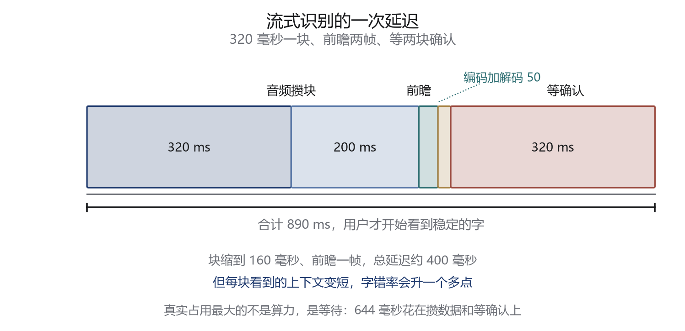

## 语音识别：从波形到文字

一个做客服质检的公司接过一单：客户有八千小时的坐席录音，要在两周内全部转成文字，然后按关键词做合规检查。他们先用了一个开源的语音识别模型，单卡跑了一天，算下来只处理了三百小时。按这个速度，八千小时要二十六天，赶不上交付。

问题出在两个地方。一是他们用的是非流式的批处理模型，为了把长音频跑完，得先切成三十秒一段再拼，切点前后各丢几个字；二是没做并行，单卡单进程，连批处理都没开。改完之后，同一张卡的处理速度到了每小时二十小时音频，八千小时两天跑完。

这件事说明语音识别的工程形态和视觉很不一样。视觉的瓶颈是 token 数量和显存，语音的瓶颈是**时长**——音频的每一秒都在产生新的输入，而人类的语速不会因为你算力不够就变慢。

### 一秒钟音频有多少个数

先把量级搞清楚。电话和会议录音通常采样率 16 kHz，意思是每秒记录一万六千个振幅值。每个值用 16 位整数存，一秒钟就是 32 KB，一小时 115 MB。

把这样的原始波形直接喂给 Transformer 是不现实的。一秒一万六千个位置，十分钟就是九百六十万个位置，注意力矩阵根本算不动，而且相邻采样点高度冗余——语音的变化尺度在几十毫秒，不在微秒。

所以第一步永远是提特征。标准做法是分帧：取 25 毫秒的窗口，每隔 10 毫秒挪一次，每帧算一个频谱，再压到 80 个梅尔刻度上的能量值。

于是：

$$\text{每秒帧数}=\frac{1000}{10}=100,\qquad \text{每秒特征数}=100\times80=8000$$

一秒钟一万六千个采样点被压成八千个数，序列长度降到原来的五十分之一。一小时音频得到 36 万个时间步，每个 80 维。这个长度对注意力来说仍然很长，但至少能处理了。

这里有个容易忽略的细节：25 毫秒的窗口对语音是合适的，因为一个音素的时长大约在 50 到 200 毫秒；但对音乐不合适，音符的起音比语音快得多。所以做音乐识别的模型会用更短的窗和更高的采样率。

### CTC：不知道对齐在哪，就全加起来

有了特征序列，接下来要把它变成文字。难点在于对齐：输入是 36 万个时间步，输出是几百个字，哪个字对应哪几帧，没人标过，也没法标。

CTC 的思路很干脆：不要求知道对齐，把所有可能的对齐都算一遍。

具体做法是引入一个空白符号，允许模型在任意帧输出"什么也没有"。给定长度为 $L$ 的答案，先把它扩成含空白的序列，长度 $2L+1$；然后在 $T$ 个时间步上，每步可以输出当前符号、前进一个符号、或者停在原地。所有能通过"合并重复、删掉空白"得到同一段文字的路径，都算正确对齐。

训练目标是把所有合法路径的概率加起来，让这个和最大：

$$P(y\mid x)=\sum_{\pi\in\mathcal{B}^{-1}(y)}\prod_{t=1}^{T}P(\pi_t\mid x_t)$$

这个式子在说什么：$\pi$ 是一条逐帧的路径，$\mathcal{B}$ 是把路径压成最终文字的操作（先合并连续重复，再删空白），$\mathcal{B}^{-1}(y)$ 是所有能压成 $y$ 的路径。外层求和表示"这些路径随便哪一条都算对"，内层连乘是路径的概率。

直接枚举所有路径是指数级的，实际用动态规划算，这就是前向后向算法。复杂度是 $O(T\cdot L)$，36 万帧乘几百个字，可以接受。

CTC 有一个很强的假设：每一帧的输出互相独立。写在公式里就是每帧各算一个 $P(\pi_t\mid x_t)$，再把整条路径的概率连乘起来。每帧只看自己那一列，不看前后。这让训练变得简单（可以对每帧并行算损失），也让流式变得天然（来了新帧就能算），但语言层面的约束完全没有了：模型不知道"期终"比"期中"更可能，只能靠后面接一个语言模型来纠。

### 注意力解码：让模型自己学对齐

另一种解法是编码器加解码器，用交叉注意力做对齐。

编码器把特征序列压成一组隐状态；解码器逐个生成文字，每生成一个，用注意力在编码器的输出上"看"一眼。训练时用真实的上文作为输入（teacher forcing），损失是每个位置上的交叉熵：

$$\mathcal{L}=-\sum_{t=1}^{L}\log P_\theta\bigl(y_t\mid y_{<t},\,h_{1:T}\bigr)$$

$h_{1:T}$ 是编码器的全部输出。这个式子在说：给定整段音频的编码和已经生成的字，预测下一个字。

它和 CTC 的差别很关键。CTC 假设帧独立，注意力解码不假设，它可以用上下文来消歧——"期终考试"和"期中考试"发音一样，但前文说了"期末考试周"，注意力机制能把信息带过来。

代价有三。第一，它需要整段音频的编码结果，天生不适合流式。第二，注意力对齐可能跑偏，出现漏字、重复生成（同一个字连续输出十几遍）。第三，训练比 CTC 难收敛，通常需要 CTC 做辅助损失来稳定。

所以真实的系统往往是混合的：训练时 CTC 和注意力损失加权相加，推理时用注意力解码，再用 CTC 的结果做对齐约束。这种组合在实践中比任何单一方案都稳。

### 算一遍：同一段音频，两种解码的账不一样

CTC 和注意力解码的差别不只是精度，还有“钱花在哪里”。

取一段 20 秒的音频，10 毫秒帧移，共 2,000 帧，词表 5,000（中文常用字加英文子词），输出层维度 512。

**CTC 的输出层。** 每一帧都要算一遍 5,000 类的分布：

$$2{,}000\times5{,}000\times512\times2\approx1.0\times10^{10}\ \text{FLOP}$$

两千万个 logits，按 16 位精度存是 40 MB。听起来不多，但训练时要把它们全留下算梯度，批大小 32 就是 1.3 GB，而且帧率一变（比如改成 20 毫秒）这个数就差一倍。

**注意力解码的输出层。** 只对输出的 30 个字算：

$$30\times5{,}000\times512\times2\approx1.5\times10^{8}\ \text{FLOP}$$

差七十倍。但代价在别处：它要串行跑 30 步，每一步都得等上一步的结果，而 CTC 一次并行算完 2,000 帧。所以 CTC 是“宽而快”，注意力是“窄而串”。

这个区别直接影响硬件选择。CTC 训练吃显存带宽和矩阵乘法效率，适合大批量堆在同一张卡上；注意力解码在推理时吃延迟，适合小批量、低并发、要求首字快。同一个模型团队同时支持两种模式时，这个差别就是两种部署形态的根源。

| 结构 | 输出层开销 | 并行与延迟 | 上下文利用 |
|---|---|---|---|
| CTC | 每帧都算 | 完全并行、一块一算 | 无（帧独立） |
| 注意力 | 只算输出字 | 串行、整句算完 | 有 |
| RNN-T | 每帧算一次联合 | 逐帧递推、一块一算 | 有（弱） |

中间那条路就是 RNN-T 的位置：它把“每帧都要判断”和“能看历史”拼在一起，代价是训练时需要对齐状态，显存占用比 CTC 高一个量级——因为要对每一帧的每个可能输出位置保存状态。

### 流式：切块大小决定延迟

语音助手必须边说边出字，这就要求模型只能看已经听到的部分。做法是把音频切成小块（chunk），每次送一块进去。

块的大小直接决定延迟。取 320 毫秒一块，那么用户说完一个词之后，模型至少要等到这个块填满才能处理，再加上计算时间，端到端延迟约 400 到 500 毫秒。块取 640 毫秒，延迟翻倍，但每块的上下文更长，准确率略好。

还有一个技巧叫前瞻：块与块之间留一小段重叠，让模型在输出当前块时能看到后面一点点音频。前瞻两帧（约 200 毫秒）通常能让准确率接近非流式模型，代价是延迟又加 200 毫秒。

即便如此，流式输出还是会反复修改。模型在第 3 块输出了"今天天气不"，第 4 块进来之后发现应该是"今天天气不错"，就得回头改。工程上的做法是只把"稳定"的部分显示给用户：连续两块给出相同结果才确认输出（这个策略常被称作本地一致性），其余的留在缓冲区等下一块验证。

这个策略的代价是可感知的延迟增加（要等两块），收益是用户不会看到文字闪来闪去。产品上通常让"已确认"的字正常显示，"未确认"的字用浅色显示，用户在心理上能接受。

### 三种结构的选择

把三种主流结构摆在一起，选择标准其实很清楚。

| 结构 | 对齐方式 | 能否流式 | 精度与难度 |
|---|---|---|---|
| CTC | 边缘化所有对齐 | 天然支持 | 中，容易训 |
| 注意力编解码 | 学出来的软对齐 | 需改造 | 高，难训 |
| RNN-T | 预测加联合网络 | 天然支持 | 高，很难训 |

CTC 最简单，适合"够用就行"的批量转写。注意力编解码精度最高，适合离线场景，比如会议记录、字幕生成。RNN-T 把两者结合：用一个预测网络吃已输出的文字，一个编码器吃音频，两者在联合网络里逐帧决定"是输出一个字，还是输出空白"，因此既能流式又有语言上下文，代价是训练和推理都更复杂。

手机上的离线语音输入基本都用 RNN-T 这一类结构，因为它必须在本地、必须流式、必须省电。

### 中文为什么更难

同样一个模型，英文上词错率能到三四个点，中文上往往要差一截。不是模型偷懒，是中文本身的问题多。

**同音字。** 中文只有约一千三百个音节，常用汉字三千五，平均每三个字共享一个读音。"期终"和"期中"、"公式"和"公事"、"权力"和"权利"，在声学上完全一样。所以语言模型在中文 ASR 里的权重比英文更重，光靠听是分不出的。

**分词歧义。** "南京市长江大桥"可以被断成好几种，每种都语法通顺。输入是字，输出也是字，看起来不用分词，但语言模型的打分实际隐含了分词假设。训练数据的切分方式会影响结果。

**多音字。** "行"在"银行"和"行走"里不同，"重"在"重要"和"重复"里不同。模型需要看上下文才能定，而同音字问题刚好相反：这种情况下上下文明明是有的，模型却可能因为训练数据不平衡而选错。

**数字与单位。** 用户说"三千五百块"，输出应该是"3500 元"还是"三千五百块"？这叫逆文本规范化。口语里的"幺""勾""两""百八十"都要映射。这块常被当作后处理，但它对下游抽取的影响比字错更大——金额错一位就是事故。

**标点与断句。** 原始输出没有标点，也没有句子边界。加标点看似简单，实则要看很长的上下文：同一句话，加不加逗号意思可能相反。现在通常用一个独立的轻量模型做，输入是识别结果，输出是带标点的文本。

**中英混说。** "把这个 feature 关掉"这类句子，需要模型同时维护两套发音习惯。规模化产品里这类句子占比不低，但训练数据里往往偏少。

### 中文同音到底有多严重：一组数字

前面说中文更难，但难到什么程度可以算。

普通话带声调的音节大约一千三百个，不带声调大约四百个。常用汉字三千五百左右，于是平均下来，每个带调音节对应两个字七，每个不带调音节对应八字八。最拥挤的几个音节（yi、ji、yu）各自对应一百多个汉字。

这个数字直接决定了模型的上限。如果声学部分对同音字没有区分能力（只能听到“yi”这个音），那么每个位置有八个以上候选，剩下的事全靠语言模型。用一句话说清楚：**中文语音识别本质上是一个“从八个候选里选一个”的任务，而且选的依据主要不在声音里**。

反过来说，英文虽然也有同音词（there/their），但词表大、音节多，同音候选少得多，所以英文的声学模型能做更多的事。这是同一个模型在两种语言上词错率不一样的根源，不是模型偏心。

公开的工程经验是，中文识别的错误里六到八成是同音或近音替换，而不是漏字、噪声、断句。这个比例意味着：想降词错率，优先换更大的语言模型，而不是换更大的声学模型。

这也解释了一个反常现象：同一个声学模型，配不同的语言模型，词错率能差两三个点。很多团队在声学模型上反复调参，收益却不如把语言模型的解码权重调一调。

### rescoring：把语言知识塞回去的两种方式

同音问题这么重，语言模型就不能只是“最后接一下”，得真正参与决策。两种做法，成本差很多。

**分数融合。** 把声学得分和语言模型得分加权相加：

$$\text{score}=\alpha\log P_{\text{am}}+(1-\alpha)\log P_{\text{lm}}$$

$\alpha$ 常见取 0.6 到 0.8。$\alpha$ 大，信任声音；$\alpha$ 小，信任语言习惯。这个参数没有普适值，它取决于录音质量和领域：电话录音信噪比低，$\alpha$ 应该小一点；专业会议录音干净，$\alpha$ 大一点。

**候选重打分（n-best rescoring）。** 先让声学模型输出前 N 个候选句子，再用大语言模型给每句打分，取总分最高的。这是把“上下文理解”真正用上的方式，因为大模型能看完整句、甚至看前后文。

它的成本可以算。假设每天一万小时音频，每三秒一句，就是一千二百万句；每句取 5 个候选，三十个字：

$$1.2\times10^{7}\times5\times30=1.8\times10^{9}\ \text{token}$$

十八亿 token，比识别本身的算力贵得多。所以真实系统不会全量重打分，而是只对低置信度的句子做——按置信度低于 0.7 的占两成算，成本降到三亿六千万 token，而错误大部分恰好就藏在这两成里。

这个做法有一个隐含前提：置信度得准。如果模型对自己错的地方很自信（常见于同音字，因为声学上确实没把握但语言上很顺），那么筛选就筛不到。所以筛选条件通常不是单一的置信度，而是“置信度低 或 句中有低频词 或 与上下文话题不符”。

### 算一遍：一万小时音频的钱和时间

回到开头那单活，把账算完整。

**存储。** 16 kHz、16 位、单声道，每秒 32 KB：

$$10000\ \text{小时}\times3600\times32\ \text{KB}\approx1.15\ \text{TB}$$

这还只是原始音频。如果要保留转写结果、对齐时间戳、说话人标签，总存储会到两三个 TB。

**计算。** 用实时率（RTF）衡量模型速度，RTF 等于处理时间除以音频时长。一个 GPU 上的中小型模型，批量模式下 RTF 能到 1/100（一百小时音频一小时跑完），流式模式下大概 1/20。

按 RTF 1/100 算，一万小时需要 100 个 GPU 小时。按每小时两美元算，两百美元。

**为什么实际开销远大于这个数。** 三个原因。一是切分与拼接：长音频要切段，切点附近的字容易错，需要重叠重跑。二是失败重试：静音段、噪声段、多人抢话段会产生异常输出，流水线要重试或降级。三是抽检：转写结果要按比例人工校对，一个小时的校对成本往往是一小时转写算力成本的几十倍。

所以真实的一万小时项目，总成本里算力占不到一成，人工校对占大头。这也是为什么 ASR 产品的定价通常不按算力算，按分钟数算——它卖的是“不需要你校对”的那个把握。

### 一个失败案例：专名与热词

有个做医疗转写的产品，总体词错率只有八个点，但医院退货了。

原因是药名。医生说话时会报药名，“甲氨蝶呤”“阿托伐他汀”“硝苯地平”，这些词在通用训练数据里出现频率极低，模型基本靠猜，猜出来的字读音对、写法错。医生没时间一个个改，整个产品就不能用。

这类问题有一个标准解法叫热词偏置：把业务词表（药名、人名、机构名）作为额外输入，让模型在解码时提高这些词的得分。实现方式有两种，一种是在解码器的输出层临时提高这些字序列的 logit，另一种是在训练时就把词表作为条件输入。前者不需要重训，上线快；后者效果更好，但要把词表编进训练流程。

热词偏置有一个副作用：词表里的词被过度偏爱时，普通词会被误识别成热词。“今天血压正常”可能被改成“今天血压症”（因为“血压症”在词表里而“正常”不在）。所以词表不能太大，也不该把整个科室的词都塞进去，通常控制在几百到几千条。

### 流式与非流式：同一段音频，五倍的钱

同样是一万小时音频，流式和非流式的成本差得很远，而且差的原因不是模型大小。

| 模式 | 批大小 | 实时率 | 一万小时需 GPU 时 |
|---|---|---|---|
| 非流式、长段切分 | 32 | 1/100 | 100 |
| 流式、块 320 ms | 1 | 1/20 | 500 |
| 流式、多路拼批 | 8 | 1/70 | 143 |

差五倍的原因很具体：非流式可以把三十二段音频堆成一个批次，一次矩阵乘法算完；流式每次只有 320 毫秒音频，批大小是一，GPU 的大部分算力在等数据。后者叫低利用率，不是模型变慢了。

补救手段是把多路用户拼成一批：八个人同时在说话，八个 320 毫秒的块拼成一个批次，GPU 就忙起来了。代价是同步——必须等八路都到齐才能算，或者定一个 40 毫秒的窗口，到齐几路算几路。后者会把延迟拉高一点，但利用率能从一成提到五成以上。

这也解释了一个产品现象：流式识别的单价通常按“并发路数”而非“音频时长”报价。因为服务商的成本主要是“同时开多少路”，而不是“总共听了多少小时”。一端固定的坐席监控（并发 5,000 路，每路说话时间不长），成本几乎全在并发上。

最后一个工程细节：流式服务的显存占用不是按批大小算的，而是按“批大小 × 缓存长度”算。每路都要保留前几块的编码器状态，以免重复计算。路数一多，这部分缓存就不可忽略了——它和上一章算的 KV 缓存是同一类东西，只是这里长度短、头数少。

### 数字串的兜底：校验位

语音识别里有一类错误不能容忍：数字。金额、卡号、身份证号、工号，错一位就是事故，而它们的词错率往往比正文高得多——因为数字没有语言上下文可以纠。

好消息是很多号码自带校验位，可以拿来做“零成本纠错”。

身份证十八位，最后一位是校验码：前十七位分别乘七个权重后求和，对十一取模，再查一个表。银行卡号用 Luhn 算法：从右往左隔位翻倍，超过九就减九，全部相加能被十整除。两者的检出能力很强：所有单字符错误、所有相邻两位交换，基本都能被检出。

算一笔账。假设单个字符错率 1%，十八位全对的概率：

$$0.99^{18}\approx83.5\%$$

也就是说，每六个身份证号里就有一个含错。加上校验位之后，其中九成以上会被当场标出来，剩下不到 1.7% 流入下游。这一道检查不花算力，只花一行代码。

更实用的做法是“校验失败后回退”：识别器输出前三个候选，逐个跑校验，第一个通过的就采用。因为错误大多是把 1 看成 7、把 0 看成 O、把 5 看成 S，这些混淆对往往就在第二候选里。实测上，这一个动作能把号码准确率拉高好几个点。

金额没有校验位，只能靠一致性：小写金额与大写金额互相校对，明细求和与总额校对，单价乘数量与金额校对。这三道检查写起来很琐碎，但它们比换一个更大的模型便宜得多，也比事后的人工核对快得多。

### 评测：别只看一个数字

词错率的定义很简单：

$$\text{WER}=\frac{S+D+I}{N}$$

$S$ 是替换，$D$ 是删除，$I$ 是插入，$N$ 是参考文本的字数。三者相加除以总字数。

这个数字的问题是它把不同类型的错误等价看待。错一个“的”和错一个金额，在 WER 里都是一次替换。

实际评测要按内容分类：数字、人名、专业术语、口语填充词各算一遍。很多产品的投诉全集中在“号码老错”，而总体 WER 只有五个点——因为数字只占字数的很小一部分，但它们全错了。

还有两个指标值得看。一是**实时率**，它决定成本；二是**首字延迟**，它决定体验。前者在批量场景重要，后者在交互场景重要，两者的优化方向完全相反：批量要大 chunk，流式要小 chunk。

### 长音频的三个坑

超过五分钟的音频，准确率会明显下降，而且往往不是模型变差了，是流水线把它切坏了。

第一个坑是硬切。为了并行，很多实现把长音频按固定长度切开（比如三十秒一段），切点落在词中间。两段分别识别，前半段听到半个音，后半段也听到半个音，两边各自猜，拼起来就多一个字或者少一个字。修法很简单：切在能量低谷处。人说话有自然停顿，检测到 200 毫秒以上的静音再切，错误率能降一截。

第二个坑是静音。一段一小时的会议录音里，真正有人说话的时长可能只有四十分钟。剩下的二十分钟如果也送进模型，模型会硬着头皮输出字。所以需要先做语音活动检测，把静音去掉，转写完再把时间戳映回去。

第三个坑是多人。两人抢话时，麦克风录到的是叠加信号，模型会把两句话混成一句。要解决得先做说话人分离：判断哪几段属于同一个人，分别转写，再加上“说话人 1”“说话人 2”的标签。分离本身也会错，尤其音色接近时，所以产品上通常让用户能手动纠正。

### 算一遍：流式的延迟预算

把流式 ASR 的延迟拆开，看每一块占多少。

一块 320 毫秒，前瞻两帧（200 毫秒），编码器每块计算 30 毫秒，解码器 20 毫秒，本地一致性策略要求等两块确认：

$$320+200+30+20+320=890\ \text{毫秒}$$

也就是说，用户说完一个词，最快也要将近一秒才能看到确定的文字。

图里最该看的是两段“等”：音频攒块和等两块确认加起来 640 毫秒，而真正算的部分只有 50 毫秒。所以优化流式延迟的第一步不是换模型，是调块和确认策略——换模型能把 50 毫秒降到 30 毫秒，调参数能把 640 降到 320。如果把块缩到 160 毫秒、前瞻一帧，延迟降到 400 毫秒左右，但准确率会掉一个多点。

交互式字幕、实时会议纪要用前者，语音搜索、输入法用后者。同一个模型可以同时支持两种模式，只是参数不同。

### 语音直接进大模型

前面讲的所有方案都是“先转文字，再理解”。还有另一条路：把音频也变成 token，和文本 token 放进同一个序列。

做法是用一个音频编码器把每 20 毫秒的音频压成一个向量，再过量化器变成离散码（一个码就是一个“音频词”），然后当成普通 token 喂给语言模型。这样模型可以直接回答“他说话的语气是生气吗”这类问题，因为语气信息从来没被转成文字，也就没丢。

代价很具体。一秒音频大约 50 个码，一小时就是十八万个 token，比同样内容的文字（约两万字）贵九倍。而且要训练模型把“声音的词”和“文字的词”对应起来，需要大量带转写的语音数据。

所以当前的产品形态大多是混合的：理解走文字，保留语气时走音频 token。两者不是替代关系，是两个不同价位的工具。

### 口音、方言与远场

普通话训练集上训出来的模型，遇到带口音的普通话会掉点，遇到粤语、闽南语、川渝方言会掉很多。这不是模型不够大，是分布不对。

工程上有三种应对。最简单的是混数据：把方言语料按比例掺进训练集。难点是方言语料本来就少，而且标注贵。第二种是分路：先判断口音类型，再路由到专门的模型。第三种是自适配：用用户的少量语音做一次微调，把模型往他的音色和口音上偏一点。

还有一类问题跟口音无关，叫远场。手机贴近嘴巴时信噪比很高，模型很轻松；会议室的麦克风在两米外，声音先直达后反射，混响把辅音拖长，“四”和“十”变得难以区分。远场的最佳解法不是更大的模型，是多麦克风阵列加降噪，把问题在信号层解决掉。

这条经验值得记住：**很多语音识别的“模型问题”，实际上是信号处理问题**。先看看输入音频的信噪比和混响时间，再决定要不要换模型。

### 说话人分离：一段被低估的前置工序

多人场景下，转写只是第一步。要把一句句话归到人，得先做说话人分离，而这一步的成本常常超过转写本身。

做法是两步。先把音频按能量与静音切成短段（常见一到两秒），每段提一个声纹向量；再把向量聚类，簇数就是人数。人数未知时，聚类得先猜个数，这是误差的主要来源——两人音色接近时，系统会把一人拆成两人，或把两人合成一人。

把成本算一下。一小时会议、每一点五秒一段，是 2,400 段；每段声纹提取 10 毫秒（用轻量模型），就是 24 秒；聚类 2,400×256 维只需毫秒。所以分离的算力比转写便宜得多，真正贵的是错判后的重工。

| 环节 | 一小时成本 | 主要误差来源 |
|---|---|---|
| 切段与声纹 | 24 秒算力 | 抢话处切在词中 |
| 聚类与定人 | 忽略不计 | 人数猜错、音色接近 |
| 人工校对 | 十几分钟 | 标签互换、串行 |

最大的坑是“标签互换”：系统把 A 的两段话标成了 B，而整体准确率看起来正常。用户看纪要时，发现一句完全不是自己说的话被安到自己头上，信任度直接崩。防的办法是在产品上让人能一键改标签，并在改过之后把这段声音反馈回去做一次小样本适配——这是唯一能让下一场会变好的机制。

还有一个工程细节：转写与分离的时间基准必须统一。两者往往在不同模块里各自分块，一方的 0.5 秒偏差会让“哪句话是谁说的”错位到相邻句。常见做法是两者都对齐到同一个绝对时间轴（毫秒级时间戳），而不是各自相对分块。这类对齐 bug 在测试集上看不出来，只有堆起真实会议录时才会暴露。

### 一份识别选型清单

把这一章的结论折成一张表，遇到具体需求时先对号。

| 场景 | 结构 | 块与前瞻 | 关键点 |
|---|---|---|---|
| 坐席质检 | 非流式 + 分离 | 长段、静音切 | 热词表 + 抽检 |
| 会议纪要 | 非流式 + 分离 | 30 秒、重叠 0.5 秒 | 声纹对齐 |
| 实时字幕 | 流式 RNN-T | 320 ms + 前瞻 200 | 本地一致性 |
| 语音输入法 | 流式小型 | 160 ms、无前瞻 | 端上运行 |
| 金融开户 | 混合 + 校验 | 短句逐句确认 | 校验位 |

表里的“关键点”那一列比结构更重要。同样是非流式模型，有没有热词表，在医疗与金融场景里差的是能不能用；同样是流式，本地一致性策略做没做，差的是用户会不会盯着屏幕发火。

还有一个选型时很少被问但影响很大的问题：音频能不能离开现场。医疗与金融常常要求端上处理或私有化部署，这一条直接排除了大部分云接口，而剩下的本地方案在模型规模上往往只能选小一号。这笔账得在项目前期就问清楚，否则模型选完了才发现不能上线。

最后一条经验：无论选哪种，上线前拿真实录音听十分钟。信噪比、口音、抢话、专业词，这四件事只有听才能发现，指标上看不出来。

### 端点检测：两个参数决定丢多少字

前面说长音频要先切段，而切段的第一个工具是语音活动检测。它看着简单，调错一步就是丢字。

两个参数：能量阈值与静音时长。阈值定高了，轻声的尾音会被当成静音；静音时长定短了，句中的自然停顿会被当成句尾，一句话被切成两半。

常见配方是：相对噪底高十二到十五分贝作为阈值，连续两百毫秒低于阈值才判为静音。后者比前者更关键，因为汉语的句内停顿常常在一百到两百毫秒，而句间停顿往往超过三百毫秒。把阈值定在一百五十毫秒，断句错误会明显变多。

把账算一下。一小时会议，若三成时间是静音，去掉之后只剩 42 分钟需要识别，省下的算力是三成。但如果切得太碎，每段都要重新初始化模型状态，反而变慢；所以切段不应该短于两秒，短于两秒的碎片应该合并。

| 参数 | 偏小 | 偏大 |
|---|---|---|
| 能量阈值 | 噪声被当人声，多算 | 轻声尾音丢失 |
| 静音时长 | 一句变多句，断句错 | 多句话连成一句 |

这两件事的共同后果是“字错了但错得很自然”，所以很难从总词错率上发现。可靠的检查方法是：把切段的边界标回波形，抽十条听一下——如果切口落在字中间，就能听出断续。

### 端上识别：模型小了怎么办

不是所有场景都能把音频传上去。会议、医疗、车载，很多需求要求端上完成。而端上的约束不只是算力，还有内存与功耗。

一个可用的端上模型通常在千万参数级，而云端典型在两亿以上。差二十倍参数，准确率差两三个点，首字延迟却能从三百毫秒降到五十毫秒。这个交换在很多场景里是赚的。

三个压缩手段里，性价比最高的不是量化，是缩小词表与层数这两件事：词表从一万降到三千，输出层参数降到三分之一；层数从十二降到六，算力减半。而量化（把权重从 16 位压到 8 位或 4 位）能把内存降一半到四分之三，但对准确率的影响取决于激活值分布，不是总是安全。

| 手段 | 体积 | 准确率损失 |
|---|---|---|
| 量化到 8 位 | 一半 | 很小 |
| 层数减半 | 一半 | 一到两个点 |
| 词表缩小 | 三成 | 专名错得更多 |

最后一行值得单独提：词表缩小对常用字几乎无影响，但人名、地名、专业术语会大量落到“未登录”上。所以端上模型的词表不能随便砍，得按业务语料统计覆盖率——覆盖九成九以上的字保留，剩下用子词兵底。

### 这一章的主线

语音识别的技术选择可以归结为三个问题：要流式还是离线，要简单还是准确，要通用还是垂直。

流式与离线决定了模型结构（RNN-T 或者注意力编解码），简单与准确决定了要不要 CTC 辅助，通用与垂直决定了热词和领域数据的分量。三个选择互相牵制，没有全面占优的方案。

落到工程上，先问三个数：音频总时长、能接受的首字延迟、目标领域的专名密度。前两个决定架构，第三个决定要不要单独做热词和领域微调。这三个数定不下来，选型就只能凭感觉。

还有一个经验：先量再调。把用户的真实音频切出十分钟亲耳听一遍，比跑十组对比实验有用。信噪比、口音、抢话，这三件事只有听才能发现，指标上看不出来。

下一章讲反向的过程：怎么让模型说话。它的约束不是时长，而是延迟——用户能忍受听不清，但不能忍受等太久。
