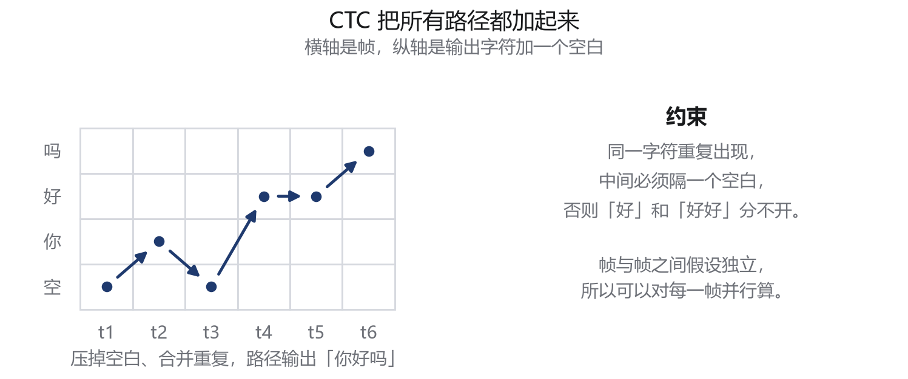

## 语音识别：从波形到文字

一个做客服质检的公司接过一单：客户有八千小时的坐席录音，要在两周内全部转成文字，然后按关键词做合规检查。他们先用了一个开源的语音识别模型，单卡跑了一天，算下来只处理了三百小时。按这个速度，八千小时要二十六天，赶不上交付。

问题出在两个地方。一是他们用的是非流式的批处理模型，为了把长音频跑完，得先切成三十秒一段再拼，切点前后各丢几个字；二是没做并行，单卡单进程，连批处理都没开。改完之后，同一张卡的处理速度到了每小时二十小时音频，八千小时两天跑完。

这件事说明语音识别的工程形态和视觉很不一样。视觉的瓶颈是 token 数量和显存，语音的瓶颈是**时长**——音频的每一秒都在产生新的输入，而人类的语速不会因为你算力不够就变慢。

### 一秒钟音频有多少个数

先把量级搞清楚。电话和会议录音通常采样率 16 kHz，意思是每秒记录一万六千个振幅值。每个值用 16 位整数存，一秒钟就是 32 KB，一小时 115 MB。

把这样的原始波形直接喂给 Transformer 是不现实的。一秒一万六千个位置，十分钟就是九百六十万个位置，注意力矩阵根本算不动，而且相邻采样点高度冗余——语音的变化尺度在几十毫秒，不在微秒。

所以第一步永远是提特征。标准做法是分帧：取 25 毫秒的窗口，每隔 10 毫秒挪一次，每帧算一个频谱，再压到 80 个梅尔刻度上的能量值。

于是：

$$\text{每秒帧数}=\frac{1000}{10}=100,\qquad \text{每秒特征数}=100\times80=8000$$

一秒钟一万六千个采样点被压成八千个数，序列长度降到原来的五十分之一。一小时音频得到 36 万个时间步，每个 80 维。这个长度对注意力来说仍然很长，但至少能处理了。

这里有个容易忽略的细节：25 毫秒的窗口对语音是合适的，因为一个音素的时长大约在 50 到 200 毫秒；但对音乐不合适，音符的起音比语音快得多。所以做音乐识别的模型会用更短的窗和更高的采样率。

### CTC：不知道对齐在哪，就全加起来

有了特征序列，接下来要把它变成文字。难点在于对齐：输入是 36 万个时间步，输出是几百个字，哪个字对应哪几帧，没人标过，也没法标。

CTC 的思路很干脆：不要求知道对齐，把所有可能的对齐都算一遍。

具体做法是引入一个空白符号，允许模型在任意帧输出"什么也没有"。给定长度为 $L$ 的答案，先把它扩成含空白的序列，长度 $2L+1$；然后在 $T$ 个时间步上，每步可以输出当前符号、前进一个符号、或者停在原地。所有能通过"合并重复、删掉空白"得到同一段文字的路径，都算正确对齐。

训练目标是把所有合法路径的概率加起来，让这个和最大：

$$P(y\mid x)=\sum_{\pi\in\mathcal{B}^{-1}(y)}\prod_{t=1}^{T}P(\pi_t\mid x_t)$$

这个式子在说什么：$\pi$ 是一条逐帧的路径，$\mathcal{B}$ 是把路径压成最终文字的操作（先合并连续重复，再删空白），$\mathcal{B}^{-1}(y)$ 是所有能压成 $y$ 的路径。外层求和表示"这些路径随便哪一条都算对"，内层连乘是路径的概率。

直接枚举所有路径是指数级的，实际用动态规划算，这就是前向后向算法。复杂度是 $O(T\cdot L)$，36 万帧乘几百个字，可以接受。

CTC 有一个很强的假设：每一帧的输出互相独立。写在公式里就是每帧各算一个 $P(\pi_t\mid x_t)$，再把整条路径的概率连乘起来。每帧只看自己那一列，不看前后。这让训练变得简单（可以对每帧并行算损失），也让流式变得天然（来了新帧就能算），但语言层面的约束完全没有了：模型不知道"期终"比"期中"更可能，只能靠后面接一个语言模型来纠。

### 注意力解码：让模型自己学对齐

另一种解法是编码器加解码器，用交叉注意力做对齐。

编码器把特征序列压成一组隐状态；解码器逐个生成文字，每生成一个，用注意力在编码器的输出上"看"一眼。训练时用真实的上文作为输入（teacher forcing），损失是每个位置上的交叉熵：

$$\mathcal{L}=-\sum_{t=1}^{L}\log P_\theta\bigl(y_t\mid y_{<t},\,h_{1:T}\bigr)$$

$h_{1:T}$ 是编码器的全部输出。这个式子在说：给定整段音频的编码和已经生成的字，预测下一个字。

它和 CTC 的差别很关键。CTC 假设帧独立，注意力解码不假设，它可以用上下文来消歧——"期终考试"和"期中考试"发音一样，但前文说了"期末考试周"，注意力机制能把信息带过来。

代价有三。第一，它需要整段音频的编码结果，天生不适合流式。第二，注意力对齐可能跑偏，出现漏字、重复生成（同一个字连续输出十几遍）。第三，训练比 CTC 难收敛，通常需要 CTC 做辅助损失来稳定。

所以真实的系统往往是混合的：训练时 CTC 和注意力损失加权相加，推理时用注意力解码，再用 CTC 的结果做对齐约束。这种组合在实践中比任何单一方案都稳。

### 流式：切块大小决定延迟

语音助手必须边说边出字，这就要求模型只能看已经听到的部分。做法是把音频切成小块（chunk），每次送一块进去。

块的大小直接决定延迟。取 320 毫秒一块，那么用户说完一个词之后，模型至少要等到这个块填满才能处理，再加上计算时间，端到端延迟约 400 到 500 毫秒。块取 640 毫秒，延迟翻倍，但每块的上下文更长，准确率略好。

还有一个技巧叫前瞻：块与块之间留一小段重叠，让模型在输出当前块时能看到后面一点点音频。前瞻两帧（约 200 毫秒）通常能让准确率接近非流式模型，代价是延迟又加 200 毫秒。

即便如此，流式输出还是会反复修改。模型在第 3 块输出了"今天天气不"，第 4 块进来之后发现应该是"今天天气不错"，就得回头改。工程上的做法是只把"稳定"的部分显示给用户：连续两块给出相同结果才确认输出（这个策略常被称作本地一致性），其余的留在缓冲区等下一块验证。

这个策略的代价是可感知的延迟增加（要等两块），收益是用户不会看到文字闪来闪去。产品上通常让"已确认"的字正常显示，"未确认"的字用浅色显示，用户在心理上能接受。

### 三种结构的选择

把三种主流结构摆在一起，选择标准其实很清楚。

| 结构 | 对齐方式 | 能否流式 | 精度 | 训练难度 |
|---|---|---|---|---|
| CTC | 边缘化所有对齐 | 天然支持 | 中 | 低 |
| 注意力编解码 | 学出来的软对齐 | 需改造 | 高 | 中 |
| RNN-T | 预测网络加联合网络 | 天然支持 | 高 | 高 |

CTC 最简单，适合"够用就行"的批量转写。注意力编解码精度最高，适合离线场景，比如会议记录、字幕生成。RNN-T 把两者结合：用一个预测网络吃已输出的文字，一个编码器吃音频，两者在联合网络里逐帧决定"是输出一个字，还是输出空白"，因此既能流式又有语言上下文，代价是训练和推理都更复杂。

手机上的离线语音输入基本都用 RNN-T 这一类结构，因为它必须在本地、必须流式、必须省电。

### 中文为什么更难

同样一个模型，英文上词错率能到三四个点，中文上往往要差一截。不是模型偷懒，是中文本身的问题多。

**同音字。** 中文只有约一千三百个音节，常用汉字三千五，平均每三个字共享一个读音。"期终"和"期中"、"公式"和"公事"、"权力"和"权利"，在声学上完全一样。所以语言模型在中文 ASR 里的权重比英文更重，光靠听是分不出的。

**分词歧义。** "南京市长江大桥"可以被断成好几种，每种都语法通顺。输入是字，输出也是字，看起来不用分词，但语言模型的打分实际隐含了分词假设。训练数据的切分方式会影响结果。

**多音字。** "行"在"银行"和"行走"里不同，"重"在"重要"和"重复"里不同。模型需要看上下文才能定，而同音字问题刚好相反：这种情况下上下文明明是有的，模型却可能因为训练数据不平衡而选错。

**数字与单位。** 用户说"三千五百块"，输出应该是"3500 元"还是"三千五百块"？这叫逆文本规范化。口语里的"幺""勾""两""百八十"都要映射。这块常被当作后处理，但它对下游抽取的影响比字错更大——金额错一位就是事故。

**标点与断句。** 原始输出没有标点，也没有句子边界。加标点看似简单，实则要看很长的上下文：同一句话，加不加逗号意思可能相反。现在通常用一个独立的轻量模型做，输入是识别结果，输出是带标点的文本。

**中英混说。** "把这个 feature 关掉"这类句子，需要模型同时维护两套发音习惯。规模化产品里这类句子占比不低，但训练数据里往往偏少。

### 算一遍：一万小时音频的钱和时间

回到开头那单活，把账算完整。

**存储。** 16 kHz、16 位、单声道，每秒 32 KB：

$$10000\ \text{小时}\times3600\times32\ \text{KB}\approx1.15\ \text{TB}$$

这还只是原始音频。如果要保留转写结果、对齐时间戳、说话人标签，总存储会到两三个 TB。

**计算。** 用实时率（RTF）衡量模型速度，RTF 等于处理时间除以音频时长。一个 GPU 上的中小型模型，批量模式下 RTF 能到 1/100（一百小时音频一小时跑完），流式模式下大概 1/20。

按 RTF 1/100 算，一万小时需要 100 个 GPU 小时。按每小时两美元算，两百美元。

**为什么实际开销远大于这个数。** 三个原因。一是切分与拼接：长音频要切段，切点附近的字容易错，需要重叠重跑。二是失败重试：静音段、噪声段、多人抢话段会产生异常输出，流水线要重试或降级。三是抽检：转写结果要按比例人工校对，一个小时的校对成本往往是一小时转写算力成本的几十倍。

所以真实的一万小时项目，总成本里算力占不到一成，人工校对占大头。这也是为什么 ASR 产品的定价通常不按算力算，按分钟数算——它卖的是“不需要你校对”的那个把握。

### 一个失败案例：专名与热词

有个做医疗转写的产品，总体词错率只有八个点，但医院退货了。

原因是药名。医生说话时会报药名，“甲氨蝶呤”“阿托伐他汀”“硝苯地平”，这些词在通用训练数据里出现频率极低，模型基本靠猜，猜出来的字读音对、写法错。医生没时间一个个改，整个产品就不能用。

这类问题有一个标准解法叫热词偏置：把业务词表（药名、人名、机构名）作为额外输入，让模型在解码时提高这些词的得分。实现方式有两种，一种是在解码器的输出层临时提高这些字序列的 logit，另一种是在训练时就把词表作为条件输入。前者不需要重训，上线快；后者效果更好，但要把词表编进训练流程。

热词偏置有一个副作用：词表里的词被过度偏爱时，普通词会被误识别成热词。“今天血压正常”可能被改成“今天血压症”（因为“血压症”在词表里而“正常”不在）。所以词表不能太大，也不该把整个科室的词都塞进去，通常控制在几百到几千条。

### 评测：别只看一个数字

词错率的定义很简单：

$$\text{WER}=\frac{S+D+I}{N}$$

$S$ 是替换，$D$ 是删除，$I$ 是插入，$N$ 是参考文本的字数。三者相加除以总字数。

这个数字的问题是它把不同类型的错误等价看待。错一个“的”和错一个金额，在 WER 里都是一次替换。

实际评测要按内容分类：数字、人名、专业术语、口语填充词各算一遍。很多产品的投诉全集中在“号码老错”，而总体 WER 只有五个点——因为数字只占字数的很小一部分，但它们全错了。

还有两个指标值得看。一是**实时率**，它决定成本；二是**首字延迟**，它决定体验。前者在批量场景重要，后者在交互场景重要，两者的优化方向完全相反：批量要大 chunk，流式要小 chunk。

### 长音频的三个坑

超过五分钟的音频，准确率会明显下降，而且往往不是模型变差了，是流水线把它切坏了。

第一个坑是硬切。为了并行，很多实现把长音频按固定长度切开（比如三十秒一段），切点落在词中间。两段分别识别，前半段听到半个音，后半段也听到半个音，两边各自猜，拼起来就多一个字或者少一个字。修法很简单：切在能量低谷处。人说话有自然停顿，检测到 200 毫秒以上的静音再切，错误率能降一截。

第二个坑是静音。一段一小时的会议录音里，真正有人说话的时长可能只有四十分钟。剩下的二十分钟如果也送进模型，模型会硬着头皮输出字。所以需要先做语音活动检测，把静音去掉，转写完再把时间戳映回去。

第三个坑是多人。两人抢话时，麦克风录到的是叠加信号，模型会把两句话混成一句。要解决得先做说话人分离：判断哪几段属于同一个人，分别转写，再加上“说话人 1”“说话人 2”的标签。分离本身也会错，尤其音色接近时，所以产品上通常让用户能手动纠正。

### 算一遍：流式的延迟预算

把流式 ASR 的延迟拆开，看每一块占多少。

一块 320 毫秒，前瞻两帧（200 毫秒），编码器每块计算 30 毫秒，解码器 20 毫秒，本地一致性策略要求等两块确认：

$$320+200+30+20+320=890\ \text{毫秒}$$

也就是说，用户说完一个词，最快也要将近一秒才能看到确定的文字。如果把块缩到 160 毫秒、前瞻一帧，延迟降到 400 毫秒左右，但准确率会掉一个多点。

交互式字幕、实时会议纪要用前者，语音搜索、输入法用后者。同一个模型可以同时支持两种模式，只是参数不同。

### 语音直接进大模型

前面讲的所有方案都是“先转文字，再理解”。还有另一条路：把音频也变成 token，和文本 token 放进同一个序列。

做法是用一个音频编码器把每 20 毫秒的音频压成一个向量，再过量化器变成离散码（一个码就是一个“音频词”），然后当成普通 token 喂给语言模型。这样模型可以直接回答“他说话的语气是生气吗”这类问题，因为语气信息从来没被转成文字，也就没丢。

代价很具体。一秒音频大约 50 个码，一小时就是十八万个 token，比同样内容的文字（约两万字）贵九倍。而且要训练模型把“声音的词”和“文字的词”对应起来，需要大量带转写的语音数据。

所以当前的产品形态大多是混合的：理解走文字，保留语气时走音频 token。两者不是替代关系，是两个不同价位的工具。

### 口音、方言与远场

普通话训练集上训出来的模型，遇到带口音的普通话会掉点，遇到粤语、闽南语、川渝方言会掉很多。这不是模型不够大，是分布不对。

工程上有三种应对。最简单的是混数据：把方言语料按比例掺进训练集。难点是方言语料本来就少，而且标注贵。第二种是分路：先判断口音类型，再路由到专门的模型。第三种是自适配：用用户的少量语音做一次微调，把模型往他的音色和口音上偏一点。

还有一类问题跟口音无关，叫远场。手机贴近嘴巴时信噪比很高，模型很轻松；会议室的麦克风在两米外，声音先直达后反射，混响把辅音拖长，“四”和“十”变得难以区分。远场的最佳解法不是更大的模型，是多麦克风阵列加降噪，把问题在信号层解决掉。

这条经验值得记住：**很多语音识别的“模型问题”，实际上是信号处理问题**。先看看输入音频的信噪比和混响时间，再决定要不要换模型。

### 这一章的主线

语音识别的技术选择可以归结为三个问题：要流式还是离线，要简单还是准确，要通用还是垂直。

流式与离线决定了模型结构（RNN-T 或者注意力编解码），简单与准确决定了要不要 CTC 辅助，通用与垂直决定了热词和领域数据的分量。三个选择互相牵制，没有全面占优的方案。

落到工程上，先问三个数：音频总时长、能接受的首字延迟、目标领域的专名密度。前两个决定架构，第三个决定要不要单独做热词和领域微调。这三个数定不下来，选型就只能凭感觉。

还有一个经验：先量再调。把用户的真实音频切出十分钟亲耳听一遍，比跑十组对比实验有用。信噪比、口音、抢话，这三件事只有听才能发现，指标上看不出来。

下一章讲反向的过程：怎么让模型说话。它的约束不是时长，而是延迟——用户能忍受听不清，但不能忍受等太久。
