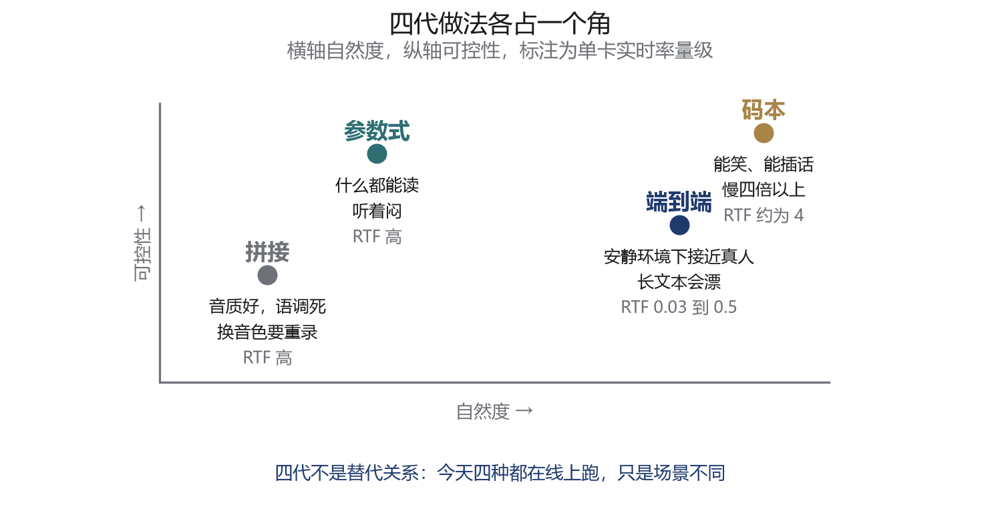

## 语音合成：让模型说话

有声书平台的技术选型会上，争论通常不在音质，而在"像不像人在读"。用现成的合成引擎跑一段小说，字都念对了，普通话也标准，但听十分钟就累：每句话的语调曲线都一样，该停的地方不停，不该停的地方断句，情绪永远停在"新闻播报"那一档。

换成真人录制的有声书，同一段文字，听众能听出紧张、犹豫、调侃。这些信息文本里一个字都没有，全靠声音补上去。语音合成要做的，就是把这些"文本里没有的东西"从上下文里推断出来。

这件事比语音识别难在一点：识别是压缩，合成是生成。压缩可以容忍模糊，生成不能——听众对一段合成语音的容忍度，比对识别结果的容忍度低得多。识别错一个字，上下文能猜；合成错一个多音字，整段的说服力就没了。

### 为什么不直接生成波形

最直接的想法是让模型从文本直接吐出 16 kHz 的波形，一秒钟一万六千个采样点。

问题是这些采样点之间的相关性太强。相邻两个点的值几乎一样，模型要花绝大部分容量去学"这一个点和上一个点差不多"，而真正有意义的信息（音素、音高、音色）只占很小一部分。这跟图像生成里"直接在高分辨率像素上做扩散太贵"是同一类问题。

工程上的做法是插一层中间表示：梅尔频谱。把波形按 25 毫秒分帧，每帧算 80 个梅尔刻度上的能量，帧移 10 毫秒。于是：

$$\text{一秒钟的表示长度}=100\ \text{帧}\times80\ \text{维}=8000\ \text{个数}$$

对比原始波形的一万六千个数，压缩比只有二比一，看起来不多，但性质变了：频谱里每个数都有明确的物理含义（某个频带的能量），相邻帧的相关性弱得多，模型学起来容易。

更关键的是它把问题拆成了两段。文本到频谱这一段管"说什么、怎么说"（音素、时长、语调）；频谱到波形这一段只管"把频谱还原成声音"（这段叫声码器）。两段可以分别训练、分别替换，这是现代 TTS 系统的基本结构。

### 三代做法

**第一代：拼接。** 预录几千个音素、音节、词的录音片段，合成时按文本拼接，再做平滑。音质在片段内部很自然，因为那就是真人录音；但在拼接处会有明显的跳变，而且语调是固定的，没法表达疑问、强调。换音色意味着重新录一整套，成本极高。今天只在极少数嵌入式场景还能见到。

**第二代：参数式。** 用统计模型（早期是隐马尔可夫模型，后来是神经网络）从文本预测声学参数：基频曲线、频谱包络、时长。再由一个声码器把参数还原成波形。灵活度高，任何文本都能读，音色可以通过调整参数改变。缺点是参数化本身丢信息，听起来"闷"，像隔着一层布。

**第三代：神经端到端。** 文本直接映射到梅尔频谱（或更底层的表示），再由神经声码器还原波形。两段都是神经网络，中间不需要人工设计的参数。当前的主流，自然度在安静环境下已经接近真人录音。

**正在成形的一代：码本加语言模型。** 用一个音频编解码器把语音压成离散码（每秒几十个），然后用语言模型像生成文字一样生成这些码。好处是可以直接复用文本模型的全套技术：大规模预训练、上下文学习、指令控制。坏处是推理慢，而且多码本的设计很讲究。

四代不是替代关系。今天的产品里，拼接还用在超低功耗设备上，参数式还在一些老系统里跑，端到端是主力，码本路线在做"能对话的语音"。

### 四代做法：同一件事，四种成本结构

把四代摆在一起看，会发现它们不是“越来越好的同一个东西”，而是四种不同的成本结构。

| 代 | 中间表示 | 单小时算力 | 换音色成本 |
|---|---|---|---|
| 拼接 | 预录片段 | 几乎没有 | 重录全套 |
| 参数式 | 基频、频谱包络 | 低 | 训一个人模型 |
| 端到端 | 梅尔频谱 | 中（RTF 0.5） | 微调几分钟音频 |
| 码本 | 离散声学码 | 高（RTF 约 4） | 几秒参考音频 |

四行的关键差异在“中间表示”那一列。越往下，表示越接近声音本身，模型能控制的东西越多（停顿、笑声、语气），但每秒要生成的 token 也越多，成本按同一个方向上涨。

拼接和参数式今天还在用，但位置很边缘：前者用在不能联网、不能跑神经网络的设备上（玩具、老式导航）；后者用在算力极低但又需要任意文本的场合。它们不是技术落后，是成本约束下的唯一选择。

真正值得讨论的是后两代的取舍。端到端把问题拆成“文本到频谱”与“频谱到波形”两段，两段都能独立替换，所以音质、音色、语速可以分开调；码本路线把语音变成“声音的词”，能直接复用文本模型的全部技术，代价是推理慢一个量级。

一个具体的数字对比：生成 10 秒语音，端到端非自回归的 RTF 能到 0.03（三百毫秒跑完），码本路线每秒 200 个 token、每秒生成 50 个 token，需要 40 秒。差别摆在这里，产品选型就不难了：只要场景允许一百毫秒以上的延迟，端到端是默认答案；只有需要“笑声、插话、语气词”这类文本表达不了的东西，才值得付码本那笔钱。

### 自回归的代价：算一遍

第三代里最经典的实现是自回归的：解码器一帧一帧地生成频谱，每生成一帧，把它喂回去预测下一帧。

这个"一帧一帧"意味着无法并行。生成 5 分钟的有声书段落：

$$300\ \text{秒}\times100\ \text{帧/秒}=30000\ \text{帧}$$

三万次前向，每次都要读一遍之前的所有帧。即使单次前向只要 5 毫秒，也要 150 秒——生成 5 分钟的音频要 2.5 分钟，实时率（RTF）0.5。这还没算声码器。

对有声书这类离线场景，RTF 0.5 完全可以接受（一晚上能合成几十本书）。但对实时对话，这是灾难：用户说完话，等 2.5 分钟才听到回复。

解决办法是非自回归。核心思路是先决定"每个字读多长"，然后一次性生成所有帧。时长从哪来？训练一个时长预测器，输入是文本的音素序列，输出是每个音素占几帧。推理时先算时长，再按总帧数一次性生成频谱。

$$T_{\text{总}}=\sum_{i=1}^{L}d_i$$

$d_i$ 是第 $i$ 个音素的帧数。这个式子在说：总长度等于各音素时长之和。有了它，整个频谱的形状就确定了，可以并行生成。

代价是丢掉了自回归的"全局连贯性"。自回归模型在生成每一帧时能看到前面所有帧，所以语调曲线是连贯的；非自回归模型一次出全部，容易出现音高跳变、重音位置不对。工程上的弥补办法是加一个韵律模型先预测音高和能量曲线，把它作为条件输入。

### 声码器：从频谱到波形

声码器这一段的输入是 80×T 的频谱，输出是长度为 16000T 的波形，是一个典型的上采样问题。

早期用声码器拼接或 Griffin-Lim 之类的信号处理方法，音质一般。神经声码器的代表是 WaveNet：用空洞卷积逐点生成波形，每生成一个采样点，感受野覆盖前面几百个点。

$$1,\ 2,\ 4,\ 8,\ \dots,\ 2^{k}\ \text{的空洞率叠加，感受野}\approx 2^{k+1}\ \text{个采样点}$$

这个式子说的是：空洞卷积按 2 的幂次扩大间隔，几层叠起来感受野指数增长。要覆盖 25 毫秒（400 个采样点），大概需要 9 层。

逐点生成同样慢。所以后来的声码器改成一次生成一大块（比如一次出 256 个点），再用多个上采样层把粗粒度的特征逐步细化。这类结构把声码器的实时率从 0.1 提到 50 以上，是 TTS 能进产品的关键一步。

牺牲的是什么？逐点生成的模型对相位细节掌握得更好，听起来更"干净"；分块生成的模型偶尔会有轻微的金属感或者气息噪声。在手机扬声器上听不出差别，在好的耳机上能听出来。

### 音色：从一分钟录音到三秒录音

音色克隆是 TTS 商业化最直接的需求：用户希望听到的不是"一个好听的声音"，而是"我的声音"或者"我们品牌代言人的声音"。

技术上，音色被编码成一个向量（说话人嵌入），从参考音频里提取出来，作为合成时的条件。传统做法需要几分钟到几小时的录音，为每个说话人训一个模型；后来的做法是一两分钟的微调；再往前一步是零样本克隆，只要三五秒的参考音频。

零样本克隆能成立，靠的是把"说什么"和"谁在说"拆开建模。声学模型的大部分参数负责语言到发音的映射，一小部分参数（或者一个条件编码器）负责音色。换音色只需要换那个小模块，不碰主体。

代价是稳定性。三秒的参考音频里可能只有平调的陈述句，没有疑问句、没有情绪变化。用这样的参考去合成一段兴奋的叫卖，合成结果很可能滑向平稳——它没有参考，只能猜。工程上的弥补办法是让用户录一段规定内容的参考音频，或者允许多段参考取平均。

这带来一个绕不开的风险：音色克隆和伪造只有一线之隔。产品上常见的约束是：只允许克隆本人声音（验证码或声纹验证）、合成音频埋水印、提供检测接口。这些手段能提高门槛，但没法根除。

### 用文字控制情绪

光有音色还不够。同一个声音说"太好了"和"太好了吧"，情绪完全相反，而文本本身不带这个信息。

当前的两种控制方式差别很大。一种是标签控制：在文本里插入情感标记（高兴、悲伤、急促、耳语），模型按标记调整音高、语速、能量。优点是可控、可复现；缺点是要有人写标签，而且标签的粒度粗。

另一种是自然语言指令：直接写"用有点疲惫但强装轻松的语气读"，让一个语言模型把指令编码成条件向量，注入合成模型。优点是门槛低，缺点是结果不稳定——同一句指令跑两次，语气可能差挺多，因为"疲惫"在训练数据里没有统一定义。

工程上的做法通常是两者并用：默认走指令，关键位置用标签钉死。真正难的地方不是生成，是评测：怎么判断合成的语气"够不够疲惫"？目前只能靠人听，没法自动化。

### 算一遍：延迟预算怎么分

实时语音对话要求首包延迟在 300 毫秒以内，否则用户会觉得对方"卡了一下"。把这 300 毫秒拆开：

| 环节 | 目标耗时 |
|---|---|
| 文本前端（分词、注音、韵律） | 20 ms |
| 声学模型首块（前 20 帧） | 60 ms |
| 声码器首块 | 30 ms |
| 网络传输 | 50 ms |
| 播放器缓冲 | 80 ms |
| 余量 | 60 ms |

这里的关键是"首块"而不是"整句"。如果把整句合成完再播，一个 10 秒的回答要等两三秒，延迟里全是等待。流式合成的做法是：先把前 200 毫秒的音频合成出来发出去，同时继续合成后面的。

首块太小会出问题。声码器需要足够的上下文才能把坑坑洼洼的频谱变成平滑的波形，块太小（比如 50 毫秒）会导致边界处的音高不连续，听起来像碎玻璃。经验值是每块不小于 200 毫秒，块间重叠 20 到 40 毫秒做交叉淡入淡出。

这三个数字（块大小、重叠、缓冲）互相牵制。块大则延迟高但平滑，块小则反之。调这几个参数的工程量，往往比换一个模型还大。

### 实时系数必须小于一

上面那张预算表是“到首包”的，还有一个更硬的门槛：合成速度必须追得上播放速度，否则一定会中途卡。

这个条件写成不等式：

$$\text{RTF}\times\text{安全系数}<1$$

安全系数取 1.5 左右。意思是合成要比播放快一半，才能在网络抖动、GC、上下文切换时不断流。换成数字：RTF 小于 0.67。

端到端非自回归模型很容易达到（0.03 到 0.1），自回归模型就很难（0.5 上下），而码本路线直接不及格（RTF 约 4，比实时慢四倍）。这里容易出现一个符号混乱：有人用“实时率 20”表示比实时快二十倍，也有人用 RTF 0.05 表示同一件事。两者互为倒数，看文档时先确认用哪一种，否则预算会差两个量级。

流式合成还得看块级 RTF，而不是整句。一块 200 毫秒的音频，必须在 200 毫秒内合成完，否则下一块还没准备好，播放器就空了。以声学模型每块 60 毫秒、声码器 30 毫秒计，块级总耗时 90 毫秒，占用一半，看上去安全；但它是在“单路”下测的，多路并发时每路都会变慢，所以真实的块级 RTF 要按峰值并发算。

这也是为什么实时语音产品必须做背压：当合成追不上时，要么把回答切短，要么提前插入“嗯”“让我想想”这类填充语，让播放器有东西放。前者是产品决策，后者是工程手段，两者比模型提速便宜。

### 前端：真正容易错的地方

模型的自然度已经够用之后，用户投诉的集中点会转到琐碎的地方，而这些问题大多出在文本前端。

**多音字。** "行""重""长""还"，这些字的读法取决于语境。前端通常用一个小的分类模型根据上下文判断，准确率很高但不是百分百。一个小时的音频里错两三个，听众一定会听到。产品上的做法是允许人工标注：编辑器里把可疑的字标黄，让作者听一遍改掉。

**数字与单位。** "2026"读"二零二六"还是"两千零二十六"，"3.5%"后面的"百分之"怎么放，"1/2"读"一半"还是"二分之一"。这些规则多得像字典，而且领域相关：财务文本和小说文本的读法不一样。

**英文与缩写。** "AI"读字母还是读"爱"，"GPU"读字母还是读单词，"200kg"里的 kg 读"千克"还是"公斤"。处理不好会出现中英混杂时音高突变，因为两套发音习惯的音高范围不同。

**韵律。** 同一句话，重音落在不同位置，意思完全不同。文本里没有重音标记，模型只能从上下文猜，猜错了意思就变了。这就是为什么专业配音还需要 SSML 这类标记语言，让作者手动指定停顿、重音、语速。

### 评测：三个数字和一个陷阱

TTS 的评测有三个常用指标。

主观自然度（MOS）：找人听一段音频，打 1 到 5 分。优点是直接对应体验，缺点是贵、慢、方差大。两个人对同一段音频的打分可能差 0.5 分，所以要控制变量（同一批听众、同一套设备、随机顺序）。

相似度：克隆音色与目标音色的接近程度，通常用说话人验证模型算余弦相似度。这个指标很容易被讨巧：把音高和语速调得像，相似度会上去，但听感并不像。

可懂度：把合成音频再送回语音识别，看词错率。它的好处是客观、可重复，而且直接反映"听不听得清"。缺点是识别模型对合成音频有偏好，某些失真它反而不敏感。

还有一个陷阱：长文本稳定性。评测集通常是一两句短句，而产品要合成几千字的连续文本。短句上 MOS 很高的系统，读十分钟后可能出现语速逐渐加快、音高缓慢下移、句尾气息消失。这些问题在短句评测里完全看不到，只有连续听才能发现。

所以工程上要专门测长文本：取一篇三千字的文章，连续合成，让评测员完整听一遍，记录"从哪里开始变得不自然"。这个位置往往比平均分更有信息量。

### 一个失败案例：多音字与长文本

有个做有声书的团队，上线后收到一条很具体的差评：《红楼梦》里"贾母笑道"的"道"被读成了"道路"的"道"（第四声）而不是"说道"的轻声。

这个错很典型。前端的多音字模型是按通用语料训的，"说道"这个词在现代汉语里不常见，模型默认选了更高频的读音。修法不是换模型，是给项目加一份专名词典，把书名、人名、固定搭配全列进去。

第二个问题更隐蔽：读到第三十分钟时，旁白的语速比开头快了约一成。原因是分块合成时，每块的时长预测独立进行，而前一块的实际音频长度与预测值有微小偏差；误差在块间累积，越往后越明显。修法是全局归一化：先算出整章的总时长目标，再按比例给每块分配预算。

两个问题都不在模型能力范围内，而在工程细节里。语音合成的技术已经足够好，产品差距基本都在这些地方。

### 码本路线为什么慢

把语音离散成码再交给语言模型生成，听起来很优雅，实际跑起来会碰到一个很具体的数字。

一个音频编解码器通常每秒输出 50 个码（有些是 25，有些是 75），而且为了音质要用多个码本叠加，常见是 4 到 8 个。取 4 个码本、每秒 50 帧，就是每秒 200 个 token。

一段 10 秒的回答：

$$10\times200=2000\ \text{token}$$

语言模型每秒生成 50 个 token（这个数字对消费级部署很现实），需要 40 秒。而用户说完话到听到回应，能接受的上限是两三秒。差了一个数量级。

这就是为什么码本路线一开始只能做研究演示。工程上的改进有三条：减少码本数（音质掉一点）、并行预测多个码本（一次出 4 个 token，速度乘四）、或者只对语义层用自回归，声学细节交给非自回归的声码器。第三条是目前产品里最常见的折中。

### 算一遍：一千本有声书的排产

回到开头那个有声书平台。假设一本书平均 8 小时成品音频，要合成 1000 本，共 8000 小时。

用非自回归模型，单卡实时率 20（一小时音频三分钟跑完）：

$$8000\ \text{小时}\div20=400\ \text{GPU 小时}$$

用八卡跑，50 小时完成，两天多。算力成本按两美元一卡时算八百美元。

用自回归模型，实时率 0.5，同样八卡：

$$8000\div(0.5\times8)=2000\ \text{小时}$$

将近三个月。这就是为什么有声书平台必须用非自回归，哪怕音质差一点。

但真正的成本不在算力，在人工。一千本书的人工校对（听一遍标出多音字和断句错误）按每小时成品音频 30 元算，是 24 万元，大约是算力成本的四十倍。这个比例决定了产品形态：降低合成成本没用，得降低校对成本——所以编辑器、专名词典、一键重录这几个功能比模型升级重要。

### 算一遍：音色克隆的存储与训练成本

一个要做“千人千声”的产品，先把账算清楚。

假设每个用户录一分钟参考音频，平台有十万用户。存储：16 kHz、16 位，一分钟约 1.9 MB，十万用户是 190 GB。再加上嵌入向量（每个几 KB），总共两百 GB 以内。存储不是问题。

训练是问题。如果每个用户微调一个小适配器（比如两千万参数），训练一百步，单卡耗时约两分钟：

$$100000\times2\ \text{分钟}\approx3300\ \text{GPU 小时}$$

四卡跑一个月。这不是一次性开销，用户改了音色要重训，模型升级了要全量重训。

所以产品上几乎都选零样本克隆：不做微调，推理时把参考音频的嵌入当作条件。代价是稳度差一点，收益是每个新用户只多一次编码，成本几乎为零。

什么时候值得微调？用户会用很久、对相似度要求高、而且愿意等。有声书主播、虚拟主播、企业品牌音，这三个场景值得；一次性用户不值得。

### 对话式语音的额外要求

把 TTS 用在对话里，标准和用在朗读里完全不同。

朗读要求每个字都清楚；对话要求“能被打断”。用户听到一半发现理解错了，会直接开口，系统必须立刻停止播放、清除缓冲、转入识别。这个动作叫打断处理，它要求播放器、识别器、合成器三者共享一个时钟，否则会出现“已经停了但还在生成”的浪费。

对话还要求语气词。真人说话有“嗯”“那个”“对”，这些词没有语义，但去掉之后听起来就像机器。工程上的做法是让语言模型在生成回复时自己决定插不插语气词，而不是在合成阶段硬加。

还有一个细节是笑。人在轻松场景会笑，笑声不是词，没有拼音，字库里也找不到。码本路线的优势在这里体现：它可以直接生成“笑声”这段声音，因为它生成的就是声音本身，不是从文字映射过去的。

### 中文前端：四类坑的具体数字

模型自然度够用之后，投诉会集中到前端，而前端的错误几乎全是“规则”：

**多音字。** 现代汉语常用多音字大约七百个，但真正高频的只有三十个左右（行、重、长、还、发、为、得、地、了、差、弹、传……）。这三十个覆盖了大部分错误。它们难的地方在于读音取决于词而不是字：“银行”与“行走”，“重复”与“重量”，“长大”与“长度”。一个小的分类模型能做到九成五以上，但一小时的音频里有几十个多音字，错两三个听众就能听出来。

**变调。** 两个三声连读时，前一个变二声：“你好”实际读成“ní hǎo”。三个三声连读更复杂，要看词的结构（“展览馆”是二声二声三声，“纸老虎”是二声三声三声）。不做好变调，合成音听起来就“像外国人在读”。这条规则模型能自己学，但学得不好，显式加一条规则成本更低。

**儿化与轻声。** “花儿”是一个音节，不是两个；“妈妈”第二个音节是轻声，不是一声。这两件事决定了合成音是“念字”还是“说话”。

**数字与单位。** 同一个“2026”，在年份里读“二零二六”，在数量里读“两千零二十六”；“1/2”读“二分之一”；“3.5%”读“百分之三点五”；电话号码逐位读，且“1”要读“幺”。这些规则多得像字典，且领域相关：财务文本与小说文本的读法不一样。

工程上的做法是分两层：一个通用规则引擎处理八成的常见情况；一个领域词表补剩下的两成。后者是上线后一点点积累起来的，比如“这支基金代码 162411”里的数字得逐位读。没有词表的产品，在长尾上永远会错。

### 算一遍：一千路并发要多少张卡

把并发换算成卡数，能看清成本到底在哪里。

假设：1000 路同时在线（客服中心的工作时间），其中三成时间在说话，也就是 300 路同时在合成；每路要求 RTF 不超过 0.67；单卡端到端吐吞 20 倍实时。

先算总需求：

$$300\times0.67=200\ \text{倍实时}$$

再除单卡吐吞：

$$200\div20=10\ \text{张卡}$$

再加两层余量：一层是峰值波动（早十点与晚八点能差一倍）乘 1.5 倍，一层是延迟余量——不能为了堆批而把首包拉高，实际只能用半批，又乘 1.5。最终落在 22 到 25 张卡。

这个数字里有一个反直觉的地方：**加卡不一定能降延迟**。如果把 300 路拼成大批，GPU 利用率上去了，但最慢那一路的首包会被拖长。所以真实部署会在“拼批”与“延迟”之间取一个每批不超过 16 路的上限，多余的并发用更多的卡接。这也是为什么客服类 TTS 报价不低：不是模型贵，是并发贵。

| 场景 | 推荐路线 | 理由 |
|---|---|---|
| 有声书 | 非自回归 + 长文本稳定 | 离线，追求稳定与便宜 |
| 客服对话 | 流式 + 可打断 | 首包优先，允许音质略降 |
| 短视频配音 | 零样本克隆 | 每个用户一个声，不能重训 |
| 导航与设备 | 拼接或参数式 | 离线、低功耗、词表封闭 |

### 声码器：决定音质也决定吐吞

前面说声码器把频谱变成波形，一句话带过。实际上它是音质的天花板，也是吐吞的瓶颈。

数量级先摆出来。采样率 24 kHz，生成 3 秒音频要输出 72,000 个采样点。这是一个“从 300 帧扩到 72,000 点”的上采样问题，放大两百四十倍。

三种做法各有位置：

| 声码器 | 质量 | 单卡秒产音频 | 适合 |
|---|---|---|---|
| 信号处理（Griffin-Lim） | 发闷、有金属声 | 上百秒 | 离线原型、预算极低 |
| 生成对抗式 | 接近真人 | 五十秒 | 线上主力 |
| 扩散式 | 细节更好 | 五秒 | 离线精品、配音 |

三行的差别不是“好与坏”，是“什么样的错误可以接受”。信号处理方法的错误是相位不准，听感是“发闷”；对抗式方法的错误是偶尔出现不自然的喷气声；扩散式的错误则是慢——它要在七万二千个点上跑十几步。

选型的实操标准很直接：先算每秒需要多少路，再看哪一档的吐吞能接下。一个有声书平台一天要产两千小时，就需要每秒产出 0.83 小时音频，即三千倍实时，扩散声码器直接出局；而一个配音工作室一天只做十分钟，用扩散的完全合理。

### 一个失败案例：块边界上的喀嗒声

有个团队做实时语音助手，实验室里听台词很正常，一上线就被投诉“说话有杂音”。录音回放一听，每个词之间都有轻微的“喀”一声，像旧磁带。

问题在分块合成。他们把一个长句拆成每块 200 毫秒，每块独立合成再拼起来。每块的波形在边界处被硬切，前后的振幅不连续，于是产生一个冲击——这就是喀嗒声。

两个修法叠在一起才有效。一是交叉淡入淡出：相邻块重叠 20 到 40 毫秒，重叠区做线性交叉，振幅就不会突然变。二是相位初始化：每块的声码器不要从零相位开始，而要拿上一块末尾的相位做初值，否则即使振幅连续，波形内部也对不上，听感是“沙沙”声。

两条都不是新发现，但很容易被忘。因为分块合成在代码上只是一句拼接，看不出问题；而模型评估用的是整句合成，根本不会触发这块逻辑。

所以 TTS 的评测必须包含一项：**用与线上完全相同的分块参数合成一段长音频**，然后人听一遍。整句评测与分块评测的差异，往往比模型版本之间的差异大。

### 水印与鉴伪：合成语音的两个门槛

音色克隆到了“三五秒参考”这个程度，另一件事就绕不开了：怎么区分合成音与真人录音。

两种手段方向相反。**加水印**是在生成时埋入隐标记：在不可听频段加微弱能量，或者在相位上做不可感知的扰动。优点是主动、可验证；缺点是一道重编码（转成 MP3、过一道会议软件的重采样）就可能把水印洗掉。所以工业上的水印通常在多个频段重复嵌，并加上纠错码，代价是音质轻微下降。

**鉴伪检测**是不依赖生成方的被动手段：用一个分类器看频谱细节，找合成音才有的痕迹。它的可靠性随生成技术迭代下降得很快，因为每一代新模型都会把这些痕迹变小。所以它只能当辅助信号，不能当唯一防线。

| 手段 | 对重编码的鲁棒性 | 主要风险 |
|---|---|---|
| 不可听频段水印 | 中等 | 被滤波去掉 |
| 相位扰动水印 | 较高 | 音质轻微下降 |
| 鉴伪分类器 | 无（对未见过的新模型） | 迭代即失效 |

工程上的组合是：生成端必加水印，播放端做一次检测并把结果告诉用户（比如“此音频包含合成标记”），同时对高风险场景（冒充熟人、敏感指令）加一道挑战式验证——让用户回答一个不在录音里能拿到的问题。三种手段叠起来也不能完全防住，但能把成本推到多数人不去尝试的程度。

### 一份合成选型清单

同样的思路，把 TTS 的选择折成表。

| 场景 | 结构 | 典型 RTF | 首要指标 |
|---|---|---|---|
| 有声书 | 非自回归 + 词典 | 0.03 | 长文本稳定 |
| 客服机器人 | 流式 + 可打断 | 0.1 | 首包与自然度 |
| 短视频配音 | 零样本克隆 | 0.1 | 音色相似度 |
| 实时翻译口语 | 流式码本 | 约 4，需并行预测 | 保留语气与笑声 |
| 导航与设备 | 拼接或参数式 | 近零 | 离线与功耗 |

第二列与第三列几乎是一一对应的：越靠近真实人声（笑声、语气、插话），RTF 越差。这不是实现水平问题，是“生成声音本身”比“从文本映射到声音”多了一步。

选型时还有一个数字经常被漏掉：并发。RTF 描述的是单路速度，而产品的成本是“并发路数 × RTF”。一个 RTF 0.1 的模型，单卡能支撑十路并发；如果产品同时有一千路在说话，就需要一百张卡。前面算过的那个例子就是这么来的。

最后一列“首要指标”是最容易错的。很多团队把自然度当第一指标，而有声书平台真正退货的原因是长文本漂移，客服真正投诉的是首包慢。把指标选对，比把模型换大更有效。

### 语速与停顿：两个可懂的旋钮

听感好不好，一半取决于字对不对，另一半取决于节奏。而节奏只有两个数真正重要。

**语速。** 中文朗读的舒适区在每秒四到五个字。低于每秒三点五字，听感变呆，而且听众会开始注意“这是合成的”；高于每秒六字，可懂度明显下降，尤其对听障用户。有声书的常见选择是每秒四点二字，比新闻播报略慢，因为听众要想象画面。

**停顿。** 句内逗号后两百到四百毫秒，句号后六百到一千毫秒，段落之间一千二毫秒以上。这三个数字并非玄学：短于这个区间，听感是“赶”；长于这个区间，听感是“卡”。而模型学到的停顿往往偏短，因为它训练用的速档偏快。

| 场景 | 语速（字每秒） | 句间停顿 |
|---|---|---|
| 新闻播报 | 5.0–5.5 | 500 ms |
| 有声书 | 4.0–4.5 | 800 ms |
| 教程讲解 | 3.5–4.0 | 1,000 ms |
| 广告口播 | 5.5–6.0 | 300 ms |

这四个档位不是主观偏好，而是由内容密度决定的：信息密度越高，听众越需要停下来消化。所以直接把语速调快会让“能听懂”变成“听不完”。

工程上的做法是把语速做成一个全局参数，而停顿做成一个与标点挂钩的规则。后者比让模型自由发挥稳定得多，也容易在听感不当时单独调。

### 这一章的主线

语音合成的技术路线已经收敛到"文本到中间表示、中间表示到波形"两段式，剩下的差异在三个地方：用不用自回归（决定速度）、音色怎么控（决定成本）、前端做得多细（决定口碑）。

三个都是工程选择，不是算法突破。真正的难点在于同时满足它们：既要快，又要像，又要每个字都读对。能做到这三点的系统，靠的不是更大的模型，是更细的流水线。

所以评估一个 TTS 方案，不要只听它的演示样例。要一份你自己的文本，读十分钟，听完再决定。演示样例是挑过的，你的文本不是。

下一章讲视频。它把图像的成本乘上时间，把语音的时长约束也叠上来，是三种模态里最贵的一种。
