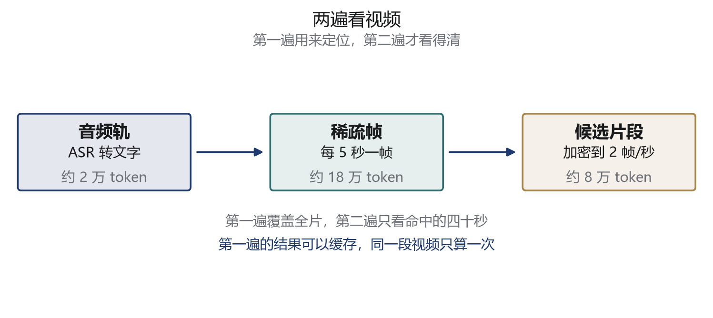
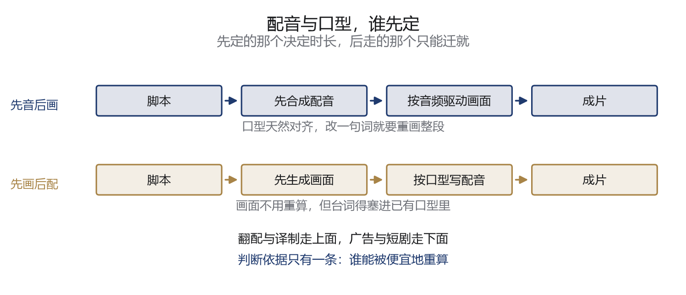

## 视频：把图像的成本乘以时间

一个在线教育平台想做一个功能：学生输入一个问题，系统自动跳到课程视频里讲这个知识点的那一段。他们有二十万小时的课程录像，希望"像搜索文档一样搜索视频"。

技术方案很快就定了：把视频的音频轨转成文字，建全文索引，检索命中后定位到时间戳。这套方案上线后效果不错，成本也低——二十万小时的语音识别，按上一章的估算，几万美元的量级。

产品经理接着提了第二个需求：有些知识点是画在图上的，老师没说出来，或者说得含糊，能不能让模型"看视频"来找？技术团队算了一笔账，然后这个需求被推迟了。

账是这样的：假设每秒钟抽一帧、每帧 256 个 token，一小时视频是 3600 帧、九十二万 token。二十万小时就是一千八百亿 token。按中档价位每百万 token 三美元算，五十五万美元，而且是一次性全量扫描的价格，内容更新还要再扫。

同样是一千八百亿 token，文本可以读完整个维基百科很多遍。视频的信息密度和它的 token 成本严重不匹配——这就是视频理解在工程上最核心的约束。

### 视频的 token 来自哪里

视频本质上是连续的图像序列。一段 30 帧每秒、1080p 的视频，一秒钟有 30 张 1920×1080 的图。如果每张图按上一章的方式编码成 4096 个 token，一秒钟就是十二万 token，一分钟七百万。

显然不能这么算。所以视频理解的第一步永远是**降采样**：降低帧率，降低分辨率，然后才谈得上建模。

降采样之后，token 数的公式很干净：

$$N_{\text{total}}=T_{\text{秒}}\times \text{fps}\times N_{\text{帧}}$$

$T$ 是时长，fps 是抽帧频率，$N_{\text{帧}}$ 是单帧的 token 数。三个因子都是线性的，所以视频成本随时长线性增长，而单帧成本随分辨率平方增长。

| 场景 | 时长 | 抽帧 / 单帧 token | 总 token |
|---|---|---|---|
| 短视频理解 | 30 秒 | 1 fps / 256 | 7,680 |
| 会议录像问答 | 10 分钟 | 0.2 fps / 576 | 69,120 |
| 课程片段定位 | 3 分钟 | 1 fps / 256 | 46,080 |
| 整门课程通读 | 1 小时 | 1 fps / 256 | 921,600 |

看最后一行。一小时课程的九十二万 token，超过了大多数模型的上下文窗口，也超过了任何"按次计费"产品的毛利空间。所以视频产品几乎不会"通读整段视频"，它们的架构都是分层的。

### 两遍走：先便宜地定位，再贵地精读

可行的架构只有一种思路：用便宜的方式把范围缩小，再对缩小后的范围做高成本的处理。

第一遍，音频轨转文字，加上每五秒抽一帧的低分辨率画面。这两路信息都不贵：一小时音频的识别成本是几美分，720 帧低分辨率图是十八万 token。用这遍结果建索引，回答"大概在第几分钟"这类问题够用。

第二遍，对命中的四十秒片段做密集抽帧（每秒两帧），单帧用较高分辨率（1024 token），总消耗约八万 token。这一遍能看清板书、图表、手势。

总成本：一小时视频的第一遍十八万 token，第二遍八万 token，合计二十六万，不到通读那九十二万的三成，而且答案质量往往更好——因为模型不用在九十万 token 里找那四十秒。

这个结构有一个不显然的好处：第一遍的结果可以缓存复用。同一段视频被不同用户问十次，第一遍只做一次，第二遍每次重跑。缓存命中率高的产品，单位成本会低很多。

### 时间怎么建模

抽完帧，接下来的问题是帧与帧之间的关系怎么表示。有三种做法，成本差别很大。

**当独立图像。** 每帧单独编码，把 token 序列首尾拼起来，交给语言模型。模型能看到每一帧的内容，但看不到运动——它不知道第三帧的车和在第五帧的位置是同一辆车在移动。

这是目前最普遍的做法，因为简单、可以直接复用图像模型的全套能力。它对"视频里有什么"够用，对"发生了什么"不够。

**帧间注意力。** 在时间维度上加注意力，让每帧都能看到其他帧。这样模型能建模运动，代价是复杂度变成帧数的平方：

$$\text{注意力计算量}\propto (T\cdot H\cdot W)^2$$

一段 100 帧的视频，如果每帧 256 个 token，总 token 是 25600，全注意力的矩阵是 6.5 亿格。这在一个 80 GB 的卡上勉强能放，但只能放一层。工程上的做法是限制时间窗口（只看前后各 8 帧），把全局注意力变成局部注意力。

**时空联合编码。** 把视频看成三维的体积，时间也是切块的一个维度。比如 2×16×16 的时空块，一次覆盖两帧的 16×16 区域。这样 token 数在时间维度上也降了一次采样：

$$N=\frac{T}{2}\times\frac{H}{16}\times\frac{W}{16}$$

代价是时间分辨率被压得厉害，快速动作（挥手、击球）会糊成一团。所以这类结构多用在生成侧，理解侧用得少。

选择标准很直接：问"运动本身是不是答案的一部分"。"这个视频在讲什么"不需要，"这个人先做了什么后做了什么"需要。

### 音频轨不能丢

视频里的声音携带大量信息，而工程上最容易犯的错是只看画面。

一条实用的流水线会把音频分两路处理。语音走识别，转成带时间戳的文字，作为额外的文本输入；非语音部分（音乐、掌声、警报、玻璃碎裂）走音频事件检测，输出一组标签和时间段。

不做这一层，会出现很尴尬的失败：视频里有人尖叫，模型平静地描述"一位女士站在房间里"。它确实没看到异常，因为异常在声音里。

更麻烦的是口型与语音的对应。如果只把转写文本拼进提示，模型知道"说了什么"但不知道"什么时候说的"，问"第几分钟提到退款"就答不准。所以时间戳必须保留，格式通常是每段文字前面加起止时间。

### 算一遍：视频生成为什么更贵

理解是"读进去"，生成是"写出来"，后者贵得多。

以生成 5 秒、24 帧每秒、512×512 的视频为例。先在潜空间做，用 8 倍下采样加 4 通道的自编码器，每帧的潜表示是 64×64×4。再做时空切块，块大小取 1×2×2：

$$N_{\text{token}}=\underbrace{120}_{\text{帧}}\times\underbrace{32\times32}_{\text{每帧的块}}=122{,}880$$

十二万个 token，是一次长文本对话的一百倍。扩散模型要跑三十步，每步都要在这十二万个 token 上做全注意力。取一个十亿参数的主干，单步前向约：

$$2\times10^{9}\times122880\approx2.5\times10^{14}\ \text{FLOP}$$

三十步是 $7.4\times10^{15}$ FLOP。按有效算力 $4\times10^{14}$ FLOP/s 估，约 18 秒。这个数字和实际体验吻合：几秒钟的视频，生成要几十秒。

三个降低成本的杠杆，方向都很明确。降分辨率（潜空间边长减半，token 减四分之三）、降帧率（24 帧降到 12 帧，token 减半，但动作变卡）、降步数（30 步降到 8 步，成本减四分之三，质量下降）。产品上的默认配置基本是三者折中的结果。

### 流式视频理解

有些场景不能等整段视频结束，比如直播监控、实时会议助手。

流式处理的做法是把视频切成固定长度的窗口（比如 4 秒），每个窗口独立编码，然后维护一个"记忆"：最近几个窗口的 token 保留完整，更早的窗口压缩成一段摘要文本。

这个结构的问题和流式语音一样：结论会反复变。第 3 个窗口判断"没有异常"，第 5 个窗口看到有人翻墙，得回头改结论。工程上的处理是分级告警：低置信度的先记录不报警，连续多个窗口一致才升级。

延迟和准确率的权衡在这里比语音更尖锐，因为视频窗口的信息量更大，一个窗口的延迟就是几秒。所以实时视频理解目前只用在"允许误报、不允许漏报"的场景，比如安防。

### 抽帧的四种策略

同样是每秒一帧，抽哪里很不一样。

**固定间隔。** 每 N 秒抽一帧，最简单，适合"整体上发生了什么"这类问题：一场讲座的主题、一段风景的天气。缺点是会错过短暂事件，比如一闪而过的字幕、两秒的爆炸镜头。

**场景切分。** 先算相邻帧的差异，差异超过阈值就当镜头切换，在每个镜头的首帧和中间帧抽。对剪辑过的视频（影视剧、广告、教程）非常有效，因为镜头边界天然就是信息密度高的位置。对长镜头（监控、直播）失效，因为整段可能只有一个镜头。

**关键帧加密。** 第一遍稀疏扫全片，找到可能相关的区间，只对该区间每秒抽多帧。这就是前面说的两遍架构的具体形态。优点是成本接近稀疏扫描，精度接近稠密扫描。

**事件触发。** 接入音频事件或目标检测，检测到特定事件（人声变大、出现车辆、画面剧烈变化）时才抽帧。适合监控场景，不适合通用问答，因为你不知道用户会问什么。

这四种的适用面可以用一句话概括：内容剪辑过的用场景切分，长镜头用固定间隔加事件触发，有明确查询意图的用关键帧加密。

### 抽帧策略的成本表

把四种策略换算成一小时视频的数字，取舍就清楚了。单帧 token 按 224 输入（256 token）或 448 输入（1024 token）算。

| 策略 | 一小时帧数 | token 量级 | 适合的内容 |
|---|---|---|---|
| 0.2 fps 稀疏 | 720 | 18 万 | 长讲座、会议、监控 |
| 1 fps 中等 | 3,600 | 92 万 | 短剧、教程 |
| 2 fps 密集 | 7,200 | 740 万 | 仅用于候选片段 |
| 场景切分 | 600–1,200 | 35–70 万 | 剪辑过的片子 |

表里最值得看的是第二行与第三行的差：帧率翻倍，token 涨八倍而不是两倍。因为密集扫描通常还要同时提高单帧分辨率（否则看不清板书和字幕），两个因子相乘。所以“要不要每秒两帧”不是一个参数调整，是成本量级的选择。

场景切分那一行有一个隐含依赖：检测镜头边界本身的成本。算相邻帧的直方图差异很便宜（每帧一毫秒量级），但它对渐变转场（淡入淡出、叠化）不敏感，会把两个镜头当成一个。要抓渐变，得用累积差异或边缘变化率，计算量涨三到五倍——即便如此，还是比提高帧率便宜。

于是有一个稳定的性价比排序：先用场景切分把片分成镜头，再在镜头内部稀疏抽帧，能覆盖九成以上的“视频里有什么”类问题；只有定位到具体秒数的任务才需要加密，而且加密范围往往不超过全片的百分之五。

### 解码与传输也是成本

讨论视频成本时，大部分人只算 token，不算前面那一段。

一个 1080p、一小时的文件，H.264 编码后大约 1 到 2 GB。要抽帧就得先解码，解码是 CPU 密集型工作：单核软解 1080p 大约能跑 2 到 4 倍实时，也就是一小时视频要 15 到 30 分钟 CPU 时间。二十万小时视频，光解码就是几万核小时。

工程上的做法是用硬件解码（GPU 上的专用单元），速度能提十倍以上，代价是并行度受显卡数量限制。还有一个更省的做法：只解码关键帧。视频编码里，关键帧（I 帧）可以独立解码，其他帧（P 帧、B 帧）依赖前后帧。如果只想要粗略的缩略图，只解关键帧就够，成本降一个量级。

存储也要算。二十万小时原始视频按每小时 1.5 GB 算是 300 TB。如果要保留抽出来的帧（比如每秒一帧 720p，一小时 3600 张、每张 100 KB），又是 360 GB 一小时，二十万小时就是 72 PB。所以抽帧结果通常不落盘，边抽边编码，用完就丢。

### 一个失败案例：看清楚不等于看对了

有个团队做健身动作纠正，用视频模型判断"深蹲时膝盖有没有超过脚尖"。演示时效果很好，上线后用户反馈"它说我没蹲下去，我明明蹲了"。

原因是抽帧率。他们的预处理是每秒一帧，而一个完整的深蹲从站立到下蹲到底再到站起，快的人两秒就做完。一秒一帧只能拿到两三个中间状态，而且很可能拿到的是"正在下去"和"正在起来"，而不是"最低点"。模型在最低点缺席的情况下，判断自然不准。

这类问题的共同点是：**被问的那个瞬间，恰好没有被抽到**。类似的情况还有"球有没有过线""手有没有碰到球""红灯亮的时候车在哪里"。

修法不是提高全局帧率（成本乘十），而是两段式：先用低帧率找到"动作发生的大致区间"，再对该区间逐帧或隔帧处理。这和第二遍精读是同一个思路，只是触发条件从"文本命中"换成了"动作检测"。

第二个失败更隐蔽。他们同时把帧率降到 0.5，以降低成本，结果模型把"站起"和"下蹲"弄反了——因为两帧之间的运动方向不明确，模型只能靠背景变化猜。视频模型对方向很敏感，它需要看到连续的运动，而不是两个端点。

### 评测：任务级问答比指标有用

视频理解没有公认的单一指标。常用的自动指标包括时序定位的 IoU（预测区间和真实区间的交并比）、动作分类准确率、字幕的 BLEU 类分数，但它们和实际体验的相关性都不高。

工程上更实用的做法是任务级评测：从自己的业务里选一批视频，每段人工写五到十个有标准答案的问题，覆盖不同类型：

- 事实型："第几分钟出现了红色汽车"
- 时序型："这个人先开门还是先打电话"
- 因果型："他为什么停下来"
- 计数型："画面里一共几个人"
- 细节型："白板上写的公式第二行是什么"

五类问题的难度递增，而且失败模式完全不同。事实型考验抽帧和定位，时序型考验时间建模，因果型考验推理，计数型考验鲁棒性，细节型考验分辨率。分开看，才知道该补哪里。

一个反复出现的观察：模型在事实型上能达到很高准确率，在时序型上掉得很多，在计数型上最差。这和它的训练数据有关——图文对里几乎不包含"数一数有几个"这种监督，而视频字幕也很少计数。

### 长视频的层级摘要

对于动辄几小时的会议、课程、直播，一遍扫描不可能也不必要。可行的结构是层级化：先把视频切成片段（按场景或静音边界），每段单独生成摘要；再把摘要拼成中层摘要；最后汇总成全文摘要。

$$\text{总成本}\approx\sum_{i}\underbrace{c\cdot L_i}_{\text{片段精读}}+\underbrace{c'\cdot k}_{\text{摘要汇总}},\qquad c'\ll c$$

这个式子说的是：逐段精读的成本是线性的，但汇总那一层处理的是摘要而不是原片，成本可以忽略。真正决定总成本的是片段长度——切得越短，每段都要重新加载一次全局上下文，开销越大。

实践中片段长度取 30 到 120 秒比较合适：短于 30 秒，模型看不到完整的事件；长于 120 秒，单段的 token 量又开始接近上下文上限。

层级摘要的代价是细节丢失。问"第三个小时里那位女士穿的什么颜色"，如果中层摘要里没写颜色，最终答案就编不出来。所以产品上通常保留两层：一层是可以检索的片段索引（带时间戳和关键词），一层是压缩后的摘要。前者负责"可能在哪"，后者负责"大概是什么"。

### 一致性：视频生成的真难点

图像生成只需一帧好看，视频生成要每一帧都好看而且彼此连贯。后者难得多，而且困难和成本不在一起。

最典型的问题是人脸漂移。第一帧是个三十岁的男人，第二十帧变成四十岁，第四十帧变成另一个人。原因是扩散模型对每一帧的采样都带随机性，微小的差异在时序上累积。

三种缓解手法。一是把首帧当条件，后面的每帧都向首帧对齐，代价是后段动态变弱；二是在潜空间做时序注意力，让相邻帧在生成时互相看，代价是显存乘帧数；三是先做低帧率的“关键帧”，再用插帧模型补中间帧。

第三条在工程上最常用，因为它把问题拆开了：关键帧负责内容和构图，插帧负责流畅。代价是插帧模型会把快速动作抹平，镜头切换处容易出现鬼影。

还有一个容易忽略的约束：镜头。图像生成本质上不会“运镜”，而人类拍的视频有推、拉、摇、移。模型要生成镜头运动，必须在训练数据里学到运动与描述的对应，而这类描述在字幕里往往缺失——“镜头缓慢推近”这种词，普通人写提示时想不到。

### 一致性的四种失效

“一致性”这个词在视频生成里被用得很粗，它实际上是四件不同的事，失效的形态、检测方法和修法都不一样。

**身份漂移。** 主角的脸、衣服、配色在镜头内慢慢变化。它是最常见的一种，因为每帧采样都带随机性，微小差异在时序上累积。检测很简单：每帧过人脸检测与嵌入，算相邻帧的余弦相似度。同一个人的相邻帧通常在 0.7 以上，跌到 0.5 以下就是漂了。每帧的检测加编码在 GPU 上是几毫秒，对一分钟的片子完全可接受。

**运动断裂与鬼影。** 快速动作处出现半透明重影、多出来的手指、突然少一条腿。根源往往是插帧：插帧模型在两个关键帧之间“估”中间态，估不准的地方就抹平。检测靠光流残差：把前一帧按光流变形到后一帧，若差异在某个区域突增，那里就有问题。

**物理与光照不连续。** 阴影方向变了、物体与地面脱开、反光跳了一下。这类失效最难自动检测，因为它没有“突变”，只是不合理。产品上的做法是抽帧人工看，或者用几何约束（深度图的连续性）做一个粗略筛。

**音画不同步。** 配音与口型、旁白与画面事件对上不上。人对这个非常敏感：音频比画面晩 125 毫秒以内、早 45 毫秒以内还能忍，超出就会被描述为“配音不对”（这是公开标准里的可觉阈量级）。检测可以用音频包络与口型开合度做互相关，峰值偏移就是延迟。

| 失效 | 检测手段 | 单帧成本 | 可自动 |
|---|---|---|---|
| 身份漂移 | 人脸嵌入余弦 | 几毫秒 | 是 |
| 鬼影与断裂 | 光流残差 | 十几毫秒 | 是 |
| 物理与光照 | 人看或几何约束 | 高 | 部分 |
| 音画不同步 | 包络互相关 | 整段一次 | 是 |

这四种里只有前两种和第四种值得做成自动流水线，第三种只能靠人工。而产品的质检成本往往就在第三种上——它不可自动化，只能按比例抽查。一个可行的折中是：自动筛出身份、鬼影、音画不同步三类问题，把它们的帧号交给人工重点看，而不是让人从头看到尾。抽查量能从全片降到百分之十。

### 配音与口型：谁先定

视频里只要有人说话，就有一个顺序问题：是先有声音还是先有画面。两条路的分岔点在于“时长由谁定”，而它会一路影响重算成本。

| 路线 | 时长由谁定 | 改一句的重算 | 主要失效 |
|---|---|---|---|
| 先音后画 | 音频 | 重画整段 | 表情僵、动作跟不上 |
| 先画后配 | 画面 | 重配一句 | 台词要挤进已有口型 |

先音后画是翻配与译制的默认做法。原片的时长是固定的，配音必须对得上，所以先把台词念好、拿到音频，再让画面（或口型）向音频对齐。改一个词就要重画那一段，成本高，但台词自由。

先画后配是广告与短剧的主流。画面先做，做完之后配音去适配现有口型与节奏。好处是画面不用重算，改一句台词只重配一句；代价是台词写作受约束——一个口型开合度大的画面，配一句短词就不自然。

两条路可以混：主体对话用先音后画（观众看口型），旁白与背景音用先画后配（不需要口型）。分界线是“镜头里能不能看到嘴”，看不到就不需要口型对齐，也就不需要为音频让路。

### 产品为什么只给几秒

主流视频生成产品的时长限制在三到十秒，不是做不到更长，是成本曲线不划算。

时长翻倍，token 翻倍，但这不是简单的线性关系：注意力是平方的，显存是平方的，而失败的代价也是倍增的——十秒的片段里有任何一处崩坏，整段作废；五秒里崩一处，只丢五秒。

还有一个更实际的原因：用户的耐心。生成一段十秒视频要两分钟，用户会离开页面；五秒视频要四十秒，用户愿意等。产品的留存和生成时长之间存在一个明确的最优点，而这个点往往落在五秒左右。

所以“支持更长视频”这个卖点，本质上是算力密度的比拼，而不是模型能力的比拼。同一个模型，卡多就能给更长的时长上限。

### 算一遍：一分钟成片的口型重绘

做译制或换声的产品，最常做的一件事是“把人脸区域的口型按新音频重绘”。把它算成钱。

一分钟、24 帧每秒，共 1,440 帧。轻量口型模型每帧 50 毫秒：

$$1{,}440\times0.05=72\ \text{秒}$$

一卡一分多钟产出，看起来便宜。但逐帧独立重绘会闪，因为相邻帧的嘴形没有约束。实际做法要带时序窗口（前后各两帧做参考），计算量乘三，到三分半。

如果换成扩散式重绘（质量高但要八步）：

$$1{,}440\times0.4\approx9.6\ \text{分钟}$$

近十分钟一卡一分钟片，而且还没有人眼的质检验收。所以产品上必须做两件事：只重绘有脸的镜头（对话类片子通常占六成），以及把整段拆成镜头分卡并行。前者把成本降到六分钟，后者用十张卡降到四十秒。

还有一笔容易被漏掉的：音频时长匹配。新配音的时长往往与原片不一致，差三成就必须要么加速播放（音调变高），要么剪掉停顿（不自然），要么重写台词。三种方案的返工比例大概是 10%、30%、60%，而它们都发生在“口型重绘”之前。所以一个译制项目的真实成本，取决于台词改写而不是模型推理——先换一个改写流程，比先换模型划算。

### 四种问法，四种最低成本

视频问答的成本不是一个数，它取决于问什么。同样是“看一小时视频”，四类问题的预算差十倍。

| 问法 | 最小帧率 | 单帧 token | 例子 |
|---|---|---|---|
| 内容 | 0.2 fps | 256 | 这段在讲什么 |
| 时序 | 1–2 fps | 256 | 先开门还是先打电话 |
| 计数 | 2 fps | 1024 | 画面里同时有几个人 |
| 读字 | 1 fps | 2304 | 白板上公式第二行 |

第一行便宜是因为它只需要“场景语义”，一张图就能贡献很多信息；第二行贵是因为动作的先后必须靠帧间对比，帧少了就只能看到两个端点，方向会搞反；第三行贵在分辨率——一个远处的人可能只占三十像素，缩到 224 就没法数了；第四行最贵，字要看清就必须高分辨率，而且不能免帧。

这个表可以直接当路由规则用：先判断用户问的是哪类，再选抽帧参数。把“内容类”问题也用“读字类”的预算去做，是视频产品毛利崩掉的最常见原因。

反过来也成立：如果你确定自己的产品只会被问第一类问题，那就不要做密集扫描，也不需要多帧时序建模——这能把整个技术栈简化一大截。

### 一个失败案例：“谁在说话”看错了

有个团队做会议纪要，需求很具体：把每个人的发言标上名字。他们的做法是抽帧、用视觉模型识别“当前谁在说话”，再与语音转写的段落对齐。

上线后错得很离谱：主讲的两个人被系统反复弄反。查下来原因很简单：判断“谁在说话”本来就是一个音画联合任务。人类看会议录像时，靠的是口型动作与声音的同步；而他们只给了画面，模型只能靠“谁在看镜头”“谁的姿态更积极”这类间接线索去猜。

正确的做法是先把声音用上去：先用声源定位或声纹分离判断“这几秒是哪个声纹”，再把声纹与人脸做一次关联（用口型同步度打分）。两次关联都比纯靠画面准，而且声纹可以跨整场会跟踪，不会因为一次误判就漂。

这个案例的教训不只是“要用音频”，而是：**很多所谓的视频理解任务，实际上是音画对齐任务**。先问一句“这个信息到底在哪个模态里”，比直接加帧率省钱得多。

### 视频生成的三段式流程

看一个视频生成产品的报价单，会发现它比图像贵很多。除了 token 多，还有一个原因：真实的视频生成很少一步完成，而是三段串行。

| 阶段 | 帧数 | 单帧耗时 | 合计 |
|---|---|---|---|
| 关键帧 | 24 | 0.5 秒 | 12 秒 |
| 插帧 | 120 | 0.02 秒 | 2.4 秒 |
| 超分 2 倍 | 120 | 0.1 秒 | 12 秒 |

这个例子是 5 秒 24 帧的成片。直接生成 120 帧要一分钟以上（每帧 0.5 秒），而三段式只要 26 秒。省下来的原因是：扩散只需要在 24 个关键时刻花力气，中间帧是“插”出来的。

超分那一段占了近一半时间，而它很容易被误认为“免费”。因为超分模型参数量不大，但它要处理全部 120 帧，而且每帧都是高分辨率输出——计算量实际上随像素数平方增长。所以很多产品在高分辨率档位上的额外收费，主要就是这一段。

| 环节 | 在总时长里的占比 | 能否跳过 |
|---|---|---|
| 关键帧生成 | 约五成 | 不能 |
| 插帧 | 约一成 | 不能（否则 8 fps） |
| 超分 | 约四成 | 可以，但只能出低清稿 |

这张表给了一个很实际的优化方向：想降成本，先看能不能降成片分辨率，而不是降帧率。降分辨率对观感的影响是“糊”，降帧率的影响是“卡”，后者很难被用户接受。

### 字幕与抽帧：一个容易被忽略的联动

视频理解里有一个现成的时间轴，常被浪费：字幕。

一部片子有字幕，就等于有人已经按句子切好了时间。字幕的每条起止时间、文本内容，构成一份稀疏但语义密集的索引。同样一小时视频，用字幕建索引只要十几万 token，而抽帧要几十万到几百万。

于是可行的流水线变成：先用字幕定位到句子级（“提到退款的那几句”），再改成对对应时间段加密抽帧。字幕粒度往往在三到八秒，比固定间隔抽帧更贴近内容边界。

| 索引方式 | 一小时成本 | 时间精度 |
|---|---|---|
| 固定间隔抽帧 | 18–92 万 token | 秒级 |
| 音频转写 | 几美分加 2 万 token | 句级 |
| 现成字幕 | 接近零 | 句级 |
| 字幕 + 片段抽帧 | 十几万 token | 帧级 |

表里第三行的成本接近零，因为字幕往往已经存在（平台自带或用户上传）。四行的精度递进很快，因为“句级”到“帧级”的跳跃只对命中片段做，成本可控。

这条流水线的前提是字幕靠谱。自动生成的字幕会有错字与漏句，而漏掉一句正好是关键词的那一句，后面就全白搭。所以用字幕做索引时，必须保留“字幕缺失”这个信号，并对无字幕或字幕覆盖率低的段落降级到抽帧。

### 帧率与分辨率：钱了哪边

成本预算定下来之后，总要在帧率与分辨率之间做一次分配。两边都会降质量，但降的方式不一样。

| 调整 | 对时长感的影响 | 对内容可读的影响 |
|---|---|---|
| 帧率减半 | 明显（卡顿） | 小 |
| 分辨率减半 | 小 | 明显（字与细节） |

人眼对卡顿极敏感，对模糊的容忍度高得多。同样降一半成本，降分辨率往往比降帧率安全。这也是为什么很多视频产品默认抽 1 fps 但用高分辨率，而不是 2 fps 低分辨率。

但这条规律有一个例外：需要判断运动方向或速度的任务。深蹲、投篮、挥手这些动作，两个端点看不出方向，只能靠中间帧。这类任务降帧率的代价不是“卡”，是“完全错”，比模糊严重得多。

所以正确的顺序是：先按任务类型定帧率下限，再用分辨率填剩下的预算。反过来的做法（先定分辨率再压帧率）会让运动类任务直接失效，而模糊类任务只是变差。

还有一条隐含约束：抽帧不能抽在编码的 I 帧之外。若只解关键帧，可选的帧就那几个，帧率实际上是视频编码器决定的上限。这也是为什么“稀疏抽帧”很便宜，而“任意时间点取一帧”很贵——后者要求完整解码。

### 一条更便宜的路：直接写文案

前面讨论的都是“理解视频”，而很多业务真正要的是“写一段描述”。后者有一条便宜得多的路。

做法是：音频转文字，取前几句与最后几句，加上两三张均匀抽的帧，直接让语言模型写。不需要逐帧看，也不需要时序建模。

为什么可行？因为视频的内容大多能由台词概括。一场发布会、一节课程、一条短剧，讲了什么基本写在词里；画面提供的是风格与情绪，而这两件事两三帧就能看出来。

| 方案 | 一小时成本 | 能回答什么 |
|---|---|---|
| 全量逐帧理解 | 92 万 token | 任何细节问题 |
| 转写 + 稀疏帧 | 19 万 token | 讲了什么、什么风格 |
| 转写 + 三帧 | 2 万 token | 大意与句点 |

三行的成本差四十倍，而第一行能回答的问题里，业务真正会问的不到一成。先统计自己的请求日志：如果九成请求都是“这段讲了什么”，第三行就够了。

这条路的前提是音频可用。纯环境音、无人声的视频（风景、舞蹈、无声演示）就不行，必须看画面。所以一个实用的路由是在入口处判一次：有没有有效人声、占比多少。有人声走便宜路线，没人声才走全量。

### 这一章的主线

视频的所有工程决策，最后都归结到三个旋钮：抽多少帧、看多清楚、看多长时间。三个旋钮都直接乘在成本上，而且互相牵制——想看得更久，就得抽得更稀或者看得更粗。

可行的产品都采用分层结构：便宜的通道负责缩小范围，贵的通道负责回答具体问题。判断一个视频产品做得好不好，看它的分层是不是真的在省钱，而不是把所有请求都丢给最贵的通道。

最后留一个提醒：视频的成本结构比图像和语音都更容易失控，因为它有两个独立的乘数（帧率和时长），而且两个都可以被预处理悄悄放大。上线前一定要把"每秒多少钱"算成一条曲线，而不是一个平均数——平均值会把最贵的那一批用户藏起来，而他们往往贡献了大部分账单。视频产品的毛利要站住，靠的是对这批用户的限额，而不是对平均用户涨价，这一点在视频上比在文本上更明显。

下一章换到生成侧。前面讲的都是"怎么把内容读进来"，从下一章开始讲"怎么把内容画出来"，它的成本结构和理解完全不同。
