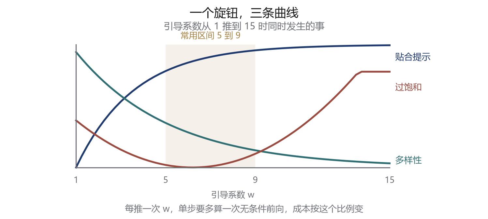

## 扩散模型：从噪声里画出图

一个设计工具接入文生图功能后，收到的最集中的抱怨不是画得不好，而是慢。用户改一个词，要等八秒才能看到新图。八秒里模型做了三十次完整的前向计算，每次都处理四千多个 token——它是一步一步把噪声擦干净的，每一步只擦掉一点点。

这个"一步步"的设计看起来低效：为什么不直接一次性生成整张图？这一章要解释这个问题的答案，以及这个答案带来的所有工程后果。理解扩散模型的关键不是记住公式，而是理解为什么"逐步去噪"这件事在数学上是必要的，而不是工程上的偷懒。

### 直接生成为什么不行

设想的理想模型是：给一个提示，直接输出 1024×1024×3 个数。这是一百多万个连续值。

训练这样的模型，最自然的损失是"生成图和真实图的差距"：

$$\mathcal{L}=\bigl\|G_\theta(c)-x_0\bigr\|^2$$

但这个损失有一个致命问题：它有两个同样好的解。给定提示"一只猫"，真实数据里有一万张不同的猫图。模型如果输出这些图的平均值，损失也很小——而平均值是一团模糊的灰。

换句话说，均方误差鼓励模型输出"所有可能答案的均值"，而生成任务要的是"从分布里采样出一个具体答案"。这两件事根本不同。

对抗训练（GAN）绕开了这个问题：不比较像素，而是让一个判别器判断"这张图是真是假"，生成器学着骗过它。这条路线能生成清晰的图，但训练极不稳定，模式崩塌（生成器只会画少数几种图）几乎无法避免。

扩散模型走的是第三条路：不直接学"图长什么样"，而是学"怎么把噪声一点点去掉"。这个转换把"一次生成一百万个相关的数"变成了"三十次生成一百万个基本独立的数"，每一步的任务都简单得多。

### 前向：一条有闭式解的加噪路

先定义加噪过程。取一张真实图 $x_0$，每一步加一点高斯噪声：

$$q(x_t\mid x_{t-1})=\mathcal{N}\!\left(\sqrt{1-\beta_t}\,x_{t-1},\ \beta_t I\right)$$

$\beta_t$ 是这一步加多少噪声，通常从 $10^{-4}$ 线性增加到 $0.02$，一共一千步。写成采样形式：

$$x_t=\sqrt{1-\beta_t}\,x_{t-1}+\sqrt{\beta_t}\,\epsilon,\qquad \epsilon\sim\mathcal{N}(0,I)$$

系数这样设计是为了让方差保持不变：$(\sqrt{1-\beta_t})^2+(\sqrt{\beta_t})^2=1$。信号被缩小一点，噪声补上一点，总和恒定。这个细节很重要，否则经过一千步之后数值会爆炸或者归零。

一步步加噪太慢，训练时也不可能真的迭代一千次。好消息是这个递推有闭式解。定义 $\alpha_t=1-\beta_t$，$\bar\alpha_t=\prod_{s=1}^{t}\alpha_s$，则：

$$x_t=\sqrt{\bar\alpha_t}\,x_0+\sqrt{1-\bar\alpha_t}\,\epsilon$$

推导的思路是两个高斯相加还是高斯：把 $x_{t-1}$ 展开代入，每一步的噪声系数平方相加，累乘之后就是 $\bar\alpha_t$。于是任意时刻的 $x_t$ 可以一步算出来，不需要迭代。

$$q(x_t\mid x_0)=\mathcal{N}\!\left(\sqrt{\bar\alpha_t}\,x_0,\ (1-\bar\alpha_t)I\right)$$

这个式子在说什么：$t$ 时刻的图，等于原图乘一个衰减系数，加上一个标准差为 $\sqrt{1-\bar\alpha_t}$ 的噪声。$t$ 小的时候衰减系数接近 1，图几乎没变；$t$ 接近 1000 时衰减系数接近 0，图变成纯噪声。

按线性调度估算，$t=500$ 时 $\bar\alpha_t$ 大约在 0.08 量级，也就是信号只剩不到一成，剩下九成是噪声。这个曲线不是线性的：前期信号掉得慢，后期掉得快，所以采样时"最后几步"对细节最关键，和很多人的直觉相反。

### 训练目标：只学"猜噪声"

知道了 $x_t$ 的闭式解，就可以构造训练样本：随便取一张图，随便取一个 $t$，按上式加噪，得到 $x_t$。

然后让模型做一件事：给定 $x_t$ 和 $t$，猜出加进去的噪声是什么。

$$\mathcal{L}_{\text{simple}}=\mathbb{E}_{x_0,\,t,\,\epsilon}\left\|\epsilon-\epsilon_\theta\bigl(\sqrt{\bar\alpha_t}x_0+\sqrt{1-\bar\alpha_t}\epsilon,\ t\bigr)\right\|^2$$

逐项读一遍。$x_0$ 是真实图，$t$ 是随机抽的时间步，$\epsilon$ 是随机抽的标准高斯噪声。括号里是加噪后的图，作为模型输入。$\epsilon_\theta$ 是模型的预测，输出和输入同形状。损失是预测噪声与真实噪声的均方误差。

这个目标为什么等价于"学会去噪"？因为在给定 $x_t$ 的条件下，噪声和原图是一一对应的：

$$x_0=\frac{x_t-\sqrt{1-\bar\alpha_t}\,\epsilon}{\sqrt{\bar\alpha_t}}$$

知道噪声就知道原图，反之亦然。所以"预测噪声"和"预测原图"在数学上是同一个任务的两种参数化。实践中选择预测噪声，是因为它的数值范围更稳定：原图的像素值在 $[-1,1]$，噪声在 $(-\infty,\infty)$ 但集中在 $[-3,3]$，模型学起来更容易。

严格地说，这个简单的均方误差是从变分下界（ELBO）推出来的，每一步的推导都涉及高斯分布之间的 KL 散度。但那套推导最后化简成的东西，就是上面这一行——去掉权重项之后的均方误差在实践里效果更好，虽然后者在理论上不是最优的。这是深度学习里常见的现象：理论给方向，实验定细节。

### 从变分下界到那一行均方误差

上面那个损失不是拍脑袋写的，它是从最大似然推下来的。推的过程值得看一遍，因为它决定了“哪些步更重要”。

目标是对数似然 $\log p(x_0)$ 的下界（证据下界）。把前向过程当隐变量，展开成三项：

$$\mathcal{L}=\underbrace{D_{KL}(q_T\,\|\,p_T)}_{\text{末项}}+\underbrace{\sum_{t=2}^{T}D_{KL}(q_{t-1}\,\|\,p_\theta)}_{\text{主项}}+\underbrace{\log p_\theta(x_0|x_1)}_{\text{重建}}$$

为写得开，$q_T$ 是 $q(x_T|x_0)$ 的简写，$q_{t-1}$ 是 $q(x_{t-1}|x_t,x_0)$ 的简写，$p_T$、$p_\theta$ 同理。

第一项与参数无关（两端都是高斯，$x_T$ 已经近似标准正态），可以不管。第三项只是在最后一步去噪，量级很小。真正的主项是中间那串 KL，而它有闭式解：两个高斯之间的 KL，在方差固定时化简为均值之间的平方差。

后验 $q(x_{t-1}|x_t,x_0)$ 的均值可以写成：

$$\tilde\mu_t=\frac{\sqrt{\bar\alpha_{t-1}}\,\beta_t}{1-\bar\alpha_t}x_0+\frac{\sqrt{\alpha_t}(1-\bar\alpha_{t-1})}{1-\bar\alpha_t}x_t$$

把 $x_0$ 用 $x_t$ 和噪声表出，再让模型去拟合这个均值，展开后剩下的就是“预测噪声与真实噪声的平方差”。这一步就是上一节那个损失的全部来历。

注意上式中两个系数之和不一定为一：低噪声时偏 $x_t$（几乎不变），高噪声时偏 $x_0$。这说明不同 $t$ 的“任务”真的不同：小 $t$ 主要在保细节，大 $t$ 主要在定构图。

严格的下界里，每一项前面有一个与 $t$ 有关的权重（正比于 $\beta_t^2/(2\sigma_t^2\alpha_t(1-\bar\alpha_t))$）。去掉它、改成均等权重，理论上不再是最优下界，但实验上效果更好。一个说得通的解释是：那些权重在低噪声段变得很大，会把大部分容量吸到“修细节”上，而构图没学会。均等权重相当于把学习力均匀分配。

### 三种参数化：学噪声、学原图，还是学速度

同一个任务可以用三种目标写，它们数学上等价，实际训练难度不同。

**预测噪声。** 目标 $\epsilon$，方差恒为一。优点是数值稳定、实现简单；缺点是在低噪声段，目标与输入高度相关，模型只需要“抄一个近似”，梯度信号弱。

**预测原图。** 目标 $x_0$。它在低噪声段很好学（输入已经很清楚），但在高噪声段几乎不可能——从一团噪声里猜出整张图，模型只能给出一个模糊的平均值。这就是早期模型“发糊”的一个原因。

**预测速度。** 把两者混起来：

$$v=\sqrt{\bar\alpha_t}\,\epsilon-\sqrt{1-\bar\alpha_t}\,x_0$$

这个量的妙处是两个系数平方和为 1，于是目标的方差在整个 $t$ 轴上大体恒定（图像方差取一时），不会出现某一段特别大或特别小。工程上的后果是：同一个学习率能在整条轨迹上工作得好，不需要按 $t$ 调权重。

预测 $v$ 的模型在采样时也更好用，因为从 $v$ 同时能还原 $\epsilon$ 与 $x_0$：

$$x_0=\sqrt{\bar\alpha_t}\,x_t-\sqrt{1-\bar\alpha_t}\,v,\qquad \epsilon=\sqrt{1-\bar\alpha_t}\,x_t+\sqrt{\bar\alpha_t}\,v$$

高分辨率模型经常选 $v$，因为细节全在低噪声段，而 $\epsilon$ 参数化在那一段的梯度最弱。这是一个很具体的取舍：同样的步数、同样的数据，换参数化能看出区别，而别的什么都不用改。

### 噪声调度：线性还是余弦

训练前还要定一件事：一千步的 $\beta_t$ 怎么分配。

最直接的是线性：从 $10^{-4}$ 均匀增到 0.02。它有一个无聊但真实的毛病：后期几乎全是噪声，模型在那些步上学到的东西很少，白花算力。

另一种是余弦调度，让 $\bar\alpha_t$ 按余弦曲线下降：

$$\bar\alpha_t=\frac{f(t)}{f(0)},\qquad f(t)=\cos^{2}\!\left(\frac{t/T+s}{1+s}\cdot\frac{\pi}{2}\right)$$

$s$ 是一个很小的偏移量，防止 $t=0$ 时导数为零。这个式子做的是：让信号一开始去掉得慢、中间去得快、最后又慢下来，而不是匀速降下来。

实际效果是低噪声区域分到更多步，而那里恰好是细节定形的地方。对高分辨率生成，余弦调度比线性稳很多，因为线性调度在低噪声端太粗，细节容易崩。

这件事在流匹配里同样存在，只是形式不同：不是 $\beta$ 曲线，而是时间步的采样分布。两者的本质一样——把训练算力花在难的那一段上。

### 采样：把路倒着走

训练完之后，模型会说"这张带噪的图里，噪声长这样"。采样就是反过来用这个能力。

从纯噪声 $x_T$ 开始，每一步：用模型预测噪声，按公式减掉一部分，再加一点点新的随机噪声，得到 $x_{t-1}$。完整的一步是：

$$x_{t-1}=\frac{1}{\sqrt{\alpha_t}}\left(x_t-\frac{\beta_t}{\sqrt{1-\bar\alpha_t}}\,\epsilon_\theta(x_t,t)\right)+\sigma_t z$$

这个式子看起来吓人，其实只做三件事。第一项 $\frac{1}{\sqrt{\alpha_t}}$ 是把信号放大回去，抵消前向时的衰减；括号里减掉的部分是"按预测的噪声把这一份噪声去掉"；最后加上的 $\sigma_t z$ 是刻意保留的一点随机性，让生成结果有多样性。

$\sigma_t$ 取 $\sqrt{\beta_t}$ 时是原始的 DDPM 采样，一千步；取 0 时是 DDIM 采样，变成确定性过程，步数可以压到几十步。

DDIM 能压步数的原因在路径。前向加噪定义了从数据到噪声的一族路径，采样是沿着某条路径往回走。DDIM 选了一条更"直"的子序列，跳着走，误差累积得少。三十步的 DDIM 质量和一千步的 DDPM 差不多，这就是产品里"三十步出图"的来历。

如果再往前一步，把"跳着走"做到极致，就得到了一步生成的想法：直接学"从噪声到图的映射"，不迭代。代价是模型要一次性承担全部变换，容量不够时会糊。现在流行的做法是在中间：四步、八步，配合蒸馏训练。

### 采样的两条递推：DDPM 与 DDIM

上一节给了直觉，这一节把两个递推写完整，因为它们决定了“多少步”。

**DDPM。** 每一步先用模型估出噪声，按后验均值把 $x_t$ 推到 $x_{t-1}$，再加回一小点噪声：

$$x_{t-1}=\frac{1}{\sqrt{\alpha_t}}\left(x_t-\frac{1-\alpha_t}{\sqrt{1-\bar\alpha_t}}\,\epsilon_\theta(x_t,t)\right)+\sigma_t z$$

后验方差是 $\tilde\beta_t=\frac{1-\bar\alpha_{t-1}}{1-\bar\alpha_t}\beta_t$，取 $\sigma_t^2=\tilde\beta_t$ 时是标准 DDPM；取零就变成确定性的。

**DDIM。** 把递推改写成“先估原图、再往原图方向走一截”的形式：

$$x_{t-1}=\sqrt{\bar\alpha_{t-1}}\,\hat x_0+\sqrt{1-\bar\alpha_{t-1}-\sigma_t^2}\,\hat\epsilon+\sigma_t z$$

$\hat x_0$、$\hat\epsilon$ 都由同一个模型从 $x_t$ 算出。关键变化是：式子里不再强依赖 $t-1$，你可以把 $t$ 跳到 $t-33$。这就是“少步”的全部秘密——**同一条轨迹，不同的步子大小**。

把 $\bar\alpha$ 按线性调度算出来，看它到底有多不均匀：

| 时间步 | $\bar\alpha_t$ | $\sqrt{\bar\alpha}$ | $\sqrt{1-\bar\alpha}$ |
|---|---|---|---|
| 1000 | 0.00004 | 0.007 | 1.000 |
| 750 | 0.0033 | 0.057 | 0.998 |
| 500 | 0.08 | 0.283 | 0.959 |
| 250 | 0.52 | 0.72 | 0.69 |
| 0 | 1 | 1 | 0 |

看第二列。从 1000 步到 750 步，$\bar\alpha$ 翻了八十倍；从 250 步到 0，才从 0.52 到 1。所以“均与均匀抽 30 个步”是一个很差的选法：前十步里几乎没有信息变化，而在最后一百步里信号从 0.52 变到 1，细节全靠那几步。

正确的做法是按 $\bar\alpha$（或 $\sqrt{\bar\alpha}$、总噪声水平）等间隔取，或者用余弦间隔。这能解释一个常见现象：同一个模型，换一套“步数表”而不是换模型，质量能变好一截——很多开源实现里所谓“采样器优化”，实质上就是这个表的选取。

最后提醒一句关于 $\sigma_t$：它控制随机性。$\sigma_t=\tilde\beta_t$ 时每一步都注入噪声，同一提示每次结果不同，适合创意；$\sigma_t=0$ 时是确定性映射，同一噪声总产生同一张图，适合“固定种子微调参数”。产品里的“重新生成”与“同种可复现”两种需求，差别就在这一个参数上。

### 潜空间：先把图压小再学

直接在 1024×1024×3 的像素上做扩散，每一步的计算都在三百一十万个数上，三十步就是九千万次数值运算的传播，不现实。

主流做法是先训练一个自编码器，把图压到一个更小的表示，在这个小表示上做扩散，最后解码回像素。这个表示叫潜空间。

以常见的 8 倍下采样、4 通道自编码器为例：

$$1024\times1024\times3=3{,}145{,}728\ \text{个数}\ \longrightarrow\ 128\times128\times4=65{,}536\ \text{个数}$$

这就是常见的 48 比 1：面积上小了 64 倍，而通道从 3 增到 4，只多一个。这 48 倍直接变成了采样速度的 48 倍，也是扩散模型能跑在消费级显卡上的根本原因。

代价是信息丢失。自编码器不可能无损地把一百万个像素压到六万个数，它必须决定"什么该保留"。训练目标是重建误差加感知损失，前者保证像素接近，后者用另一个网络的特征距离保证"看起来像"。两者都在均方误差之外额外加了约束，所以自编码器的输出不是模糊的平均值，而是清晰的近似。

但总有一些细节会丢。细小的文字、密集的纹理、远处的物体边缘，这些在潜空间里可能只剩几个数，重建时靠猜。这为后面要说的一类错误埋下了伏笔。

### 潜空间的代价：小字为什么必糊

压缩比 48 比 1 这句话背后有一个具体的后果，值得算一遍：图里的小字什么时候彻底消失。

8 倍下采样意味着潜空间的一个格子对应原图 8×8 像素。一张 1024 的图，潜空间是 128×128。假设图里有一段 20 个字的标题，占宽 800 像素，每字 40 像素。在潜空间里，每字只占 5 个格子，而一个汉字的笔画有七八笔——5 个格子装不下，只能保留“这里有东西”的感觉。

再往下一步：如果生成的是 512 的图，8 倍下采样后每字只占 2.5 个格子，基本就是一团。这就是为什么所有图像生成模型都不能可靠地写小字，而不仅是“模型不够大”——自编码器在第一步就把字的信息磨掉了。

| 图宽 | 字宽 | 潜空间字宽 | 能否读对 |
|---|---|---|---|
| 2048 | 80 px | 10 格 | 常见字形能认 |
| 1024 | 40 px | 5 格 | 大字体勉强，小字不会对 |
| 512 | 20 px | 2.5 格 | 不可能 |

工程上的三种绕过方式：把文字交给排版层（生成时只生成背景，文字后期用字体渲染上去）；用更低的下采样倍率（4 倍而不是 8 倍，成本乘四）；或者局部超分（先低分辨率出图，再对含字区域单独重给）。三种都不是模型能力提升，是把任务拆给了能做好它的环节。

这张表也能用来解释另一个常见问题：为什么模型画远景人脸很好，画近景五官却崩。同样是“细节密度过高”：远里的人脸在潜空间占 2 格，只需保留“是一张脸”；近景要保留眼神方向、睫毛、瞳孔，那需要几十个格子，而管子只有那么粗。

### 引导：让它更听提示

无条件训练的扩散模型只会生成"某种图"。要让它按提示画，得把条件注入。做法很多（交叉注意力、自适应归一化、拼接），这里只讲注入之后的控制手段。

分类器引导的想法是：同时算两次预测，一次带条件，一次不带，然后把两者的差放大：

$$\hat\epsilon=\epsilon_\theta(x_t,t,\varnothing)+w\bigl(\epsilon_\theta(x_t,t,c)-\epsilon_\theta(x_t,t,\varnothing)\bigr)$$

$c$ 是条件（提示的编码），$\varnothing$ 是空条件（相当于"什么都不说"），$w$ 是引导系数。

这个式子在说什么：先看"不带提示时我会怎么去噪"，再看"带提示时我会怎么去噪"，两者的差就是提示带来的调整方向。$w=1$ 时正常使用，$w>1$ 时把这个调整方向放大，$w=0$ 时完全忽略提示。

实践中的 $w$ 常在 5 到 9 之间。放大之后，生成的图明显更贴提示：写"红色"就真的是红色，写"三只"就真的画三只。

代价有两个，而且第二个很少被提到。

第一个是过饱和。$w$ 太大时，颜色变得刺眼、对比度变高、细节变硬，看起来像被过度锐化的照片。原因是外推：模型在训练时只见过 $w=1$ 的分布，$w=8$ 的预测已经跑到分布之外，网络在那里的输出没有经过校准。

第二个是多样性下降。同一个提示跑十次，结果越来越像。因为放大"条件方向"等于缩小"其他方向"，随机性被一起压掉了。所以做创意类产品时，$w$ 要调低一点，牺牲贴合度换多样性；做商品图这类要求精确的场景，$w$ 调高一点。

训练时还有一种做法叫条件丢弃：以一定概率（通常一成）把条件置空，让模型同时学会"带条件"和"不带条件"两种模式。这样推理时才能用上式做两次预测。如果没有这个训练技巧，引导就没法用。

### 引导系数：多花一倍钱买贴合

上一节说了引导系数怎么算。它真正的代价在采样次数上，这一点值得单独说。

引导的那条式子每步要算两次前向：一次带条件，一次不带。三十步就是六十次函数评估，时间直接翻倍。上一章的账重算一遍：单次前向 0.08 秒，三十步无引导 2.4 秒，有引导 4.8 秒。对“输入即预览”这个需求，4.8 秒直接出局。

工程上有两条路把这一倍收回来。

一是合并批次。把“带条件”与“不带条件”两组噪声拼成一个 batch=2 的前向，一次算完。因为 GPU 在 batch=1 时通常没有打满，batch=2 的实际耗时往往只有 1.3 倍而不是 2 倍。显存占用翻倍，但 4096 个 token 的激活本来就不大，这笔交换划算。

二是蒸馏掉无条件分支。先训好带引导的模型，再用它做教师，把“带引导的采样轨迹”蒸馏到一个只需一次前向的学生里。这一步能直接省一半，代价是灵活性——学生模型固定在某个 $w$ 上，用户不能再调。

| 做法 | 单步前向 | 30 步耗时 | 可调 $w$ |
|---|---|---|---|
| 两次前向 | 2 次 | 4.8 秒 | 是 |
| 拼批次 | 2 次（合并） | 3.1 秒 | 是 |
| 蒸馏掉无条件 | 1 次 | 2.4 秒 | 否 |

图里那三条曲线还解释了一个产品现象：为什么“创意类”工具默认的引导系数比“商品图”类低。创意要的是十张里有一张惊喜，多样性比贴合度值钱；商品图要的是“就必须是这只包”，贴合度优先。同一个模型，两个默认值，背后是两种完全不同的目标函数。

### 条件怎么进去

引导只是控制手段，前提是条件已经进了模型。注入方式有三种，差别在计算量和控制精度。

**交叉注意力。** 把提示编码成一串文本向量，在主干的每一层用注意力去查。优点是可以处理任意长度的提示，而且能定位（“左边的红色”会落在左侧区域）；缺点是每一层都要算一次注意力，成本不低。

**自适应归一化。** 把时间步和条件向量拼起来，各过一个小网络，输出用于调制每层归一化的缩放和偏移。优点是极便宜（只多两个向量）；缺点是全局调制，难以表达“左边是红的右边是蓝的”这种空间条件。

**拼接。** 把条件向量直接拼到每个 patch 的 token 上。实现最简单，但信息嵌入得浅，需要模型自己学会从 token 里读条件。

三者的一个实际差别是分辨率。交叉注意力可以指定“这个条件作用于哪个区域”，所以在做局部重绘、分区控制时必需；自适应归一化做不到。这也是为什么分区控制类工具总是选前者。

另一个常被忽略的是文本编码器的选择。生成模型不自己读文本，它读的是一个文本编码器的输出。这个编码器能理解什么，生成模型就只能理解什么。早期模型用的编码器对中文和多词组合的语言学结构理解很弱，所以当时写中文提示效果差——不是因为生成模型不认识中文，是编码器没读准。

### 算一遍：一张 1024 的图要多少算力

把数字摆出来。假设条件：潜空间 128×128×4，切块 2×2，得到 $(64\times64)=4096$ 个 token；主干是十亿参数的 Transformer；采样三十步。

**单步前向。** 按每参数每 token 两次乘加：

$$2\times10^{9}\times4096\approx8.2\times10^{12}\ \text{FLOP}$$

**三十步。**

$$8.2\times10^{12}\times30\approx2.5\times10^{14}\ \text{FLOP}$$

按 $4\times10^{14}$ FLOP/s 的有效算力估，约 0.6 秒。

但实际体验是两三秒。差距在哪？三处。注意力部分不是简单的线性乘加，4096 个 token 的全注意力矩阵是 1677 万格，每层都要算一遍；显存带宽成为瓶颈，参数读一次就要几百 GB/s，而算力常常在等数据；以及调度与框架开销。

所以纸面算力只能用来比较不同配置，不能用来预测实际耗时。真正的判断方法是：在同一张卡上跑一次，量出单步时间，再乘步数。

**换分辨率的代价。** 从 1024 到 2048，潜空间边长翻倍，token 数变四倍（4096 到 16384），注意力矩阵变十六倍。单张图的时间从两三秒变成三十秒以上，而显存很可能直接不够。这就是为什么 2K、4K 生成要么分块生成再拼，要么用更激进的下采样。

**降步数的收益。** 三十步降到八步，纸面算力降到四分之一，实测时间也差不多降到四分之一。但它不会降到零，因为还有解码（把潜空间变回像素）和调度开销，这部分在低步数时占比变大。所以步数从三十降到八，体验上的提升是一倍多，不是四倍。

### 一个常见误解：步数越多越好

"步数越多质量越好"是入门时最容易形成的误解，它有历史原因——早期的一千步 DDPM 确实比一百步好。但在 DDIM 和各种高阶采样器普及之后，这个结论不再成立。

原因在于步数与质量的关系不是一个单调曲线。采样是在近似一条连续的轨迹，步数少则离散误差大，图像会出现块状、撑开、细节错位；步数超过一定值之后，额外的步骤只是在重复已经准确的位置，质量不再提升，反而因为数值误差累积而略差。

每个采样器都有自己的最优区间。欧拉采样器在二三十步就差不多饱和；高阶龙格库塔类采样器能用更少的步数达到同样质量，但单步贵。选采样器实际上是在"单步成本"和"步数"之间做乘法。

另一个误解更隐蔽：同一种子同一个提示，不同步数会得到不同的图，这不是退化，是因为路径不同。步数少时，模型跳过了某些中间状态，而扩散采样是路径相关的，跳过就会落到另一个点。所以对比两个模型的质量时，必须用各自的推荐步数，否则比的是调参水平而不是模型水平。

### 失败案例：为什么手指数不对

手指数错是图像生成的祖传问题。早几年的模型几乎画不对五根手指，现在的模型好很多，但依然会在复杂姿态下出错。

这个现象有三个原因，它们叠加在一起。

**第一，潜空间分辨率不够。** 1024 像素的图压到 128×128 的潜空间，一双手在画面里可能只占两百像素宽，手掌加五根手指在潜空间里只有二十多个格子。模型在这个尺度上分不清"四根"和"五根"，因为它们的潜表示几乎一样。这是结构性缺陷，不是数据不够。

**第二，损失不惩罚结构错误。** 均方误差看的是每个像素的数值差距。画了六根手指和五根手指，在像素层面差别很小，损失也小。模型没有任何直接动力去数对。

**第三，训练数据本身差。** 互联网上的图里，手部经常是模糊的、遮挡的、特写的。训练数据里"清晰完整的手"占比很低，模型见得太少。

类似的错误还有文字乱码（字母形状对但拼不成词）、对称物件不对称（两只耳朵形状不一样）、透视不一致（桌子两条边不平行）。它们属于同一类：**模型学到了纹理分布，没学到结构约束**。

缓解手段都是外围的。加手部专项数据、用检测器在生成后校验并局部重绘、用结构条件（骨架图）约束构图、把文字生成交给专门的渲染层。没有一种能从根上解决，因为根在"用像素损失代替结构约束"这个设计上。

### 评测与版权

自动指标主要看两个方向：质量（图像本身好不好看）和贴合（是不是按提示画的）。前者用 FID 这类分布距离，后者用图文相似度模型打分。

两个指标都有明显局限。FID 衡量的是生成分布与真实分布的距离，它对"好看但错"的图不敏感，因为错的图可能依然落在真实图像分布里。相似度打分则容易被"文字堆在一起"的图骗过——图文模型看到关键词就给了高分。

所以产品评测里，人工打分占的比重反而更大。可用的方法是双盲：让评审员看两张图，一张来自旧版本一张来自新版本，问哪个更好，不看提示、不看参数。一百对样本就能看出显著差异，比跑一万张的自动指标可靠。

版权是绕不开的另一个维度。训练数据来自互联网，生成结果可能复现训练图，尤其是名画、标志、名人肖像。工程上的手段包括：训练数据去重、生成时对提示做过滤（拒绝某些名字和风格）、输出比对检索（生成后拿结果去反查训练集）、嵌入不可见水印。

这些手段能降低风险，但都不能消除。判断要不要上线一个生成功能，靠的不是技术手段多完备，是法律和业务对风险尺度的共识。

### 采样器：阶数、单价与稳定步数

采样器不是“随便选一个”，它们直接决定花多少钱买到同样的质量。

| 采样器 | 每步 NFE | 稳定步数 | 主要缺点 |
|---|---|---|---|
| 欧拉 | 1 | 30–50 | 步少了出块状纹 |
| Heun | 2 | 15–25 | 单步贵一倍 |
| DPM-Solver++ | 1–2 | 15–25 | 参数多，调错出彩噪 |
| 蒸馏少步 | 1 | 4–8 | 多样性窄，需专门训 |

把 NFE 换算成时间看：欧拉 40 步是 40 次，Heun 20 步是 40 次，DPM 20 步大约 30 次。三者的实际耗时差不多，但质量不一样——高阶方法在同一个 NFE 下往往更好，因为它多用了上一阶的信息。

这也是为什么“步数”这个参数在不同采样器之间不可比，而“NFE”可比。看产品宣传“十步出图”时，得看它用的是几阶方法，否则那个十步可能是二十次评估。

蒸馏少步那一行是另一个世界：它把“多次评估”压成一次，代价是模型得重训，而且训完之后 $w$ 与步数都固定了，不能再调。适合的场景很明确：需求单一、量大、可抽查。

最后提醒一个实践里的坑：换采样器之后，原来的种子不再对应同一张图。扩散采样本是路径相关的，换一个积分器就走另一条路。所以做“种子复现”功能时，种子必须与采样器绑定存，而不能只存一个整数。

### 自编码器的三个指标

潜空间不是“越能压越好”，它同时被三个指标拉着，而它们互相矛盾。

**重建误差（像素级）。** 解码回来的图与原图的 L2 或 PSNR。高压缩下这个数会很差，而且它惩罚的是“局部平滑”，不惩罚“结构错”。

**感知距离。** 用一个预训练网络的特征距离衡量“看起来像不像”。它偏好锐利与纹理，惩罚模糊，但沿用原图的纹理来源时，它不惩罚“长得不像这个具体物体”。

**压缩比。** 决定了扩散需要处理多少 token，直接乘在采样成本上。

| 配置 | 压缩比 | 重建 | 采样成本 |
|---|---|---|---|
| 8 倍下采样、4 通道 | 48:1 | 一般 | 基准 |
| 8 倍、16 通道 | 12:1 | 好 | 四倍 |
| 16 倍、4 通道 | 192:1 | 差 | 四分之一 |
| 4 倍、4 通道 | 12:1 | 很好 | 四倍 |

这张表解释了一个常见现象：为什么高分辨率模型往往用 16 倍下采样的自编码器。不是它更好，而是 8 倍下采样在 2048 时 token 太多，根本跑不动；宁愿丢一些重建质量，也要把序列长度拉回可控范围。

代价直接体现在保真度上：16 倍下采样下，一个汉字的笔画往往只剩一格，所以高分辨率模型写的字反而不如低分辨率的清晰。这是一个很具体的交换：分辨率高不等于可读，因为中间还有一道压缩。

### 两种引导：一个已淘汰的路线

引导这一节只讲了无分类器引导。还有另一条路线叫分类器引导，它现在基本不用了，但它解释了为什么前一种成了主流。

分类器引导的做法是：另外训一个分类器，判断“这张带噪图像不像提示描述的东西”，然后拿它的梯度去推动采样。相当于每一步都问一句“往哪个方向改，分类器会更肯定”。

它在数学上很干净（就是条件分数的贝叶斯分解），但工程上三个毛病。一是必须额外训一个带噪图的分类器，而这个分类器要能处理一千种噪声水平，本身就不容易。二是多一次前向加一次反向，比无分类器引导还贵。三是它只能按“类别”引导，遇到长句子、复杂描述就无能为力。

| 对比 | 分类器引导 | 无分类器引导 |
|---|---|---|
| 额外模型 | 需要带噪分类器 | 不需要 |
| 每步代价 | 一次前向加反向 | 两次前向 |
| 能理解长提示 | 不能 | 能 |

无分类器引导之所以赢，就是因为它把“条件”统一成了文本，而文本可以任意长。代价是每步两次前向，而这个代价可以用拼批次或蒸馏收回（上一节算过）。

这条历史对今天还有意义：当你想给生成加一个新条件（比如“避开这个品牌标志”）时，先问能不能写成文本，能写就不需要新训分类器。写不成文本的（比如空间布局、参考图风格），才需要单独的条件分支。

### 分辨率与步数是乘法关系

两个旋钮看上去独立，实际上是乘在一起的，而它们的乘积直接决定“能不能上线”。

从 1024 到 2048，潜空间边长翻倍，token 数变成四倍（4096 到 16384）。单步耗时不只是四倍：注意力从 $4096^2$ 涨到 $16384^2$，那部分涨了十六倍。取一个中间值，单步约四到六倍。再乘步数：

| 分辨率 | 步数 | 单图耗时 | 可行性 |
|---|---|---|---|
| 1024 | 8 | 0.6 秒 | 可交互 |
| 2048 | 8 | 3 秒 | 可接受 |
| 2048 | 32 | 12 秒 | 只能离线 |
| 4096 | 8 | 15 秒以上 | 显存先不够 |

这张表解释了为什么高分辨率产品都在押“少步”。2048 下用三十二步，单图就是十几秒，用户不会等；而同样的模型用八步就能压到三秒。所以“高分辨率”与“少步数”不是两个卖点，而是同一个卖点的两面。

工程上的顺序也是这个：先把分辨率拉到目标值，再重新调步数与引导——而不是先在 1024 上调好，然后直接把参数搬到 2048。后者常见的后果是“图很糊”，因为分辨率变了之后，最佳步数与引导系数都变了。

### 这一章的主线

扩散模型的核心只有两件事：前向加噪有闭式解，所以训练样本可以随时构造；反向去噪可以分解成很多步，所以每一步的学习任务都很简单。这两个性质把一个"一次生成一百万个相关的数"的难题，换成了"多次生成一百万个基本独立的数"的易题。

工程的三个关键点：潜空间降本（快 48 倍）、条件注入控内容（能不能听提示）、引导系数调贴合度（听得多紧）。三个都有代价，且代价往往不在同一维度：降本降精度，控内容增复杂度，提贴合度降多样性。

下一章讲两个改进：把采样路径拉直（流匹配），把主干换成 Transformer（DiT）。它们共同的效果是：同样的质量，更少的步数，更简单的工程结构。

最后留一个能用来判断宣传口径的问题：一个模型说它"四步出图"，要问它四步的质量与三十步相比打了多少折扣，以及这个折扣是在什么分辨率下测的。两个数字都不给，那个"四步"基本只是演示用的。
