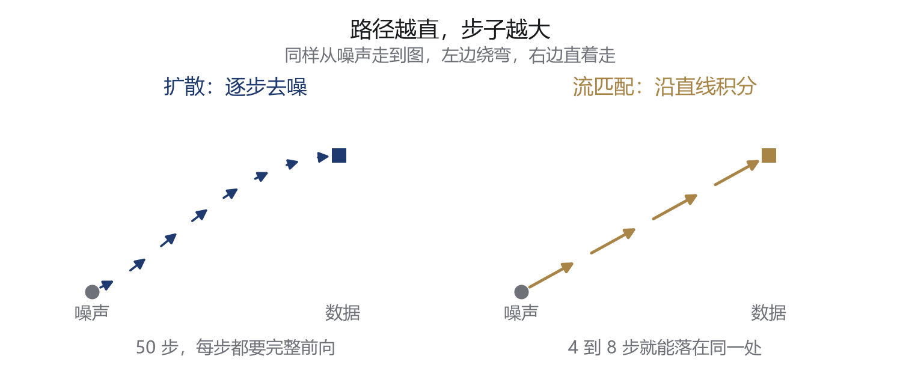

## 流匹配与生成式 Transformer

上一章结尾那个设计工具的抱怨是"改一个词等八秒"。八秒里三十步采样占了大头，剩下的是一次文本编码和一次图像解码。如果要做到"输入即预览"，预算只有一秒，也就是采样必须压到三四步。

这一章讲的两件事，就是围绕这个目标展开的：换训练目标（流匹配），让路径变直，步子能迈大；换主干结构（DiT），让模型能吃下更多数据、更大规模，同时和语言模型共享同一套技术栈。

两件事都不是"更聪明的数学"，而是"更省的计算"。理解它们的关键是先弄清：为什么扩散采样非要走那么多小步。

### 步数多，是因为路是弯的

把扩散的采样过程写成连续形式，它是一条常微分方程（ODE）的解：

$$\frac{dx}{dt}=v_\theta(x,t),\qquad x(1)\sim\mathcal{N}(0,I),\quad x(0)\ \text{是生成的图}$$

$v_\theta$ 是"在位置 $x$、时刻 $t$，该往哪个方向走、走多快"。采样就是从这个 ODE 的终点往回积分到起点。

数值积分有一条基本规律：步长越小，误差越小。一阶方法（欧拉法）的全局误差与步长成正比，步长减半，误差减半；二阶方法误差与步长平方成正比。所以想精确积分，要么用小步，要么用高阶方法。

扩散模型训练出来的速度场是弯的。原因在训练目标：模型学的是"在任意噪声水平下去掉噪声"，而不同噪声水平下的去噪方向并不共线。低噪声时方向接近"补细节"，高噪声时方向接近"定大致构图"，两个方向夹角很大。走这条弯路径，步长一大就会偏离轨道，落到训练分布之外，图像就崩。

五十步、三十步是工程上的经验值，对应"弯路径能被一阶方法跟上"的最小步数。

### 流匹配：把路修直

流匹配的想法是：既然弯路径难积分，那就换一条直的路。

做法是定义一个从噪声到数据的直线插值：

$$x_t=(1-t)\,x_0+t\,x_1,\qquad x_0\sim\text{数据},\ x_1\sim\mathcal{N}(0,I)$$

$t=0$ 是数据，$t=1$ 是噪声，中间是线性混合。对 $t$ 求导，得到这条直线的速度：

$$\frac{dx_t}{dt}=x_1-x_0$$

这个速度是常数，与 $t$ 无关。于是训练目标就变成：让模型在任意 $t$ 预测这个常数方向。

$$\mathcal{L}_{\text{FM}}=\mathbb{E}_{t,\,x_0,\,x_1}\left\|v_\theta\bigl((1-t)x_0+tx_1,\ t\bigr)-(x_1-x_0)\right\|^2$$

逐项读：随机取一个数据点和一个噪声点，按 $t$ 线性混合得到中间点，模型看着这个中间点预测"从这往噪声方向走多少"。标签就是两者的差。

注意这个标签和扩散的标签（噪声本身）长得像但不同。扩散学的是"噪声长什么样"，流匹配学的是"到噪声点的位移"。两者在一维情况下是线性关系，在高维下方向也不同：扩散的预测是逐点的噪声向量，流匹配的预测是"这个样本配的那个噪声减去它自己"。

### 为什么直线能少走几步

直线的几何性质很直接：如果路径是直的，从起点到终点的位移是常数方向，欧拉法一步就能走到，误差为零。现实中的路径不是完全直的，因为模型只能近似这个速度场，而且不同样本的直线在空间里交叉。

但比扩散的弯路径直得多。实测中，同一个模型容量下：

- 扩散 30 到 50 步达到的视觉质量，流匹配 8 到 15 步就能接近；
- 步数再降到 4 以下，两者都会明显掉质量，但流匹配掉得慢。

为什么不是完全直？因为训练时 $x_0$ 和 $x_1$ 是独立采样的。一个数据点可能配到任何一个噪声点，于是所有样本的速度场叠在一起，整体上仍然是一个"从噪声分布流向数据分布"的旋涡。要想更直，得让配对变"聪明"：用最优传输的近似方法选择配对，让流量走最短路径。这类改进能把步数再压一半，代价是每个批次多做一次匹配计算。

### 算一遍：从三十步到八步省了多少

采样成本与函数评估次数（NFE）成正比，一次评估就是一次完整前向。

假设条件是：十亿参数的主干，4096 个 token，单次前向 0.08 秒（这个数来自上一章的估算再加一点实测折扣）。

三十步：

$$30\times0.08=2.4\ \text{秒}$$

八步：

$$8\times0.08=0.64\ \text{秒}$$

省下 1.76 秒。加上文本编码 0.1 秒、解码 0.3 秒、调度 0.2 秒，端到端从 3.0 秒降到 1.24 秒。

对"改一个词看效果"这个交互来说，3 秒和 1.2 秒是两种体验：前者用户会停下来等，后者用户会连续试。连续试带来的价值不是省时间，是用户愿意多做几次尝试，最终选到更满意的结果。这是产品指标上的差别，不是技术指标上的。

如果还要再快，就得动容量：把主干从十亿降到三亿，单次前向 0.03 秒，八步 0.24 秒。质量会降，但对"草图预览"这个场景够用。所以成熟的产品往往准备两档：低分辨率少步数做预览，确认后再跑高质量版本。这在工程上叫先粗后精，在扩散里也确实成立——因为粗版的构图已经定了，精版只需要在同样的构图里补细节。

### 蒸馏：把步数变成训练目标

另一条把步数压到极致的方法是蒸馏。思路是：与其让模型学"去噪"，不如直接让它学"多步之后的结果"。

最简单的形式是让学生模型看教师模型走完 $k$ 步后的输出，然后一次预测出来：

$$\mathcal{L}_{\text{distill}}=\left\|G_\theta(x_t,t)-x_{t-k}^{\text{teacher}}\right\|^2$$

这个式子在说：学生在 $t$ 时刻一步跨到 $t-k$，目标是教师走 $k$ 步到达的位置。反复做，学生就学会了"大步走"。

逐步把 $k$ 翻倍（从 2 到 4 到 8），就能用很少的步数覆盖整条路径，这叫渐进蒸馏。四步、两步、一步的模型都是这么来的。

代价是分布变窄。学生的输出是教师的确定性轨迹，原来采样时的随机性被抹掉了一部分。所以蒸馏模型常常出现"每张图都很干净，但同一个提示跑出来的图都很像"。做创意工具时这是缺点，做批量生产时反而是优点——结果稳定、可复现。

还有一个副作用是误差累积。教师走 $k$ 步的结果本身带误差，学生学着去匹配这个带误差的目标，误差会叠加。所以蒸馏模型的单图质量通常略低于同规模的原模型，即使步数一样。

### DiT：把 U-Net 换成 Transformer

早期的扩散主干是 U-Net：先卷积下采样几次，再上采样回来，中间用跳跃连接把浅层细节接到深层。它适合图像，因为卷积天生带局部性和平移等变性。

但 U-Net 有两个问题。它的感受野靠堆层数撑，要建模“左上角的红色与右下角的蓝色呼应”，需要很多层；而且它的结构是为图像设计的，换成视频（多一个时间维）、换成音频（一维序列）都要重新设计。

DiT 的做法是把潜空间的图切成块，当成 token 喂进一个标准 Transformer：

$$z=\mathrm{Conv}_{2\times2}(x_{\text{latent}})+\mathrm{pos},\qquad \text{tokens}=\frac{H}{2}\times\frac{W}{2}$$

这个式子说的是：用一个步长为 2 的卷积把 2×2 的潜空间小块压成一个 token，再加上位置编码。128×128 的潜空间就变成了 64×64=4096 个 token。

剩下的部分就是普通的 Transformer 块，只多了一个东西：每个块都要知道“现在第几步”，以及“要画什么”。两个条件都通过同一种机制注入，就是自适应归一化：

$$\mathrm{adaLN}(h)=\gamma(t)\odot\frac{h-\mu}{\sigma}+\beta(t)$$

$\gamma(t)$ 和 $\beta(t)$ 由时间步编码经一个小网络算出，$\odot$ 是逐元素乘。$\mu$、$\sigma$ 是这一层激活的均值和标准差。这个式子在说：先把特征归一化，再按当前时间步重新缩放和偏移。

DiT 的一个关键改进是把 $\gamma$ 初始化为 0。这样训练开始时每个块相当于恒等映射，整个网络接近零输出，梯度从最后面的层慢慢向前传——和极深网络里常用的残差零初始化是同一个道理。这一步对训练稳定性影响很大，没有它，深层 DiT 很难收敛。同理，文本条件的那一路输出也做零初始化，让模型一开始就“忽略提示”，然后逐步学会使用它——先把图像生成学好，再学条件控制，顺序比同时学稳定得多。

换成 Transformer 之后，一个直接的好处是与语言模型共享技术栈：同样的并行策略、同样的混合精度训练、同样的推理引擎、同样的量化方案。工程上一个团队能维护两套模型，而不是两套完全不同的代码。

### 算一遍：大模型为什么更划算

DiT 的论文里有一条经验：模型变大时，要达到同样质量所需的采样步数会减少。这个现象在工程上很重要，因为它改变了成本结构。

假设条件是：小模型三亿参数，三十步，单次前向 0.03 秒；大模型三十亿参数，八步，单次前向 0.20 秒（参数十倍，token 一样，所以单次成本也差不多十倍）。

小模型：$30\times0.03=0.9$ 秒。
大模型：$8\times0.20=1.6$ 秒。

大模型反而更慢。那为什么还用大模型？因为质量不一样。它八步的质量可能相当于小模型八十步都达不到的水平，而小模型跑到八十步需要 2.4 秒。

所以要比较的不是同一步数下的时间，而是同等质量下的时间。这个换算法在实际决策里很重要：用户抱怨“质量不够”时，增加步数是最贵的解法（线性涨），换大模型往往更便宜（质量指数变好）。

反过来说，用户抱怨“太慢”时，先试降步数，不要先换小模型。因为降步数的质量损失是可预见的（细节变糊），换小模型的质量损失不可预见（可能某些能力直接没了）。

### 可控性：四件套

生成模型最大的产品痛点是不可控。想改一个细节，不能重生成整张。工程上围绕这个痛点发展出四类工具，参数量差别很大。

**局部重绘。** 给一个掩码，只对掩码区域加噪并重生成，其余区域固定。实现上不需要改模型，只需要在采样时把非掩码区域的潜变量每步重置回原图。成本很低。

**结构条件（控制网）。** 复制主干的编码器部分，接一个轻量侧网络，把边缘图、深度图、姿态骨架作为额外输入。参数量是主干的几分之一到一半。优点是控得准，缺点是每种条件要单独训一个。

**身份适配器。** 把参考图编码成一个固定长度的向量序列，通过交叉注意力注入。参数量往往只有几千万，但能保住角色长相一致。它不改变模型主体，可以插拔。

**低秩微调。** 给每层加一对低秩矩阵，训练时只改这两小个矩阵：

$$W'=W+\frac{\alpha}{r}BA,\qquad A\in\mathbb{R}^{r\times d},\ B\in\mathbb{R}^{k\times r}$$

这个式子在说：原权重不动，另加一个“瘦的”乘积项。$r$ 取 16 或 32 时，新增参数只有原参数的千分之几。一个十亿参数的模型，微调参数可能是五百万。

四件套解决的是不同层级的控制：局部重绘管“改哪里”，控制网管“构图”，身份适配器管“像谁”，微调管“风格”。它们的参数量从零到几亿，选择取决于你要控制的东西有多抽象。

但四件套都有一个共同的副作用：它们都是在训练分布之外做外推。控制强了，生成结果的多样性就会下降，照片感会变弱。这是控制与自由的根本矛盾，无法通过调参消除，只能按产品定位选一个比例，而且这个比例最好在项目早期就定下来，中途改会让所有调好的参数作废。

### 为什么流匹配训练更敏感

流匹配的数学更简洁，但调起来比扩散更容易出错，原因在时间采样。

扩散的训练里，$t$ 均匀采样基本能用，因为每一步的任务难度差异不大。流匹配不一样：$t$ 接近 0 和接近 1 时，$x_t$ 几乎就是数据或者噪声，预测“位移”的难度最低；难度集中在中间段，那里信号和噪声各占一半，模型必须同时考虑两者。

如果 $t$ 均匀采样，中间段样本只占三分之一左右，模型在那个区间的精度不够，而采样时恰恰是中间段决定构图。所以实践中会用非均匀采样，把更多样本分配在中间段（常见的是对数正态分布，均值偏中间）。

这件事的代价是超参变多：采样分布的形状、时间步的嵌入方式、损失权重怎么随时间变。每个都要调，而且调错了不一定报错，只是质量差一点，很难定位。

工程上的经验是：先用官方配置跑通，再改一个参数、看一个指标。同时改三个参数，基本不可能知道是哪个在起作用。

### 一个失败案例：八步加高引导

有个团队把采样从三十步改成八步，为了保持“听提示”，把引导系数从 5 提到了 10。单张图的速度确实到位了，但用户反馈“糊”。

两件事叠在一起会出事。引导系数放大的是“条件方向”与“无条件方向”的差，这个差在低步数下本身就估不准：每一步只能看到很少的信息，速度场的误差被八步的跳跃放大。再把误差乘一个 10 倍，图像就崩到分布外。

他们的修正方式是降引导系数并补一个重提示环节：把用户的一句话用文本模型扩写成结构化的描述（主体、风格、构图分开写），这样即使引导系数降到 4，也能画对内容。成本是文本侧多一次调用，几乎可以忽略。

这条经验可以推广：**低步数下，提质量的杠杆是改提示，不是提引导**。提示写得具体，模型不需要外推就能找到对的方向；提示写得很笼统，就高度依赖引导去“硬拉”，而硬拉在少步数下必崩。

还有一个连带现象：八步模型对手的细节比三十步差很多，而且不是均匀变差，是“有时候很好有时候很坏”。这种不稳定性比均匀变差更难接受，因为用户无法预测。工程上的处理是专门的细节修复：生成完之后跑一个小的判别器检查手部区域，不合格就局部重绘该区域。

### 少步数什么时候不能用

不是所有场景都能用四步模型。有一条简单的判断标准：**结果能不能被抽查**。

能被抽查：社交媒体配图、概念草稿、灵感探索。生成十张挑一张，质量波动被稀释。这类场景用少步数模型完全合理。

不能被抽查：电商主图、广告物料、需要审核的宣传图。一张不满意就得重来，而且上游可能已经排了预算。这类场景应该用多步数或蒸馏前的模型，宁可慢。

还有一类场景特殊：需要精确定位的任务，比如“把第三行的文字改成红色”。这类任务依赖文字渲染能力和空间对齐，而少步数模型在这两个维度上都更差。它适合“画得好看”，不适合“画得准确”。

判断自己的场景属于哪类，有个很简单的方法：拿二十个真实需求，分别用四步和三十步各做一遍，盲评。如果评审员分不出，就四步；如果分得出但产品能接受，也是四步；只有在能被用户明确感知到质量下降时，才舍得多步数。

### 从图像到视频、音频：同一套主干

DiT 的另一个价值是模态无关。潜空间的图切成块，视频切成时空块，音频切成时间块，剩下的事情一模一样：加时间步条件、过 Transformer、输出同样形状的预测。

这让“一个团队维护多模态生成”成为可能。图像、视频、音乐三个产品的底层代码可能只有数据加载和自编码器不同，采样器、训练循环、分布式策略全部共用。

代价是三类数据的特点不同，调参不能照搬。视频对时序连贯性极敏感，帧间差异一大就顿；音频对相位极敏感，波形上的一点偏差听着就是略略声；图像相对宽容。所以同一套主干，视频需要更多的时序层，音频需要更长的上下文，图像只需要更大的容量。

这也解释了为什么后来的“统一生成模型”大多从 DiT 出发：它是目前唯一一个在三种模态上都跑通过、而且结构不改的主干。

### 这一章的主线

流匹配和 DiT 分别从两个方向改进了扩散：前者改路径（把弯的拉直，步子能迈大），后者改结构（把卷积换成注意力，规模能上去）。两者叠加的效果是：同样的质量下，步数少了一个量级，而工程上可以直接复用语言模型的整套基础设施。

但要记住一点：步数不是免费的午餐。它省下的时间，一部分被更大的模型吃回去了；剩下那部分，换成的是“用户愿意多试几次”。真正的收益在产品指标上，不在模型指标上。

这也意味着，评估这类改进不能只看单图耗时。还得看“用户从输入提示到满意下载”总共花了多久。如果他因为快而多试了五次，总时长反而更长，但满意度更高，这笔账在单图耗时报表上完全看不见。

下一章讲最后一件事：既然理解和生成已经共享了这么多基础设施，两边的技术路线也在往中间靠，那要不要干脆合成一个模型。这个问题没有标准答案，但有可以算的账。
