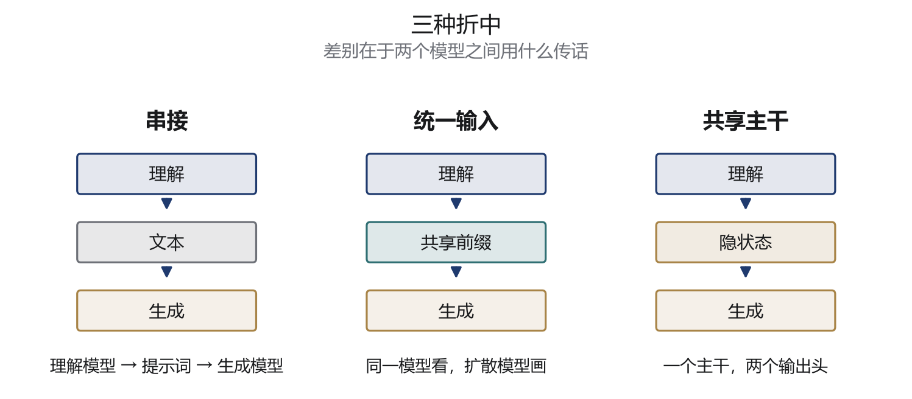

## 理解与生成：要不要放进一个模型

一个做电商素材的工具，最早的需求很朴素：用户上传一张商品图，输入"把背景换成海边日落，保留商品和文字"，系统重画背景。

第一版是拼装出来的。语言模型先看图，生成一段描述："一只白色陶瓷杯，纯色背景，下方有品牌文字"；然后把这描述和用户的指令合并，改写成给生成模型的提示；最后调扩散模型出图。

上线后问题很具体。杯子有时候被重画成了另一个形状，因为提示里只写了"白色陶瓷杯"，生成模型就自己发挥了；文字经常糊掉，因为扩散模型本来就不擅长画字；用户改五次，五次的结果风格都不太一样，因为每次都被重新描述了一遍，描述本身在漂移。

技术上把这类失败归为三处损耗：理解模型把图像压成文字，细节在压缩中丢了；文字再变回图像，又添了一层猜测；两个模型串行，延迟叠加，而且前一步的错误会被后一步放大。

于是有了一个自然的想法：能不能不要中间那层文字，让一个模型直接看图、直接画图。

### 统一的设想长什么样

原生多模态的设想是：所有模态都用同一种表示——离散 token，放进同一个 Transformer，训练目标只有一个：预测下一个 token。

图像被一个编码器压成离散码，一张 1024×1024 的图变成 1024 个码；音频压成每秒几十个码；视频按时间切片。于是"看图"变成"读一串码"，"画图"变成"写一串码"，"听"和"说"同理。

这个设想在结构上极其干净。没有连接层，没有模态间的接口，没有"文本中转"的信息损失。跨模态的推理直接在同一个注意力里发生：模型可以一边看图的第 300 个码，一边生成文字。

它也带来一个诱人的能力：任意模态到任意模态。给它一段音乐，让它生成匹配的动画；给它一张草图，让它补成三维模型；给它一段视频，让它写出配乐。这些任务用文本中转很难做，因为中间那层文字根本描述不了。

难的地方在三个层面，每一个都够写一篇论文。

### 难点一：图像怎么变成离散码

文本的 token 有天然边界（空格、标点），词表是给定的。图像没有边界，也没有词表，得自己造。

标准做法是 VQ-VAE 一类的向量量化。先用编码器把图像压成特征图，然后对每个位置的特征，在码本里找最近的一个向量替换掉：

$$z_q(i,j)=\arg\min_{e_k\in\mathcal{C}}\ \bigl\|z_e(i,j)-e_k\bigr\|_2^2$$

$z_e$ 是编码器的连续输出，$\mathcal{C}=\{e_1,\dots,e_K\}$ 是码本，$K$ 通常取 8192 或 16384。这个式子在说：把连续特征"四舍五入"到码本里最接近的那个码字。

训练时，编码器、解码器、码本一起学。损失有三项：重建误差（解码回来要像原图）、码本损失（码字要靠近分配给它的特征）、承诺损失（特征不要离码字太远）。后两项是为了防止码本退化：如果不管，编码器会只使用少数几个码字，其余码字永远不被选中，这叫码本坍缩。

码本大小的取舍很直接。码字多，重建质量好，但输出层的分类空间变大，预测更难；码字少，压缩率高，但细节丢失，模型画不出细纹理。

算一下信息量。一张 1024×1024 的彩色图，原始是 $1024^2\times3\times8\approx2.5\times10^7$ 比特。压成 32×32=1024 个码，每个码 14 比特（码本 16384），总共 $1024\times14\approx1.4\times10^4$ 比特。压缩比接近 1800 比 1。

这个比例说明一件事：离散化之后的图像表示携带的信息，比原始像素少三个数量级。它必须保留"语义上重要"的部分，丢掉"像素级精确"的部分。所以这类模型画出的图在语义上很对，在细节上（文字、细纹理、精确边缘）往往不行——不是模型不够大，是表示本身装不下。

### 算一遍：自回归画一张图要多久

假设一张图 1024 个 token，模型生成速度每秒 50 个 token（这是消费级部署的常见量级）。

$$1024\div50\approx20\ \text{秒}$$

一张图二十秒，而且这二十秒是串行的：第 $n$ 个 token 必须等前 $n-1$ 个算完。对比扩散模型的八步、每步并行处理 4096 个 token，总时间一秒多，差距在量级上。

这就是原生多模态在生成侧的主要障碍。它把图像生成变成了长文本生成，而长文本生成恰好是自回归模型最不擅长的事——慢。

工程上的缓解有三条。一是降分辨率：512×512 的图只需 256 个码，五秒。二是用多码本并行：一次预测多个位置的码，牺牲一点质量换速度。三是混合：理解走自回归（它天然适合），生成走扩散（它天然适合），只共享主干不共享输出方式。

第三条是当前产品的主流，也就是下一节要说的第三种折中。

### 难点二：训练目标打架

理解任务和生成任务对表示的要求不一样。

理解要抽象、稳定、对扰动不敏感。同一只猫，换个角度、换个光照，模型应该认为它是同一只猫。所以好的理解表示会把无关变化压掉。

生成要具体、丰富、对细节敏感。同一只猫，换个角度就该画出不同的样子。所以好的生成表示必须保留那些"无关变化"。

把两个目标放进一个模型，梯度会互相拉扯。表现出来就是：理解指标上去了，生成变糊；生成清晰了，理解变脆。工程上的缓解是分阶段训练加数据配比调节，但配比本身是个极难调的参数，而且不同任务的最优配比不一样。

还有一个更隐蔽的冲突：序列长度。理解时，图像 token 应该尽量短（省上下文）；生成时，图像 token 应该尽量长（保细节）。同一个模型很难同时满足，通常的做法是理解用池化后的短序列，生成用未池化的长序列，两套投影头。

### 难点三：数据

文本预训练的数据是现成的，图文对也算好找，但"交错的图文序列"很少。

所谓交错，是指一段内容里文字和图像交替出现，像一本画册或者一篇带插图的教程。这种数据对统一模型极其重要，因为只有在这种数据里，模型才能学到"什么时候该画图、画什么、画完接着说什么"。

互联网上的文章大多是"文字为主，图作为附件"，图与文的位置关系在抓取时就丢了。要重建这种关系，得从网页结构里解析，或者人工构造。这项工作的工作量很大，而且质量参差。

所以统一模型的能力往往呈现一种奇怪的不均衡：单轮“看图回答”很好，因为图文对数据充足；“边写边画”很差，因为交错数据稀缺。产品上表现为：能看懂，但不会主动画。

### 三种折中

现实里没有被严格意义上的“一个模型”占满的产品，大家都在中间找位置。当前的方案可以归为三类，差别在于两个模型之间用什么传话。

**第一种，串接。** 理解一个模型，生成一个模型，中间用自然语言传。它最成熟、最好调，每一段都能单独替换、单独评测。代价就是开头说的三处损耗：描述丢细节、延迟叠加、错误累积。

缓解手段都在“把那层文字写得更厚”：让理解模型输出的不是一句话，而是结构化描述（主体、属性、位置、风格分字段）；让生成模型的提示里保留原始图像的引用（图生图而不是纯文生图）。第二种尤其有效，因为它绕开了“用文字描述图像”这个信息瓶颈。

**第二种，统一输入，分开输出。** 图像和文本进同一个模型做理解，输出仍然是文字；要画图时，交给扩散模型。这是当前大多数“能看图”的产品形态。它的问题在于：模型虽然看懂了图，但它不能把自己的理解直接传给生成模型，只能再用文字说一遍。

改良版是让理解模型输出隐向量而不是文字，直接当作生成模型的条件。这一步把“文字中转”换成了“向量中转”，信息损失小很多，代价是两个模型必须联合训练过，否则向量空间对不上。

**第三种，共享主干，多个输出头。** 一个 Transformer 吃所有模态的 token，输出端按模态接不同的头：文本头用词表分类，图像头用码本分类，或者接一个轻量的扩散头。理解与生成共享绝大部分参数，只在最后分开。

这一类在研究上进展最快，因为它兼顾了两个目标：共享带来了跨模态的推理能力，分开的头避开了“理解与生成的表示冲突”。它的问题在工程上：训练难度高，推理时两种模式的调度复杂，而且两个头的最优数据配比仍然要调。

三者的成本递减、能力递增，但成熟度正好相反：串接最稳，第三种最不稳定。选哪个不是技术先进性的问题，是产品能不能承受“不稳定”。

### 算一遍：多模态对话贵多少

统一模型的一个现实问题是推理成本，因为它的输入长度是几种模态相加。

假设一次对话的输入包含：一张 1024 token 的图，一段 30 秒的音频（按每秒 25 个码算，750 token），以及 500 个文本 token：

$$1024+750+500=2274\ \text{token}$$

同样内容的纯文本对话是 500 token。前者是后者的 4.5 倍。按中档价位每百万 token 三美元算，单次对话从 0.15 美分变成 0.68 美分，看上去很少，但乘上日活就不可忽略了。

更麻烦的是多轮。图像和音频在每一轮都会被重发，如果缓存命中不了，四轮之后就是九千 token。所以多模态对话产品普遍会给历史消息降采样：只保留最近一两轮的原始图像，更早的换成缩略图或者文字摘要。

这个策略的代价在“回忆”：用户问“刚才那张图里左边那个人穿的什么”，如果那张图已经被降成缩略图，模型就答不准。产品上的处理是把“图存在哪”交给外部存储，需要时重新加载——把模型的上下文当成索引，而不是仓库。

### 什么时候值得统一

判断标准只有一个：任务是否需要跨模态的细粒度对齐。

“看图回答问题”不需要。文字中转虽然丢细节，但丢掉的那些细节对答案影响不大，而且把中间结果变成文字还有一个好处——可检查、可编辑、可缓存。

“根据一段音乐生成匹配的动画”需要。音乐的情绪曲线、节奏变化很难用文字表达，即使表达了，生成模型也未必能从文字还原。中间那层文字在这里不是桥，是瓶颈。

“看着手绘图改成三维模型”需要。约束条件（这里的弧度、那里的比例）无法用语言完整描述，必须让生成侧直接看到图。

“把这张照片的背景换成海边”处于中间地带。它可以通过“分割 + 文字描述 + 图生图”做好，但每一步都有损耗；统一模型能一次做完，但可控性差，用户想微调时无从下手。所以这类需求目前的最佳方案反而是拼装，因为拼装天生支持“只重跑其中一步”。

这个判据可以写成一句话：**能分解成可检查的中间结果的任务，用拼装；不能分解的，才需要统一。**

### 一个失败案例：交错生成的能力塌陷

有个团队做教学助手，目标是“边讲边画”：解释一个物理过程，同时生成示意图。他们用了共享主干的方案，文本头和图像头都接在同一个 Transformer 上。

演示时效果惊人：输入“讲一下勒夏特列原理”，模型先输出一段文字，然后生成一张示意图，接着继续解释。但大规模使用后出现了两个问题。

第一个是文本变差。纯文本问答的流畅度和准确性都比改造前下降，长回答尤其明显——写到中途会突然插入“（此处应有示意图）”然后不画。原因很可能是训练数据里交错样本的比例过高，模型学会了“写到一半就该画图”这个模式，却没学会判断什么时候真的需要画。

第二个是图像退化。生成的示意图构图正确、标注位置也对，但字形极差，因为图像头用的是离散码本，而示意图里大量文字在码本里找不到对应的码。

他们的修法是分路：文字继续走纯文本模型，图像改走扩散模型，两个模型之间用一个结构化的“画面描述”连接（包含要画的元素、位置、标注文字）。最终产品的形态回到了串接，但中间那层从“一句话”变成了“一张结构化图纸”，损耗小了很多。

这个案例的教训不是“统一模型不行”，而是：**统一的价值在跨模态推理，不在跨模态输出**。让同一个模型“边想边画”，不如让它想清楚、把画交给擅长的模型。

### 算一遍：统一模型的训练成本

假如要训一个真正统一的模型，把训练数据拆成三块：文本 2 万亿 token、图文对 3 亿对（每对按 700 token 算）、视频片段 1 亿段（每段按 8000 token 算）。

$$2\times10^{12}+3\times10^{8}\times700+10^{8}\times8000=2\times10^{12}+2.1\times10^{11}+8\times10^{11}\approx3\times10^{12}\ \text{token}$$

三万亿 token，是纯文本模型常见训练量的两三倍。按 $6N$ 的系数、模型 300 亿参数算：

$$6\times3\times10^{10}\times3\times10^{12}\approx5.4\times10^{23}\ \text{FLOP}$$

按单卡 $4\times10^{14}$ FLOP/s 估，一张卡要四十年，一千张卡要两周——但这是纸面数字，真训练里还要乘上训练效率、失败重跑、调参搜索，实际上月。

这笔账解释了为什么统一模型比单模态模型少见得多：多一个模态，数据要重新收集，算力要乘上几倍，而且训练不稳定导致的返工成本无法预估。这也意味着它短期内不会成为默认选择。

### 一个被低估的中间方案

在“拼装”和“彻底统一”之间，有一个工程上很实用的位置，值得单独说：共享表示，分开解码。

具体做法是：让理解模型和生成模型共享同一个文本编码器和同一套注意力结构，但生成侧不用自回归画图，而是用扩散。两个模型的参数不共享，但它们的“语言”对得上——理解模型输出的隐状态可以直接当作扩散模型的条件，不需要经过自然语言。

这个方案的价值在延迟。拼装方案的延迟是两段相加，而被共享的那部分只算一次。以一次改图为例：

- 纯拼装：理解 0.4 秒（编码图像并输出描述）加生成 2.4 秒，共 2.8 秒；
- 共享表示：理解侧只算到隐状态，不解码文字，0.3 秒，加生成 2.4 秒，共 2.7 秒。

差得不多。真正的差别在第二轮：用户说“背景再暗一点”，拼装方案要重新理解图、重新写提示、重新生成；共享方案可以把新的指令直接加到原来的隐状态上，理解那 0.3 秒也省了，而且不会被重新描述一遍，人物不会走形。

这个“不会走形”是产品层面的关键。用户改了五次背景，前四次都满意，第五次发现人物脸变了——这种体验比慢两秒更致命。共享表示之所以在改图类产品里流行，主要不是因为快，是因为稳定。

代价是两个模型的版本必须锁死。理解侧升级了，生成侧的隐状态分布就变了，原来调好的参数全部失效。所以采用这个方案的团队通常会维护一整套“配对发布”流程，升级时必须两个模型一起回归测试。

### 同一套主干能长到多大

统一模型的另一个争论是规模。一个直觉是：既然一个模型要同时会看、会听、会画，它应该比单模态模型更大。

实际情况更微妙。理解能力和生成能力对参数的使用方式不同。理解是“把输入压成一个判断”，需要的是深度和抽象；生成是“把条件展开成细节”，需要的是宽度和分辨率。同一个主干同时承担两件事，参数不是简单相加，而是要在两种用途之间分配。

工程上的观察是：统一模型在理解侧的表现可以接近同规模的专用模型，但在生成侧往往落后于同规模的专用模型。原因不难理解——专用生成模型的每一层都在为“还原细节”服务，而统一模型还要留出容量给理解任务。

所以“统一”目前的价值不在“一个模型顶两个”，而在“一个模型能做一些两个模型做不到的事”。如果产品只需要“看图 + 回答”，两个专用模型拼起来更便宜、更好；如果产品需要“看着图改图”，统一的收益才开始显现。

这条判断可以反向使用：评估一个宣传“原生多模态”的模型，先问它在纯生成任务上的质量，再问它跨模态任务的质量。前者弱、后者强，说明它走的是统一路线而且做对了取舍；两个都强，多半是宣传口径问题。

### 三种折中的账

把三种方案的延迟、可控性与训练成本摆在一起，选择就没那么玄了。

假设条件是：一次改图请求、1024 的图、八步采样；理解侧 0.4 秒（编码加解码文字），生成侧 2.4 秒；统一输入的多模态理解 0.5 秒（多了一倍的视觉 token）。

| 方案 | 首轮 | 改五次 | 可控与训练 |
|---|---|---|---|
| 串接 | 2.8 秒 | 14 秒 | 高，分开训 |
| 共享表示 | 2.7 秒 | 12 秒 | 中，配对发布 |
| 单塔自回归 | 20 秒 | 100 秒 | 低，交错数据贵 |

第一列看不出差别——串接与共享表示的首次延迟差不多。差在“改五次”：串接每改一次都要重新描述一遍图，而描述会漂，所以五次里有两次人物会走形，用户会重跑，真实轮次往往比五次多。共享表示把指令加到原隐状态上，不重描述，所以走形少。

第三列是真正的分水岭。串接的每一步都能单独检查：描述对不对、提示写得好不好、图是哪一步坏的。这种可检查性在排障时价值极高。单塔自回归的图是一串码，你不知道第 613 个码为什么错，只能整体重生成。

所以选型的关键不是“哪个先进”，而是“你的故障排查能不能承担不透明”。一个团队如果连生成侧的可控性工具都还没建好，直接上单塔只会把问题变得更难定位。

### 离散码的带宽账：为什么写不好字

“语义带宽够、细节带宽不够”这句话可以用数字说清楚。

一张 1024×1024 的彩色图，原始信息量按每像素 24 位算：

$$1024^{2}\times24\approx2.5\times10^{7}\ \text{bit}$$

离散化后是 1024 个码、码本 16384（每个码 14 位），总共 $1.4\times10^{4}$ 位。压缩比约一千八百比一。

但“压缩比”本身并不致命。写一个汉字只需要选定三千五百常用字之一，信息量是 $\log_2 3500\approx11.8$ 位；一行二十个字不到 240 位。从信息量上看，1.4 万位完全够写一整页。

真正不够的是**空间分辨率**。一千个码分给一张 1024 的图，平均每个码负责 32×32 的像素块。一个汉字的笔画宽度常常只有三到五像素，比一个块的边长还小，于是在离散化那一步就被抹平了。模型不是“不知道该写什么字”，是“没有位置放笔画”。

| 目标 | 信息量是否够 | 分辨率是否够 |
|---|---|---|
| 画一只猫 | 够 | 够 |
| 画一辆轿车轮廓 | 够 | 勉强 |
| 写一行小字 | 够 | 不够 |
| 画精确表格线 | 够 | 不够 |

这张表解释了一个反复出现的现象：离散生成模型在“画什么”上追得很快，在“写什么”上几乎不动。原因不是参数或数据，是表示的空间粒度。

三条修法各有代价：提高分辨率（码数变四倍，自回归时长也变四倍）；加一个专门的文字头（多一个模块，还得单独训）；或者把文字交给渲染层（最实用，但就不是“端到端”了）。

### 模态竞争：谁在压谁

统一模型训练时有一个几乎必然遇到的问题：文本把视觉压住。

原因很简单：一个批次里文本 token 往往占八九成（一段对话几千 token，一张图几百 token），损失按 token 平均时，文本贡献的梯度比视觉大一个量级。模型优先把文本学好，因为那是降 loss 最快的方向。

表现出来的是两种。一种是视觉能力长得慢：文本 loss 早就平了，视觉 loss 还在慢慢降；另一种更隐蔽——生成侧完全学不动，因为它的梯度比文本小两个量级，被当成噪声。

| 现象 | 可观察的信号 | 常见原因 |
|---|---|---|
| 视觉学得慢 | 分模态 loss 不降 | 文本 token 占比过高 |
| 生成学不动 | 图像 loss 卡在高位 | 梯度被文本淹没 |
| 文本退化 | 纯文本测试集掉点 | 视觉噪声干扰 |

检测方法就一条：把 loss 按模态分开画，再算两种模态的梯度范数比。正常应该在同一个量级；差十倍以上，就说明有一边在主导。

缓解手段三种。一是按模态加权，权重取该模态 token 占比的倒数，把两者拉回同一量级。二是模态丢弃，训练时随机把整个模态的输入置空，逼模型不能只靠一边。三是分阶段，先各自训好再联合微调，避免从零开始就一边倒。

三种里第一种最常用，但它有一个副作用：权重一变，两边的最优点也变，原来调好的学习率可能要重调。所以实际工程里往往固定权重、改采样比例——调数据配比比调损失权重可控得多。

### 一份选型清单

把全书的结论压成一张表，遇到具体需求时可以对号入座。

| 需求 | 建议方案 | 关键理由 |
|---|---|---|
| 文档字段抽取 | 高分辨率 + 专用 OCR | 字高与校验位比模型重要 |
| 商品图分类 | 336 图 + 零样本 | 只看整体，不用读字 |
| 视频搜索 | 音频转写建索引 | 比看画面便宜两个量级 |
| 实时字幕 | 流式 + 本地一致性 | 首字延迟优先于词错率 |
| 有声书 | 非自回归 + 词表 | 长文本稳定与纠正流程 |
| 改图类工具 | 共享表示 | 不希望人物走形 |
| 批量出图 | 回流 + 少 NFE | 可抽查，速度优先 |
| 边想边画 | 串接 + 结构化中间层 | 统一模型暂时撑不住 |

表里没有一行是“用最新的模型”。这不是保守，是现实：这一册的所有算账都指向同一个结论——多模态工程的胜负在于输入预处理、接口设计与成本分层，而不在于换一个更大的模型。

### 三个可以拿去用的判断

最后留下三个能用一辈子的判断，它们都不依赖具体模型。

**第一，先算一遍再选型。** 任何多模态需求，先算出三个数：单次请求的 token 数、日请求量、目标单价。三个数一乘，能付得起什么方案就定了一半。不算这三个数直接选型，预算超支只是时间问题。

**第二，问信息在哪个模态里。** 视频里的“谁在说话”在声音里，发票上的金额在字里，商品的“好不好看”在整体里。先把信息定位到模态，再选模型与分辨率，能避开一大半无效优化。

**第三，能拆就别合。** 能分解成可检查中间结果的任务，拆开来做；每一步单独优化、单独评测、单独替换。只有当中间那层表达不出来时（比如音乐到动画），才值得付统一模型的代价。

三个判断背后是同一个思路：把“智能化”当成一个流水线去设计，而不是当成一个魔法去期待。模型只是流水线里的一段，它的上限往往不是产品的上限——预处理、校验、降级、兜底，这些琐碎的东西才是。

### 从统一退回拼装：什么信号说明该退

统一架构在演示阶段总能赢，因为演示的提示写得很短、目标很单一。真正的问题总在大规模使用后出现，而这时已经没有退路。有几个信号值得提前盯。

**第一个信号是不可控。** 用户开始投诉“只改一处理，整体变了”。拼装架构下，改动可以只重跑一段；统一架构下，一个改动会重新采样整张图。如果产品的核心交互是“反复微调”，这个信号会来得很快。

**第二个信号是难以排障。** 线上出现一批坏结果，团队无法定位是数据、提示、还是模型内部。拼装架构下可以逐段看中间结果；统一架构只有最终输出，只能靠猜。

**第三个信号是单点升级失效。** 想提升读字能力，结果整体风格变了；想换更快的采样器，结果文本问答能力掉了。参数共享得越多，局部改进越难。

| 信号 | 具体表现 | 建议动作 |
|---|---|---|
| 不可控 | 微调引起全局变化 | 回到串接 + 局部重绘 |
| 难排障 | 坏结果无法归因 | 加可检查中间层 |
| 升级失效 | 改一处坏一处 | 拆分输出头 |

三条都指向同一个判断：统一模型适合“一次性生成”，不适合“反复编辑”。而大多数真实产品是后者——用户不会只生成一次，他会改十次。这就是为什么很多团队在统一模型上跑了一圈，最后回到拼装，但中间那层从一句话变成了一张结构化图纸。

退回来不等于白做。那些为了统一而建的东西（共享文本编码器、向量中转、分模态 loss 监控）在拼装架构里同样有用；它们本来就不是统一架构的专利，只是统一架构逼着你把它们建起来了。

### 评测一个多模态产品，看哪几个数

多模态产品的评测不能只有一个准确率。四个数搭起来，才能看清产品到底在哪一层。

| 指标 | 测什么 | 典型阀值 |
|---|---|---|
| 字段准确率 | 抽取内容对不对 | 九成五以上 |
| 置信度校准 | 说九成把握时真的九成 | ECE 低于 0.05 |
| 降级率 | 多少请求走了兵底逻辑 | 两成以下 |
| 首次成功率 | 用户不重试就完成 | 八成以上 |

第一个数是常规指标，后三个才是产品指标。置信度校准决定你能不能不让人复核；降级率说明主路到底能接多少；首次成功率是用户真正体验到的“能不能用”。

四个数往往互相拉扯。把置信度阀值调高，字段准确率上去，但降级率也跟着上去；降级到人工的比例一高，成本就失控。所以调参的目标不是单指标最高，而是一个约束下的平衡：首次成功率八成、降级率两成以内，再在这个区间里找准确率。

还有一层容易被忽略：这四个数应该按输入类型拆开看。截图、拍照、扫描件三类混在一起的总体数，会掩盖某一类的崩溃。拆开之后常发现，总体准确率九成其中两类九成五、一类只有八成——而那一类恰好是增长最快的入口。

最后一条关于看着好看的指标：图文相似度分数。它在本章开头就暴露过弱点——关键词对上就能得高分。所以它可以用来粗筛，不能拿来当验收标准。

### 一个反面案例：为统一而统一

有个做教育的团队，需求是“图文并茂的讲题”：给一道数学题，先解析，再配一张图。他们的选择是直接上统一模型，理由是“反正一张图一句话，中间不需要交互”。

上线后三个月，项目停了。三个原因一个接一个。

第一，数学题要精确。统一模型的图是离散码生成的，坐标轴刻度、几何标注这类需要精确的东西几乎从来没对过。而串接方案里，图可以由一个专门的绘图工具生成，坐标是算出来的。

第二，改题成本。用户要求“把图中的三角形改成等腰”，统一模型会重画整张图，包括已经对的标注与坐标轴；而串接可以只改图的一个图层。

第三，质量归因。题解得不好，是语言能力问题还是视觉编码器没看清？统一模型只能靠猜；串接可以单独测两段。

这个案例的教训不是“统一模型不好”，而是：**当一个任务能分成“可计算的”与“可生成的”两部分时，把可计算的部分交给代码，剩下才交给模型**。数学图形、表格、坐标轴、流程图，都属于可计算的那一类；把它们交给生成模型，等于把一个确定性问题换成了一个概率性问题。

这条判断可以反向使用：如果一个需求里超过一半内容是“可以算出来的”，就不该用统一模型，而应该用“代码渲染 + 模型解说”的拼装。

### 上线的四个阶段

如果非要从头做一个多模态产品，顺序比技术选型更重要。四个阶段，每一步都能停下来。

| 阶段 | 做什么 | 过门槛的判据 |
|---|---|---|
| 一 | 拼装、不调模型 | 业务准确率比人工高 |
| 二 | 加预处理与校验 | 降级率低于两成 |
| 三 | 只调该调的那一段 | 单段指标明显上升 |
| 四 | 才考虑统一 | 前三步均撞天花板 |

第一阶段最容易做错：直接拿现成模型对接业务，然后发现“效果不行”，于是开始调模型。而真实的问题往往在输入分辨率、字段定义、评测口径——这三件事不改，换什么模型都一样。

第四阶段的门槛应该很高。前面所有算账都指向一个结论：统一模型能解决的问题，拼装往往也能，而且更便宜、更可控。只有当“中间那层文字根本写不出来”时，统一才有不可替代的价值。

这四个阶段的顺序有一个附带好处：每一步都能单独上线、单独衡量。而直接上统一模型的项目，往往在第一个月很好看，第三个月开始说不清哪里不对，第六个月就停了。

### 一个数字：多模态请求的平均成本

把全书算过的数收在一处，得到一个可以拿去对齐预算的值。

一个典型的多模态应用（七成文字请求、三成带图，带图的里大多数是截图或商品图，每日请求一百万），单请求平均 token 落在 1,500 到 2,500。按中档价位算，每日输入成本 4,500 到 7,500 美元；若加上输出与失败重试，落在 6,000 到 10,000 美元。

| 主导请求类型 | 平均 token | 每日成本 |
|---|---|---|
| 全文字 | 600 | 1,800 |
| 以截图为主 | 2,000 | 6,000 |
| 以扫描件为主 | 5,000 | 15,000 |
| 含视频 | 20,000 以上 | 60,000 以上 |

四行的差不是模型差，是输入差。所以“这个产品能不能赚钱”这个问题，在写第一行代码之前就能算出一个大概——只要你能把用户传什么估个准。估错了也没关系，上线后第一个月的请求日志会告诉你真相；怕的是不估，等到账单来了才知道自己在做一门高成本的生意。

这也是这一册反复回到同一个点的原因：多模态的门槛不在模型，在“每一张图值多少 token”这个换算上。

### 这一册回头看

九章讲下来，约束其实只有两条。

第一条是 token 成本。图像的成本随边长平方增长，视频再乘上时长，音频随时长线性增长。所有的工程选择——切块大小、抽帧率、潜空间压缩比、步数——最后都会落到同一个数字上：这次请求花了多少 token、多少 FLOP、多少钱。账算不清楚的方案，效果再好也上不了线。

第二条是转换损耗。每一次模态转换都会丢信息：图变文字丢掉颜色和空间关系，文字变图丢掉精确性，连续变离散丢掉细节。拼装架构的每一段接口都是一个损耗点，统一架构把损耗点藏进了模型内部，但没有消除它。

两条约束指向同一个工程判据：先问这个任务能不能分解成可检查的中间结果。能分解，就用拼装，每一段单独优化、单独评测、单独替换；不能分解，才考虑统一。今天绝大多数能上线的产品都属于前者，而统一模型真正的用武之地，是那些“中间那层文字写不出来”的任务——它们目前效果都不好，但也正因为不好，才是一个还没有被填满的方向。
